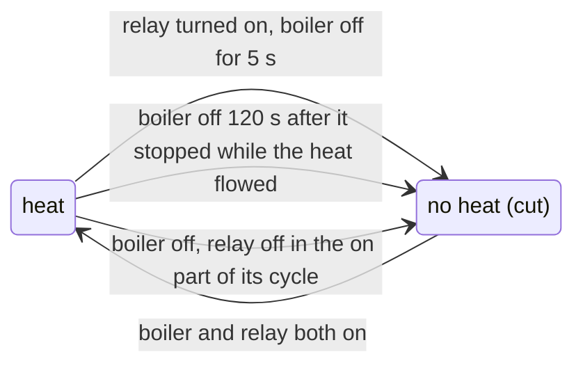

# Smart-PI: Technical and Scientific Documentation

## 1. Introduction

**Smart-PI** is a self-adaptive discrete proportional-integral controller, available as a standalone integration for *Versatile Thermostat*. Its goal is to replace a fixed-coefficient TPI with a loop that learns the real thermal behavior of the room online.

The current codebase is built around three guiding ideas:

1. identify a simple first-order thermal model with dead time,
2. adapt the PI command from that model,
3. admit or reject each learning window according to the physical regime that
   generated it.

This document describes the behavior that is actually implemented in the current SmartPI code.

---

## 2. Thermal model and control law

### 2.1 Thermal model in use

The learned thermal model is:

$$ \frac{dT_{int}}{dt} = a \cdot u(t) - b \cdot (T_{int}(t) - T_{ext}(t)) $$

With:

- $T_{int}$: indoor temperature,
- $T_{ext}$: outdoor temperature,
- $u(t) \in [0,1]$: normalized active-actuator command,
- $a$: signed actuator thermal gain, positive in HEAT and negative in COOL,
- $b > 0$: passive heat-exchange coefficient with outdoors.

A SmartPI VTherm is mono-mode: it learns either a HEAT model or a COOL model.
The equation is identical in both cases; the sign of $a$ carries the direction
of active thermal action.

The associated time constant is:

$$ \tau = \frac{1}{b} $$

The model is intentionally simple. Dead time is learned separately and injected into tuning heuristics and protections.
For higher-order physical plants, the learned `a` is therefore an effective local
1R1C gain over the operating regime represented by the accepted windows, not a
unique physical constant of the whole installation. It must be validated across
representative operating conditions rather than tuned from a single history.

### 2.2 Command chain

The current command follows this structure:

$$ u = u_{FF} + u_{PI} $$

with:

- `u_ff1`: structural feed-forward derived from $b/a$,
- `u_ff2`: slow `FFTrim` bias,
- `u_ff3`: bounded short-horizon predictive correction, enabled by default and zero outside eligible contexts,
- `u_pi`: discrete PI term.

The value effectively injected into the controller is `u_ff_eff + u_pi`, then it goes through:

- rate limiting,
- anti-windup,
- cycle constraints and protections.

---

## 3. Online identification

### 3.1 Bootstrap order

In phase `HYSTERESIS`, learning follows a strict order:

1. the active-response dead time must be reliable before useful collection for
   `a` (`heat` in HEAT, `cool` in COOL),
2. the passive-response dead time must be reliable before useful collection
   for `b` (`cool` in HEAT, `heat` in COOL),
3. `b` must progress before `a` through a soft gate.

Rules effectively coded:

- `AB_MIN_SAMPLES_B = 5`,
- `AB_MIN_SAMPLES_A = 5`,
- `AB_A_SOFT_GATE_MIN_B = 5`.

SmartPI leaves `HYSTERESIS` once `b` has 5 measurements and `a` is published.
`a` is published at 5 measurements, or from `AB_MIN_SAMPLES_A_CONSISTENT = 4`
measurements when they agree: their median absolute deviation is at most
`AB_A_CONSISTENT_MAX_REL_MAD = 0.10` of their median. The first publication of
`a` also waits for the delivered power model (3.7): while the response lag is not
resolved, measurements are collected without publication, until the collection
holds `AB_HISTORY_SIZE = 31` measurements: the next accepted measurement then
publishes `a`. Both buffers continue
filling up to `AB_HISTORY_SIZE = 31` during normal SmartPI regulation. After a
restart, the restored response lag state sets the phase from the first
calculation; a state saved without a response lag block waits for the first
learning update.

Inside the hysteresis band, the output keeps its previous on/off state. A
modulated output left by another phase is not a hysteresis state: it is set to 0
until the next threshold. The on/off state is persisted with the wall-clock time
of the last calculation. After a restart, the first calculation that has the
indoor temperature and the setpoint resumes it inside
the band when the stop lasted at most `RESPONSE_LAG_RESTART_MAX_GAP_S = 600 s`
(3.7) and the HVAC mode is unchanged, as an uninterrupted hysteresis would have.
Outside the band, the thresholds decide. Otherwise, and for a state saved without
it, the output starts at 0. A heating phase in progress can thus resume after a
short restart.

The `b` convergence used for drift-aware `a` learning relies on `b_converged_for_a()`:

1. `learn_ok_count_b >= 11`,
2. `len(_b_hat_hist) >= 5`,
3. `MAD(b_hat)/Med(b_hat) <= 0.30`,
4. `range(last_5_b_hat)/Med(b_hat) <= 0.10`.

### 3.2 Effective learning window

The code no longer uses a `WINDOW_MIN_MINUTES` constant. Learning now relies on `LearningWindowManager` and on a sliding window that:

- requires outdoor temperature to be available,
- obeys thermal governance except during calibration,
- rejects or resets an ON/`a` window on the exact observation where the user
  setpoint changes, so a window cannot span the old and new regimes,
- keeps early active ascent after that observation eligible for `a` under the
  existing dead-time, power-stability, robust-slope, FF3, and governance guards,
- keeps passive OFF/`b` learning under its existing physical guards; calibration
  keeps its dedicated learning contract and disturbance-only responses are not
  blocked by this setpoint gate,
- blocks bootstrap collection until the required dead times are reliable,
- applies a post-resume pause (`LEARNING_PAUSE_RESUME_MIN = 20`),
- anchors the window start after the dead-time end when needed,
- delays the window start until the response transient has decayed
  (`skip: response transient (a|b)`): once the response lag is published (3.7),
  an `a` window starts at least `min(3 lag, half the median active episode)` after
  the power step. A `b` window starts after the power cut at least the longer of
  `3 lag` (published lag) and `AB_SETTLE_K_PASSIVE_DEADTIME = 1.5` reliable
  passive dead times: the emitter keeps heating after a cut, and since the room
  only starts to cool once this residual heat falls below the losses, the passive
  dead time bounds its decay even when the lag is unknown. In the bootstrap and
  the calibration only the `3 lag` term applies,
- does not submit an active window shorter than one PWM cycle
  (`active_window_shorter_than_cycle`): its duration is set before its data, since
  stopping as soon as a short window looks significant favours the steepest noisy
  slopes. In the bootstrap the heater runs at full power between the hysteresis
  thresholds and a heating phase may be shorter than one cycle: the minimum is
  then capped at half the median heating phase (`AB_SETTLE_ACTIVE_CAP_FRAC`),
  measured on the previous phases,
- closes the window at its last observation when two updates are not contiguous
  (interval capped at one cycle): the window is submitted on
  the data up to that instant when its slope is robust there, otherwise abandoned
  (`skip: observation gap`); it never spans the unobserved period,
- monitors power stability through the coefficient of variation (`U_CV_MAX`),
  evaluated once the window mean power reaches `U_CV_MIN_MEAN = 0.05` (below
  it, power returning in an OFF window is not detected by this check),
- extends the window while the slope is not yet considered robust,
- gives up the slope after `DT_MAX_MIN = 240` minutes if no robust signal emerges.

In practice, the decision to submit or extend the window depends on slope robustness, not on a fixed minimum duration. A window closed without a robust slope is not lost: its integral balance feeds the pools described in 3.5.

### 3.3 Robust slope estimation

`ABEstimator.robust_dTdt_per_min()` applies slope guardrails:

- minimum amplitude: `DT_DERIVATIVE_MIN_ABS = 0.05°C`,
- minimum number of level changes: `OLS_MIN_JUMPS = 3`,
- statistical significance: `OLS_T_MIN = 2.5`,
- minimum span: once the slope is significant, the adjusted variation over the
  window (`|slope| × duration`) must cover at least `OLS_MIN_SPAN_STEPS = 1.5` sensor
  steps; the step is the smallest change observed in the window, with a floor
  `OLS_SPAN_MIN_STEP_C = 0.05°C` that acts as a noise margin for fine-resolution
  sensors. Otherwise the window is extended (`span_below_resolution`).

Since the slope is tested at each update, a window that is too short relative to
quantization would be submitted as soon as its slope looks significant: with a
0.1 °C sensor switching between two levels and a slowly cooling room, the sampling
triggered by publications then dominates the fit and `b` can be off by ±50 %. On a
window covering several steps, the slope is unbiased whatever the sensor profile.

Slopes are computed on the raw measured indoor temperature, not on the filtered signals, because the robustness guard counts distinct value jumps of the measurement. The raw history (and the filtered history used by the dead-time detection) keeps the samples of the last `TIN_HISTORY_RETENTION_MIN = 300` minutes (`DT_MAX_MIN` + 60) and at most `TIN_HISTORY_MAX_SAMPLES = 1800` samples. A sample is added on each value change or after 60 s, so the full duration is covered while samples arrive on average at most every 10 s; beyond that rate the sample cap shortens the covered duration (about 150 minutes at one changing sample every 5 s) and the slope of a long window uses only its most recent samples. Validated slopes are then fed into `ABEstimator.learn()`, which:

- rejects physical outliers (`max_abs_dT_per_min = 0.35`),
- learns `b` if `u < U_OFF_MAX`,
- learns `a` if `u > U_ON_MIN`,
- requires `a > 0` in HEAT and `a < 0` in COOL,
- publishes values with robust aggregation (median or weighted median depending on configuration).

### 3.4 Estimation of `a` and `b`

The calculation followed by `learn()` is:

- OFF phase:

$$ b = -\frac{dT/dt}{T_{int} - T_{ext}} $$

- ON phase:

$$ a = \frac{dT/dt + b \cdot (T_{int} - T_{ext})}{u} $$

Histories are filtered through median/MAD. The published magnitude of `a` is
bounded while preserving the mode sign; `b` remains strictly positive.

For an active window, `u` is the mean delivered power of the window (3.7), not
the applied command.

Each `a` measurement keeps its observation (`dT/dt`, `T_int - T_ext`, `u`). Each
time a new value of `b` is published, all retained measurements are recomputed
with that `b`, then `a` is aggregated again if it has already been published: an
`a` measurement made before `b` was accurate therefore follows its corrections. A
measurement restored without an observation, or whose recomputation would
contradict the mode sign, keeps its value.

### 3.5 Integral balance of windows without a robust slope

With a coarse sensor (0.2 °C steps) or one that reports rarely, a heating or cooling phase rarely contains the three value jumps required by the OLS slope. The model integrated between two instants nevertheless carries the information without a significant slope:

$$ T(t_2) - T(t_1) = a \cdot U - b \cdot D, \quad U = \int u\,dt, \quad D = \int (T_{int} - T_{ext})\,dt $$

`ABWindowBalance` (`ab_window_balance.py`) tracks each accepted window:

- it records, at each raw temperature step, the cumulative integrals of `u`, of `T_int - T_ext` and of `T_ext`;
- when a window closes through a guard, a timeout or the absence of a robust slope, it keeps the segment between the first and the last step: `b` if the mean power is below `U_OFF_MAX`, `a` if it exceeds `U_ON_MIN`;
- a window submitted through the OLS slope is never reused, and an external reset (resume, learning disabled) discards it;
- a slope timeout does not close the segment, which continues into the next window until a guard.

A segment is kept only if:

- all steps of the window go in the direction of the response (otherwise the sensor is noisy at step scale and the window remains the responsibility of the OLS),
- it lasts at least `AB_BALANCE_MIN_SEGMENT_MIN = 15` minutes,
- the power did not change during collection: collection stops at the first tick that deviates from the mean power, so that the emitter's inertia after a cut-off is not attributed to the previous power,
- for `b`, the inside/outside gradient and outside margin guards of the passive window are respected.

Both endpoints are steps in the same direction. A sensor that reports on change then crosses the same quantization threshold, and the measured variation is exact; a periodically sampled sensor provides values to within half a step. The uncertainty model keeps half a step per endpoint:

$$ \sigma_{rel} = \frac{q \sqrt{n / 6}}{|N|} $$

with `q` the smallest observed step (bounded below by `AB_BALANCE_MIN_RESOLUTION_C = 0.05`, `AB_BALANCE_DEFAULT_RESOLUTION_C = 0.1` until a step has been seen), `n` the number of segments and `N` the numerator (`ΔT + b·D` for `a`, `ΔT` for `b`).

Segments are accumulated per parameter (at most `AB_BALANCE_POOL_MAX_SEGMENTS = 12`, aged at most 24 h, emptied on HVAC mode change). As soon as `σ_rel <= AB_BALANCE_MAX_REL_UNC = 0.25`, the pool is submitted to `ABEstimator.learn()` as a single measurement, with the equivalent slope, power and indoor/outdoor difference (averages over the cumulated duration); median/MAD aggregation, drift detection and the soft gate apply as is. The `a` pool waits until `b` has `AB_A_SOFT_GATE_MIN_B` measurements. The threshold is stricter than that of the OLS slope (`t >= 2.5` accepts a relative error up to 0.40).

### 3.6 Dead-time estimation

`DeadTimeEstimator` implements an independent FSM. Its channels describe the
physical room response, not the power-transition direction:

- `deadtime_heat`: delay before temperature starts rising,
- `deadtime_cool`: delay before temperature starts falling.

Therefore OFF -> ON learns `heat` in HEAT mode but `cool` in COOL mode. The
ON -> OFF transition learns the opposite passive response.

The power the estimator sees is SmartPI's committed command. For a thermostat
that Versatile Thermostat's central boiler counts, it is the heat the boiler
really gives: the command while the boiler is on, and no power while it is off
(3.8). The boiler going off is then a power cut, and its start a power start,
also for a room that called before the boiler started.

The estimator gets a start or a stop at the moment Versatile Thermostat applies
the command, not at SmartPI's next calculation. Versatile Thermostat applies a
command after the calculation that computed it: a valve's position at once, a
relay's command at the start of its next cycle (at once when the cycle is
forced or idle), and confirms each application with a receipt. SmartPI commits
the applied power at that receipt and, when it crosses the estimator's
threshold (0.01) either way, feeds the estimator then
(`SmartPI._feed_dead_time_at_commit`), with the last raw reading SmartPI got: the
raw history holds only the sensor's readings, as the learning windows expect
(3.3), one treatment for the whole series, as the guidelines ask of all the
signals of a model (reference 11, §3.2, p. 12). In the first phase the
estimator is fed at the calculation, and without receipts (an older Versatile
Thermostat) at a cycle's start and at a change of the applied power. A dead time counts from the onset of the
step of the control signal (reference 5, §2.4, p. 16). Fed at the next
calculation instead, a room's own start and stop reached the estimator up to a
calculation period (60 s) late, and both its dead times came out shorter by as
much. A calibration feeds the estimator its own command, so a receipt during a
calibration feeds nothing.

Detection tracks the filtered indoor temperature, including during a forced calibration: a raw measurement that oscillates by one sensor step would otherwise detect a response as soon as the power steps. A detection in progress is not resumed after a restart, and the minimum OFF duration must be observed again in the new session before a detection can be armed.

The filtered temperature still follows a one-step toggle of the sensor for a while: it rises with the toggle and falls back after it. While a response is waited for, a step of the raw reading therefore counts only once it is confirmed: held for `DEADTIME_RAW_CONFIRM_S = 120 s` (two of SmartPI's periodic calculations), followed by a second step the same way, or going on with a move confirmed less than 120 s before (a room that moves by more than a step every two minutes). Until then the tracking follows the filtered temperature held at its value before the step, and after a toggle, until the filtered temperature is back there. A step not confirmed does not move the trough (heat) or the peak (cool) and gives no detection; a step that comes back is the sensor's noise, not the room's response. The estimator keeps the level its tracking followed (`tin_track_history`): a response armed at an earlier moment, such as a stop dated back to the boiler's (3.8.2), takes its trough or peak from it, not from the filter's own history. A wait armed while a step is not confirmed starts from the temperature before the step; if the step is then confirmed, the room moved before the power transition, and the trough or peak is taken again from the filtered temperature since the transition, as without the confirmation (`_rebase_after_confirmed_step`). A step response must be "easily visible above the noise level" (reference 5, §6.4, p. 237). A commercial adaptive controller, the Foxboro EXACT, starts its adaptation only when the error exceeds two times its noise band, the peak-to-peak amplitude of the measurement (reference 5, §6.6, p. 245–246; reference 4, §4, p. 1174). A sensor rounded to one step that toggles has a noise band of one step: one step may be a toggle, two steps is a real move, as for the trend before a start below. A relay with hysteresis works the same way: noise switches it only when the noise exceeds the hysteresis width (reference 5, §2.6, p. 39). The instant of the response is still taken from the history (the `0.01 °C` lookback), so confirming a step delays the detection, not its dating. A faster detector makes more mistakes (reference 8, §7.2, p. 573): without the confirmation, a toggle of the raw reading against the response could shorten a dead time several times. Waiting for a change to hold before acting on it is an alarm's delay timer (reference 12, §3.3, p. 30; p. 97); the value of 120 s, two calculation periods, is chosen by this reasoning and checked in a synthetic test, not taken from a publication. Limit: a response whose first step is followed by a power transition before the step is confirmed is not measured (outcome `aborted`); the next transition measures again.

The same holds after a reset of the estimator: a reset of learning (`reset_smartpi_learning`) and the reset at a change between heating and cooling start the minimum OFF duration (`min_off_time_seconds = 600 s`) at the reset. The room's past is unknown then: a room still warming from its last heating rises right after a start, and the estimator would take that rise for the response and give a dead time of about 0 s. A step response is measured from a process at rest: "it is necessary that the process be in equilibrium when the experiment is begun" (reference 5, §6.4, p. 237). A new thermostat without a saved state has no last stop either: its first start is not held back.

Limit: a room without heat for 600 to 900 s that is still warming from its last heating can still give a dead time shorter than the true one. The minimum OFF duration has passed, and the trend before the start needs `DEADTIME_PRESTART_MIN_SPAN_S = 900 s` of history.

A response is detected once the temperature has moved by `0.05 °C` from its trough (heat) or peak (cool) since the power transition. The dead time runs from the transition to the last instant within `0.01 °C` of that trough or peak, tracked during the wait, so it does not depend on the retention of the temperature history. The wait gives up after `DEADTIME_ACTIVE_TIMEOUT_S = 14400 s` for an active response (power started) and `DEADTIME_PASSIVE_TIMEOUT_S = 43200 s` for a passive response (power cut): after a cut, an emitter with a large stored heat (floor heating) keeps warming the room, then plateaus, and the drop can come several hours later. In the bootstrap the passive wait ends by a detection or a power restart, which needs a drop the detection sees first; the limit only bounds how late a drop is still attributed to the cut. A power transition aborts a pending wait, also a start that is not measured (too little time without heat, or too little power). The outcome of the last wait per response and the age of the wait in progress are published (`analysis.deadtime`).

The response to a power start is the deviation of the temperature from the course it followed before the start. Without heating, a room is flat or cools down: the trough tracking above then dates the response. A room that already warms with the heater off (occupants, sun, a neighbouring room) moves away from the start level by itself, and the trough tracking would date the response too early (in COOL, the same holds for a room that already cools before the cooling starts). So, at an active start (power on), `deadtime_trend.prestart_trend()` fits a line on the raw temperature of the OFF period before the start:

- window: the last `DEADTIME_PRESTART_WINDOW_S = 1800 s` before the start, beginning no earlier than the last power cut plus the passive dead time (the emitter still acts on the room before that);
- with less than `DEADTIME_PRESTART_MIN_SPAN_S = 900 s` or fewer than `DEADTIME_PRESTART_MIN_SAMPLES = 4` samples, no trend is removed;
- a trend whose fitted change stays within one sensor step (the smallest change observed in the window, at least `DEADTIME_PRESTART_STEP_FLOOR_C = 0.01 °C`), or that goes against the response, is not removed either: the detection is the trough (or peak) tracking above, unchanged. This is the usual case in the bootstrap, where the heating restarts because the room has cooled down;
- a trend in the direction of the response is fitted on the whole window and on its recent half (at least `DEADTIME_PRESTART_MIN_HALF_SAMPLES = 3` samples per half). The detection is rejected if the trend is not a line: a residual rms above half the detection threshold (and above one sensor step), or a slope that grows towards the response from the first half to the second by more than the detection threshold per half window. A line would then under-estimate the trend at the start;
- otherwise the detector follows the temperature minus the extrapolated trend, with the steepest slope of the two fits: removing too much only delays the detection. The trough, the `0.05 °C` threshold and the `0.01 °C` lookback apply to that difference;
- at the detection, the measurement is rejected if the trend alone accounts for at least the detection threshold since the start: the response is then not separable from the trend.

A rejected measurement publishes the outcome `rejected` and leaves the detections unchanged: the dead time keeps its previous value. A passive response (power cut) is not concerned: the trend before a cut is that of the heating itself.

A measurement that would lower the published dead time is also ignored (outcome `ignored`, the dead time keeps its value) when the evidence is weak: the trend before the start is clearly in the direction of the response (a fitted change of at least `DEADTIME_PRESTART_RISE_MIN_STEPS = 2` sensor steps over the window, even if it was removed rather than rejected), or the window is too short to evaluate any trend. A room that warms before the start can only make the response look earlier, so it never shortens the dead time. A measurement that equals or lengthens the published value follows the rules above, and so does any measurement before the first published value.

A passive response is timed only after an active period that has settled. A step response is measured from a process at rest (reference 5, §6.4, p. 237). A room heated at constant power is close to a process with integral action, which reaches no steady state, its output changing at a constant rate (p. 21); a heating that ends is a pulse, and a pulse test allows a process with an integrator (p. 237). SmartPI therefore starts the passive response from a settled steady rise: its own choice, not the book's. A step response settles after about its mean residence time $T_{ar} = L + T$ (p. 14, 16; about 3.3 $T_{ar}$ in the book's example, p. 38). The active period that ends at the cut must have lasted:

- the reliable active dead time, while no response lag is published (3.7);
- with a published lag, the longer of the active dead time and the settling time of an active learning window (`ResponseLagEstimator.active_settle_s`: three lags, at most half the median active episode, 3.2). SmartPI already waits for this gate, and never less than the dead time, before it learns `a` from an active response. Three lags put the response within 5 % of its steady value, as the time to 95 % used for heating systems (reference 7, p. 5).

Without a reliable active dead time no passive response is timed. A shorter period records the cut (the minimum OFF duration counts from it), ends a detection still waiting (outcome `aborted`), and arms nothing. The period starts at the last power start the estimator saw; for a thermostat the central boiler counts, at the boiler's start (3.8). SmartPI passes the settling time to the estimator at each calculation. In COOL the roles swap: the rise after a cooling period is timed once the cooling has settled.

Limits:

- with short active episodes the cap at half the median lowers the band below 95 %, as for the learning windows;
- where no response lag is published, the active dead time alone remains the threshold;
- the first phase learns `b` only once the passive dead time is reliable (3.1, 3.2): a room whose heating periods end before the threshold, for example through the sun or the stored heat of a floor heating, can stay longer in its first phase. A calibration (4.6) is concerned too: its cool-down times a passive response only after a heat-up longer than the threshold.

Reliability becomes true as soon as at least one valid measurement has been captured on the corresponding channel. Each channel keeps its last 6 detections; the published value is their median, so a single aberrant detection does not move it (with one or two detections the median equals their mean). On restart, the published value is recomputed from the restored detections.

### 3.7 Response lag and delivered power

At the scale of a learning window, the room behaves as an integrator behind
fast lags (actuator, emitter, air mixing, sensor housing) and a pure delay
(integrating first-order plus dead time response). After a power step, the
slope settles progressively and its ramp asymptote crosses the extrapolated
passive trajectory at $t = T_{ar} = L + \sum \tau_i$, the mean residence time of
the response (Åström and Hägglund). A window that starts $k \cdot T_{ar}$ after the
step has a slope deficit of at most $e^{-k}$ for a single lag, whatever the pure
delay share. A window within the transient underestimates `a`, all the more as
the lags are long or the sensor reports late.

`ResponseLagEstimator` (`response_lag.py`) measures $T_{ar}$ on active episodes
at constant power (deviation at most `RESPONSE_LAG_U_TOL = 0.05`):

- the episode must follow a passive period of at least
  `max(RESPONSE_LAG_MIN_OFF_S = 1800 s, RESPONSE_LAG_MIN_OFF_LAGS = 5 × known lag)`,
  so that the power of the previous episode has decayed;
- the passive baseline is the robust OLS slope of the end of that OFF period (at
  most `RESPONSE_LAG_PASSIVE_SPAN_S = 3600 s`), otherwise the published `b`;
- the late line is fitted on the level crossings of the raw history (at least
  `RESPONSE_LAG_MIN_CROSSINGS = 3`). For a jump of one sensor step, the crossing is
  dated at the midpoint between the two samples; a jump of several steps keeps the
  raw value. This removes the staircase and trigger-threshold biases of sensors
  that report on change;
- the intercept of an OLS line fitted on a transient segment falls before
  $T_{ar}$: the estimator inverts the closed-form intercept of a single-lag
  response over the fitted interval (monotonic in the lag). An episode is not
  used when the inversion is too flat (`RESPONSE_LAG_MIN_INVERSION_SLOPE = 0.05`)
  or when the intercept reaches `RESPONSE_LAG_RESOLVABLE_FRAC = 0.9` of its
  limit for an infinite lag. An estimate above `RESPONSE_LAG_MAX_S`
  (`DT_MAX_MIN` × 60 = 14,400 s) is also discarded (`intercept not resolvable`);
- each estimate carries its standard deviation, propagated from the fit
  residuals and from an assumed relative uncertainty of `b` of
  `RESPONSE_LAG_B_REL_UNC = 0.10`.

The last `RESPONSE_LAG_HISTORY = 7` estimates are kept. The lag is published
when at least `RESPONSE_LAG_MIN_ESTIMATES = 3` estimates give a combined standard
deviation of their inverse-variance weighted median at most
`RESPONSE_LAG_MAX_REL_UNC = 0.15` of that median (floor
`RESPONSE_LAG_UNC_FLOOR_S = 30 s`); estimates more than three standard deviations
away from the median are not combined. An inconsistent set keeps the published
value, so dispersed estimates do not switch the delivered power model on and off. A discontinuity of more than 1 s between two updates ends the
episode at the last observed instant, and the power cut is dated at the resume.

A restart resumes the passive period or the active episode in progress at the
save. The context is persisted as wall-clock times (last observed instant, then
start of the passive period, or start, power, constancy, preceding passive time
and outdoor temperature of the episode) and converted back to the monotonic
clock on load. It applies to the first following observation, when the stop
lasted at most `RESPONSE_LAG_RESTART_MAX_GAP_S = 600 s` and the HVAC mode is
unchanged. During a short stop the actuator keeps its last state; beyond it (host
down, power outage, update) the power is unknown. A passive period resumes, and
the stop counts as passive. An episode resumes when the first applied power after
the restart equals its power within `RESPONSE_LAG_U_TOL`. Otherwise it ends
without an estimate (`episode interrupted by restart`), and a
nonzero power opens a new episode without a known passive period. The crossings
come from the raw history of the dead time detector, persisted the same way; it
holds no sample during the stop. A state saved without this context resumes
nothing.

The inversion assumes a single-lag (first-order) response. It recovers the mean
residence time only for such an emitter, or when the episode lasts several times
the lag. On an emitter that combines a pure delay and an inertia, or two
successive inertias, the intercept of a short episode falls later than that of a
single lag with the same residence time: the published lag is then overestimated,
by about 1.3 times on the simulated shapes, or is never published when the episode
stays in the transient regime.

The intercept fixes the mean delay of the response, not its shape. The
delivered power model splits it into a pure delay
$L = \min(\text{active dead time}, T_{ar})$, then a first-order lag of
$T_{ar} - L$. The dead time is detected after the response has started, so it
bounds the pure delay from above: the model never delivers power earlier than a
pure delay with the same intercept. Without a published lag or a reliable dead
time, the delivered power equals the applied power. For an active window starting
$t_0$ after the step and lasting $W$, the mean delivered fraction is, with
$\tau = T_{ar} - L$:

$$ \eta = \frac{1}{W}\int_{t_0}^{t_0+W} \left(1 - e^{-(t-L)/\tau}\right)\mathbb{1}_{t>L}\,dt $$

The model is resolved once the lag is published, or after
`RESPONSE_LAG_RESOLVE_EPISODES = 4` heating phases without a publication
(the applied power is then used). A heating phase groups the active episodes
separated by power cuts shorter than `RESPONSE_LAG_PHASE_MIN_OFF_S = 600 s`: an
episode that starts less than 600 s after the end of the previous one does not
count as a new phase. Until then, `a` measurements are collected
without publication. When the published lag appears or changes by more than
`RESPONSE_LAG_MODEL_CHANGE_REL = 0.5` before the first publication of `a`, the
collected measurements are recomputed with the new delivered power. Only the
windows that the settling gate admits are recomputed; the others are dropped,
since their correction depends on the shape of the response.

The state is published in `analysis.learning.response_lag` (`lag_s`, `estimates`,
`episodes`, `episodes_target`, `episode_median_s`, `last_reason`) and persisted
with the learning state. `episodes` counts the heating phases ended since the
start of the learning, also after the lag is published; `episodes_target` is
`RESPONSE_LAG_RESOLVE_EPISODES`. When both collections have reached their count
and `a` waits for this model, `learning.bootstrap_status` reads
`step2 - waiting response lag: estimates N, heating phases K/4`.

The lag is learned on constant-power episodes, which the hysteresis bootstrap
provides. In PWM regulation the duty cycle changes from cycle to cycle, so an
installation already out of the bootstrap rarely provides one.

### 3.8 Central boiler: learning pause and the heat the boiler gives

Versatile Thermostat's central boiler heats the rooms of the thermostats it
counts only while it is on. Versatile Thermostat turns it on when the number of
active devices (valve heads or switches), or their total power, reaches a
threshold, after an optional activation delay, and off at once below it. While
a counted thermostat calls for heat and the boiler is off, the room gets no
heat and cools although the command says it heats. Learning from that time
would count the wait for the boiler as the room's dead time (3.6). SmartPI
computes its gain from the dead time, $K_p = 1/(|a|(\lambda + L))$ (4.1), so a
dead time four times too long gives a gain about four times smaller and a much
slower regulation. This matters most while SmartPI learns from its default
values (3.1).

For such a thermostat, SmartPI therefore pauses its learning while the boiler
is off (3.8.1), and its dead-time estimator sees the heat the boiler really
gives, not the command (3.8.2 to 3.8.4). The regulation does not change, and
the FF trim learns from no window in which the boiler withheld the heat
(3.8.5).

#### 3.8.1 The learning pause

Learning (the `a`/`b` windows (3.2) and the response-lag measurement (3.7),
also during a calibration (4.6)) pauses once all of these have held, without a
break, for one period of SmartPI's calculation; the dead-time detection (3.6)
goes on, following the heat the boiler gives (3.8.2):

- Versatile Thermostat counts the thermostat for its central boiler
  (`is_used_by_central_boiler`),
- SmartPI calls for heat (committed power above 0),
- Versatile Thermostat's central boiler is off (its binary sensor
  `central_boiler_state`, read by `boiler_call.py`; a state that cannot be read
  does not pause), as it heats the room: a short stop held as heat (3.8.2, 3.8.4)
  does not count, and a stop confirmed at the end of the hold counts from the
  boiler's stop, so the pause then starts at once.

The period (`BOILER_PAUSE_CONFIRM_S`: 60 s, less 1 s for the clock's jitter)
covers a room's own start: Versatile Thermostat turns the boiler on only once it
counts the thermostat's device, after the device reports its new state, seconds
later with a real valve head, and a check in that time must not pause. The value
follows SmartPI's calculation period, not a publication.

The handler checks this before each calculation, at each change of the
boiler's state, which it follows, and of a relay's, at the checks it schedules (a
start held 5 s, the end of a hold), and at the moment the period ends
(`SmartPIHandler._update_boiler_learning_pause()` sets
`SmartPI.set_boiler_learning_paused()`): the pause starts then, not at the next
calculation, up to a period later. Adaptation is to be interrupted as quickly as
possible once the measurement no longer follows the control signal (reference
4, §5, p. 1175). Learning resumes once the boiler's start counts for the
dead-time estimator, when the boiler has run 5 s (`BOILER_BLINK_S`, 3.8.3), or at
the first calculation where SmartPI stops calling. A shorter run of the boiler
gave the room no heat: the pause goes on, and so does the time counted towards
it. An alarm is cleared in the same way, only once its signal has stayed back for
a set time (reference 12, §3.3, p. 30). A
change of the pause drops the `a`/`b` window in flight and ends the response-lag
observation at its last sample before the change, as the user's pause
(`set_smartpi_learning`) does, without changing that setting: learning's next episode starts at the change at the earliest, so
SmartPI does not learn during the room's dead time after the boiler starts
(3.2).

The pause only pauses learning; it does not wipe what the dead-time detection
(3.6) knows. The estimator keeps the time the heating last stopped and its
temperature history, and it keeps recording the temperature during the pause:
the room gets no heat then, so this is time without heating. Nothing can arm
while the boiler is off (3.8.2); as a safeguard, the pause's start still drops a
heating detection waiting (outcome `aborted`). A detection of the passive
response to the boiler's stop stays.

#### 3.8.2 The heat the boiler gives

For a thermostat the boiler counts, the dead-time
estimator does not see SmartPI's command but the heat the boiler really gives:
the command while the boiler is on, and no power while it is off
(`SmartPI.set_boiler_state()`). The handler reads the boiler's state before each
calculation and gives each change to SmartPI at once, from its listener, without
waiting for the next calculation. A change that changes the power the estimator
sees is fed to it at that moment, on SmartPI's last filtered temperature and the
sensor's last reading, and the
estimator's own rules judge it (3.6), as any stop or start. With a boiler state
that cannot be read, or a thermostat the boiler does not count, the estimator
sees the command, as without a boiler.

This holds during a calibration (4.6) too. The calibration feeds the estimator
its own command, and no power while the boiler is off; a change of the boiler
reaches the estimator at once with the calibration's command. A calibration
that starts while the boiler is off arms nothing, and its heating counts from
the boiler's start, as any start (below).

A state that becomes known, or unknown, is neither a stop nor a start: the
estimator sees the power at its next feed, by its own rules. Two cases are
handled at once:

- **The state known again after an outage.** Whether the room got heat while
  the state could not be read is not known. As after a restart of Home
  Assistant, a response spanning the outage is not attributable: the
  estimator's observation restarts at the power it sees then (a detection in
  progress is dropped, and so is its temperature history, which the `a`/`b`
  windows and the trend before the next start read too: that trend's window is
  then too short, which counts as weak evidence, 3.6), and its minimum
  time without heat counts from then: an estimation that starts again begins
  from current values (reference 4, §8, p. 1178). No passive response is timed
  until a new heating has been counted. This is logged ("SmartPI central boiler state
  known again: dead-time observation restarted").
- **The first reading off, while the estimator saw power** (it got SmartPI's
  command before the state could be read). The heat stopped at a moment that
  is not known: the stop is recorded, so the minimum time without heat counts
  from it, and a heating detection waiting is dropped, but no passive response
  is timed, as the room may have been cooling for a while.

The cases:

- **The boiler goes off while the room calls.** The room's heat stops at that
  moment, though SmartPI's command does not change. For a room on a valve, or
  on a relay whose heat flowed, the stop counts once the boiler has stayed off
  for 120 s, and is then dated from the boiler's stop (below, "A valve's hold"). A heating
  detection still
  waiting is dropped first (outcome `aborted`): a later rise would not answer
  this heat. The estimator then sees the power fall to 0. It records the stop,
  so the minimum time without heat (`min_off_time_seconds`, 600 s) counts from
  the boiler's stop, and it times the room's passive response from it if the
  heating had settled (3.6). The stop is logged ("SmartPI heat stopped with the
  central boiler", with "(heating dead-time detection aborted)" when one was
  dropped) and published at once. The pause, which starts at once after a hold
  and a calculation period after any other stop (3.8.1), keeps this passive
  detection.
- **The boiler stays off.** The estimator sees no power, whatever the room does.
  The room's own stop changes nothing, and neither does a new call: nothing
  arms, and a passive detection timed from the boiler's stop goes on to its
  end. A room that stops calling during the pause has had no heat since the
  boiler's stop, so no passive response is timed from its own stop: the room is
  already cooling, and that dead time would come out too short.
- **The boiler starts while the room calls.** The room's heat starts at the
  boiler's start. This holds for a room that waited for the boiler, and for a
  room whose own call turns the boiler on: its start counts from the boiler's
  start, not from its call, also when the boiler starts seconds after the call
  (once the room's device reports) or after an activation delay. The estimator
  judges it as any start:
  - it arms only if the heating has been off for at least the minimum time
    since it last stopped, and the wait for the boiler counts in that time. A
    room that calls again shortly after its last heating, and then waits for
    the boiler, measures nothing;
  - the trend before the start comes from the history kept through the pause;
  - a passive detection still waiting ends `aborted`: the heat is back.
- **The room calls while the boiler already heats.** Its start counts at that
  moment, when Versatile Thermostat applies the command (3.6); in the first
  phase, at the calculation.

**A valve's hold.** The boiler can go off for seconds while a room on a valve
calls: with a threshold of devices, for example, in each off part of another
room's relay. The water in the room's emitter goes on heating then: along a
panel radiator, a change of its water shows after a dead time of 1.5 to 8
minutes and settles in a balancing time of 9.5 to 16.5 minutes (reference 9,
Table 2, p. 2754, a model of the heating up at nominal flow). Taken as a stop, each of these short
stops would drop the room's heating detection and restart its minimum time
without heat, so a room whose boiler goes off in every such cycle would never
measure its heating dead time and would stay in its first phase (3.1). So, while
a thermostat not on a relay calls and its heat flows (a start the dead-time
estimator saw, the boiler having run 5 s, 3.8.3), the boiler going off is held as
heat for `BOILER_VALVE_HOLD_S` (120 s, two calculation periods):

- the boiler back within it is no stop and no start: the heating, and a
  detection in progress, go on;
- the boiler still off after it is a stop dated from the boiler's stop: the
  handler checks it 120 s after the stop (or at the next calculation). The
  estimator records the stop from then, so the minimum time without heat counts
  from it, and a passive response armed by it counts from it too, if the heating
  had settled by the boiler's stop (otherwise it is dropped without an outcome),
  its peak taken
  from the level the estimator's tracking followed since
  (`DeadTimeEstimator.tin_track_history`, `SmartPI._heat_stopped_at`), where a
  step of the sensor not confirmed yet does not count (3.6): a dead time counts
  from the onset of the step (reference 5, §2.4, p. 16). The pause starts
  at once, 120 s after the boiler's stop;
- a room that stops calling within it had its heat stopped by the boiler: its
  stop is dated from the boiler's stop in the same way.

A room on a relay gets the same hold when the boiler goes off while its heat
flows, the relay on (3.8.4). A call with the boiler off is not held: it waits for
the boiler, as any start; nor is a run of the boiler shorter than 5 s, which
gave the room no heat.

The hold's length comes from measurements of radiators and floor heating. When
the boiler stops, the water stays in the radiator, or the boiler's pump goes on
moving the installation's warm water, so the radiator cools slowly. Panel
radiators measured by thermography lose 63 % of their heat only after 18 to 22.4
minutes, while they heat up to 63 % in 3.6 to 4.3 minutes; sectional and
tubular radiators cool more slowly still (reference 10, Table 6, p. 77).
Measured with thermocouples after its valve closed, a panel radiator lost 63 %
of its heat after 19.8 minutes, without a delay (reference 13, Table 8, p. 62).
Floor heating changes over hours: in a measured room, its floor reached
63 % of a change after 4.5 to 5 hours (reference 7, Table 4, p. 6). A radiator's
cooling follows a first-order curve, its heating a curve of higher order
(reference 10, p. 37). With the radiators' values in a first-order model
(reference 5, §2.4, p. 16, equation 2.8), and for the heating the delay of 50 s
and the time constant of 178 s measured on a panel radiator of 500 × 1000 mm
(reference 10, p. 77), a panel radiator still gives at least 89 % of its heat
after one stop of 120 s. Stops repeated in every cycle of another room's relay
leave less: at Versatile Thermostat's default cycle of 5 minutes, 82 to 85 % on
average for stops of 120 s, and 65 to 69 % for stops of 180 s. SmartPI's
dead-time estimator measures a start only at a command of at least 80 %
(`DeadTimeEstimator.min_power_heat_threshold`), so a stop it holds must leave
the room at least that much heat on average. That bound lies at about 130 s for
the panel radiators that cool fastest (18 minutes) and 145 s for the slowest
(22.4 minutes); the hold is 120 s, two calculation periods. A synthetic test of
a valve room whose boiler stopped for one to two minutes in every cycle checks
it: with a hold of 59 s the room paused its learning several times a day, with
120 s almost never, and the held stops lengthened its measured heating dead time
by less than a minute on average.

#### 3.8.3 Blinks of the boiler

Versatile Thermostat can switch its boiler off and on again within
milliseconds, as it counts the devices again: tens of milliseconds at a stop in
synthetic tests with Versatile Thermostat 10.6. A valve's hold (3.8.2) covers them; a stop the estimator
sees counts at once, as above. A start counts once
the boiler has run `BOILER_BLINK_S` (5 s) without a break: the handler checks it
then, or at the next calculation, and dates the start from the boiler's start
(not before the estimator's last temperature sample). So:

- the boiler off, on and off again within 5 s is one stop: the passive
  detection timed from it goes on;
- the boiler on, off and on again within 5 s is a blink: the estimator sees
  SmartPI's command again without a new start, so the heating period goes on
  (3.6), and the passive detection armed at the short stop ends `aborted`. This
  is logged ("SmartPI heat back with the central boiler after a blink (no new
  start)"). A blink needs a stop the estimator saw, from on to off, while the
  room's heat flowed (the estimator saw power): the boiler read off for the
  first time, after a restart of Home Assistant or once its state can be read,
  is no stop, so its start within 5 s is a start; and for a room whose heat did
  not flow at the boiler's stop (it did not call yet, the boiler heated other
  rooms), the boiler's return is the onset of its heat, a start, also when the
  room starts calling in the blink or in the 5 s after it: a dead time counts
  from the onset of the step (reference 5, §2.4, p. 16);
- a start shorter than 5 s is not seen: the estimator sees no start, a relay's
  heat is not held after it (3.8.4), and a learning pause goes on through it
  (3.8.1).

5 s is two orders of magnitude longer than the blinks seen, a twelfth of the
estimator's time step (SmartPI's calculation, 60 s), and under 1 % of a room's
dead time (a radiator alone takes minutes to answer: reference 10, Table 6,
p. 77). The value is chosen by this
reasoning, not taken from a publication. A longer wait would let fewer false
changes through but see the real ones later. Waiting for a change to hold before
acting on it is the delay timer of alarm systems: an alarm is raised only once
its signal has stayed beyond the limit for a set time, and cleared only once it
has stayed back for a set time; fewer false alarms cost a later detection
(reference 12, §3.3, p. 30; chapter 3, p. 22; p. 97).

#### 3.8.4 A room on a relay

SmartPI drives a switch in cycles: at a command of 60 %
the relay is on for 60 % of each cycle and off for the rest. Versatile
Thermostat counts a switch for its boiler only while it is on. So when the relay
alone keeps the boiler on, the boiler goes off in each off part of the cycle and
comes back, milliseconds after the relay, at the next on part. That off part is
the cycle's own: SmartPI's command, which the estimator and the learning see as
the cycle's average, already counts it. It is not the boiler withholding heat.
For a thermostat whose device SmartPI drives in on/off cycles (Versatile
Thermostat's cycle scheduler, not in valve mode), while SmartPI calls:

- with the relay on, the boiler cuts the heat once the relay has been on for 5 s
  (`BOILER_BLINK_S`) with the boiler off: Versatile Thermostat has then had the
  time to start it, and did not (its threshold is not reached, or its
  activation delay runs). The handler follows the thermostat's own state, which
  Versatile Thermostat writes at each change of the relay, and checks again 5 s
  after the relay turns on;
- after a cut, the heat comes back only while the boiler and the relay are both
  on (for a relay off where its cycle has it on, with the boiler as read, below). A boiler started by another room in the relay's off part does not heat
  this room yet: the heat's start counts from the relay's next on part, not up
  to half a cycle too early (30 minutes in an hour's cycle);
- in between, the last state holds: in the relay's own off part, and while the
  boiler may still follow a relay just on. Learning does not pause in a normal
  cycle, and the estimator sees no stop and no start in it; a cut from outside
  holds through the relay's on and off parts, without flickering;
- the boiler going off while the room's heat flows (the relay and the boiler
  on), as in another room's off part with a threshold of devices, is held as
  heat for `BOILER_VALVE_HOLD_S` (120 s), as for a valve (3.8.2): the water in
  the radiator goes on heating, whatever drives it. The boiler back within it is
  no cut and no start; still off after it, through the relay's own off part
  too, it is a cut dated from the boiler's stop, and the pause counts from it.
  A relay that turns on with the boiler already off is not held: the boiler did
  not start for it, and the rule of 5 s above applies. Nor is a run of the boiler
  shorter than 5 s: as for a valve, the hold needs a start the dead-time
  estimator saw (3.8.3).



The diagram shows the room's heat, for the dead-time estimator and the learning
pause, while SmartPI calls: any other change keeps the state. The third path to
a cut is explained in the next paragraph.

The off part is the relay's own only where SmartPI's applied cycle has the relay
off. SmartPI knows that cycle from Versatile Thermostat's receipts of each
command: the cycle's start, and how long the relay is on from it, the applied
command times the cycle, after Versatile Thermostat's own corrections (a pulse
too short to apply, for example). An on/off actuator gets in each cycle a pulse
whose width follows the controller's output (reference 5, §3.4, p. 78, equation
3.23). A relay found off where its cycle has it on, from 5 s into the on part
(Versatile Thermostat reports a cycle's start just before it switches the relay)
to 5 s before its end, is not in its own off part: it is unavailable, or it did
not switch. Its boiler is then followed as read, without a valve's hold: with the boiler
off, the heat stops and learning pauses. Learning assumes that the changes of
the temperature are caused by the command (reference 4, §5, p. 1175). A relay
that does not switch breaks this, like any fault of an actuator, which should be
found before a controller is tuned (reference 5, §6.7, p. 262 and p. 269).

A relay held off by its own protection did not fail to switch. Versatile
Thermostat keeps a relay off until it has been off for its minimal deactivation
delay (`minimal_deactivation_delay`, 0 by default), which spares the device rapid
switching. When a cycle starts again soon after the relay's off part (a new
command), it starts the on part later, by what is left of that delay, and from
Versatile Thermostat 10.6.5 on keeps its length (the documentation of its cycle
scheduler). The on part then counts from the end of that protection, the
relay's last switching off plus the delay, when that comes after the cycle's
start; the 5 s count from there.

A cut found only at the relay's next on part started earlier: the boiler went
off during the off part (another room stopped), and the room's last heat ended
with the relay's last on part, both on. The stop is dated from then, so the
minimum time without heat counts from the real end of the heat. The passive
response armed at the cut starts late, so it can only come out shorter than it
is. As for a start on weak evidence (3.6), it is kept only when it does not
lower the published passive dead time; it is ignored otherwise (outcome
`ignored`). Without a published passive dead time there is nothing to judge it
against, and none is timed: a passive detection then waiting is dropped without
an outcome. In an hour's cycle the off part lasts up to tens of
minutes, so a measurement timed from the cut could come out far too short.

When SmartPI does not call, the boiler's state is followed as read, so a new call
with the boiler off waits for it as any start. A valve is not concerned: it is
open through the whole cycle while it calls, and Versatile Thermostat counts it
only once it reports its opening, seconds after the call, so a valve's start
must count from the boiler's. Nor is a thermostat without a cycle scheduler (a
climate underlying).

#### 3.8.5 Regulation and diagnostics

The pause and the boiler's state change nothing but learning. Unlike the user's pause, the pause does not
restart the regulation's heating episode: the dead-time window in which the
controller holds its integral counts from the start of the heating, and the
command and the integral are the same as without the pause. The pause is shown
as `learning.boiler_paused` in the diagnostics, published at once when it
changes, and each change is logged ("SmartPI learning paused (central boiler
off)"). The power the dead-time estimator sees and the age of the heating in
progress are published as `analysis.deadtime.last_power` and
`analysis.deadtime.active_elapsed_s` (diagnostics documentation).

**The FF trim.** The slow feed-forward correction (`FFTrim`, 4.2) learns how much
power the room needs to hold its temperature, from windows of at least 30
minutes (5.4). It compares the applied power with how the temperature moves:
a room that cools under a steady power needs more of it. The applied power is
what Versatile Thermostat applied to the device (the valve's opening, the
relay's cycle), not the heat the boiler gave. While the boiler is off, the
room cools under that power, and the trim would read it as a room that needs
more power for good, and heat it too much once the boiler is back. The trim
has no learning pause of its own: neither the boiler's pause nor the user's
stops it. So while the boiler that heats the thermostat is off and the applied
power is above 0, SmartPI marks the time in the trim's power trace as power
the room did not get (`central_boiler_off`), as it does for a valve whose
position is not known (5.4). A trim window that overlaps that time is rejected
(`causal_power_not_covered`). The rest of the trim, and the command, do not
change.

The mark follows the boiler's state as the dead-time estimator sees it (3.8.2,
3.8.4): a relay's own off part is not marked, and a cut found late is marked
from the room's last heat. It starts when the boiler goes off, or when the
applied power rises above 0 with the boiler off, and ends at the boiler's
start. A time without heat shorter than the pause's confirmation
(`BOILER_PAUSE_CONFIRM_S`, 59 s) is dropped as a whole, also when the powers
committed in it split its mark into pieces: a blink of the boiler, or the seconds a room's own start
waits for it, changes the heat little against a window of 30 minutes or more,
as for the pause. A panel radiator still gives about 95 % of its heat after a
stop of 59 s (reference 10, Table 6, p. 77); a convector with a fan loses far
more (3.8.7).

#### 3.8.6 Sources

- Learn only while the heating moves the temperature. An estimator assumes
  that the change of the output is caused by the control signal. When another
  cause dominates, the estimates "will not converge to their true values", and
  adaptation should be "interrupted as quickly as possible" (reference 4, §5,
  p. 1175). This is the paper's main conclusion: adapt only when the changes
  of the measurement are caused by the control signal (§10, p. 1179). A boiler
  that does not heat is such another cause.
- First the time scale. An adaptive controller first needs the time scale of
  the process, its dead time and time constant: it sets the sampling and the
  filters, and the rest depends on it (reference 4, §3, p. 1172–1173). An
  erroneous initialization of the estimator gives "bumps" in the estimates
  (§8, p. 1178).
- A slow regulation learns ever more slowly. When the estimates give a very
  slow regulation, the temperature moves little, and the adaptation becomes
  "very slow" (reference 4, §9, p. 1179).
- A dead time that is too long does not make the regulation unstable; it makes
  it slow. A closed-loop time constant equal to the dead time is a good
  compromise between speed and robustness (reference 6, p. 296); with three
  to four dead times, SmartPI is already on the gentle side.
- After a pause, start from fresh data. When the measured signal saturates,
  the estimation is interrupted and "kept off for a while" afterwards
  (reference 4, §7, p. 1178); when it starts again, its signals "should be
  initialized by actual values" (§8, p. 1178).
- An adaptive controller must find out why the control changed before it
  retunes: poor tuning is only one cause (reference 5, §6.7, p. 262 and
  p. 269).
- A feed-forward that learns needs a good model. Adaptation "has proven
  particularly useful for feedforward control", because feedforward "requires
  good models" (reference 5, §6.3, p. 233). An adaptive feed-forward is
  identified from the measurement, the control signal and the disturbance
  (reference 5, §6.6, p. 249, equation 6.7): it assumes, as any estimator, that
  the measurement follows the control signal it sees (reference 4, §5,
  p. 1175). The boiler's heat withheld breaks that assumption, so the FF trim
  learns from no such window.
- Time a response from the real change of the input. A dead time is the time
  between the onset of the step and the response (reference 5, §2.4, p. 16),
  so a stop confirmed late is dated from the boiler's stop. The water in an
  emitter goes on heating for minutes after a change (reference 9, Table 2,
  p. 2754), and a radiator loses 63 % of its heat only after about 20 minutes
  (reference 10, Table 6, p. 77; reference 13, Table 8, p. 62), so a stop of a minute or two is not a step of
  the room's heat.
- Confirm a change before acting on it. A detector of changes is judged by how
  fast it detects the real ones and how well it avoids false ones (reference 8,
  p. 561–562, on failure detectors in computer networks); the wait of 5 s for a
  start of the boiler is such a choice, and so is a valve's hold: longer, it
  lengthens the measured dead time more; shorter, it takes more of another
  room's off parts for stops. An alarm system's delay timer makes the same
  trade, both when it raises an alarm and when it clears it (reference 12, §3.3,
  p. 30): the learning pause ends only once the boiler's start counts.

#### 3.8.7 Limits

- SmartPI follows Versatile Thermostat's command to the boiler, not the burner:
  a boiler that does not fire for another reason (a fault, hot water) is not
  seen. Versatile Thermostat changes its boiler's state when it decides, without
  waiting for the integration that drives the boiler; the boiler itself starts
  later, by that integration's delay (Home Assistant polls a device every 15 s by
  default) and its own start (a fan's pre-purge and an ignition trial: from
  several seconds to tens of seconds in the manufacturers' manuals). That delay
  is part of the room's dead time as SmartPI measures it, from the command
  (reference 5, §2.4, p. 16), and changes little from one start to the next; the
  median of six measurements absorbs the rest (3.6). A command shorter than the
  boiler's own start gives the room no heat, though SmartPI counts it from 5 s
  on: its heating detection then ends `aborted`.
- A start of the boiler is dated from the boiler's start, but not before the
  estimator's last temperature sample: when a calculation sampled the
  temperature in the 5 s before the start is seen, the start counts from that
  sample, at most 5 s late.
- A room that starts calling within 5 s of the boiler's start counts its start
  from the boiler's start, up to 5 s before its call.
- A room on a valve, or on a relay whose heat flowed, gets less heat while its
  boiler is off for less than 120 s,
  which the estimator does not see: its heating dead time comes out longer, by
  up to the length of such stops. Stops longer than 120 s in every cycle of
  another room's relay still stop the room's heat each time, and such a room may
  stay in its first phase. The hold's length rests on measurements of radiators
  and floor heating (3.8.2). A convector without a fan cools about as a panel
  radiator, to 63 % in 15 to 18 minutes; a convector with a fan (a fan coil) in
  1 to 5 minutes (typical values, reference 14, Fig. A.30, p. 37). Such a room
  keeps little of its heat through a stop of 120 s: its measured heating dead
  time comes out longer, which only makes the tuning more cautious, and the FF
  trim, which gets no mark for a stop the hold covers (3.8.5), may learn more
  power than the room needs.
- A stop of the boiler soon after the room's heat started (once the boiler
  has run 5 s) is held as heat too, though an emitter gives heat only after its
  apparent delay: 46 s for a panel radiator, 54 s for an aluminium sectional one,
  42 s for a tubular one and 104 s for a cast-iron one (reference 13, Table 6,
  p. 57; reference 10, p. 77). Not holding such a stop would drop the
  measurement altogether, as the stop starts the minimum time without heat
  again: a room that starts calling in the middle of another room's relay cycle
  would often measure nothing. Held, its heating dead time comes out longer by
  at most the stop's length: SmartPI's closed-loop time grows with the dead time
  (4.1), and a longer one favours stability and robustness (reference 6,
  p. 296).
- A stop the estimator saw drops a heating detection still waiting, also when
  the boiler comes back right after it.
- A room on a relay whose boiler does not start for it is cut 5 s after the
  relay turns on, not at once; with several relays on one thermostat, the 5 s
  count from the first relay on, and the applied cycle is the first relay's.
- Before Versatile Thermostat 10.6.5, an on part started later by the relay's
  minimal deactivation delay was shortened, and left out when it became shorter
  than the minimal activation delay: SmartPI then sees the relay off where its
  cycle has it on, and a short cut.
- A cut that starts in a relay's own off part loses its passive measurement when
  that measurement comes out shorter than the published one, or when there is no
  published one yet.
- A boiler off while the room calls for less than the hold (120 s: a valve, or
  a relay whose heat flowed), or otherwise for less than 59 s, does not stop the
  FF trim's window; a longer time without heat rejects every window that
  overlaps it, and a window that ends while the boiler is still off is rejected
  too. A room whose boiler is often off while it calls, for minutes at
  a time, learns its trim more slowly.
- After an outage of the boiler's state, no passive response is timed until a
  new heating has been counted, and no active one for the minimum time without
  heat.
- After a restart of Home Assistant, Versatile Thermostat shows the boiler off
  until it has counted the thermostats again and, with an activation delay,
  until the delay has passed: learning may pause for that time.
- After the installation or a reset, the first learning takes longer: SmartPI
  learns only while the boiler heats. In a room that starts heating mostly while
  the boiler is off, for example when the boiler stays off for hours, SmartPI
  may stay long in its first phase (3.1): it learns the dead time only from a
  heating start made while the boiler is on.

---

## 4. Smart-PI control

### 4.1 PI gains

`GainScheduler.calculate()` applies the following logic:

1. if `tau`, the sign of `a`, or the active dead time is unreliable, fall
   back to `KP_SAFE = 0.55` and `KI_SAFE = 0.010`,
2. otherwise compute IMC/SIMC from the active-gain magnitude:

$$ K_p = \frac{1}{|a| \cdot (\lambda + L)} $$

3. compute the SIMC integral time (Skogestad, 2003)
   $T_i = \min(\tau, 4(\lambda + L))$ (`GAIN_TI_LAMBDA_FACTOR = 4`), then
   $K_i = K_p / T_i$,
4. clamp the gains ($K_p \in [0.10, 5.0]$, $K_i \in [0.001, 0.050]$) and apply governance freezes.

For a room, $\tau$ (several hours to several days) far exceeds the closed-loop
horizon $\lambda + L$: the room is close to an integrator and $T_i = 4(\lambda + L)$.
With $T_i = \tau$, $K_i$ would fall on the floor `KI_MIN = 0.001` and the integral
would take days to correct a model error. The near-band taper of $K_i$ is
clamped to the same floor.

The effective integral time $T_i = K_p / K_i$ of the applied gains is published
in minutes as `control.ti_min` (`None` when $K_i \le 0$).

On every change of the applied $K_i$, the integral is rescaled by
$K_{i,old} / K_{i,new}$, so the integral power $K_i \cdot I$ is unchanged (bumpless
transfer). The rescale applies to any change, however small: the near-band taper
moves $K_i$ by small steps, and a threshold would let $K_i \cdot I$ drift during holds.

`GainScheduler.generation` counts the changes of the untapered model gains
(IMC/SIMC or safe gains). It advances only while the gains are not frozen and
is not advanced by the near-band taper. The periodic FF-trim window rejects a
window that spans several generations (`periodic_gains_changed`).

The active dead time is `deadtime_heat` in HEAT and `deadtime_cool` in COOL.

Important:

- near-band damping is applied continuously between the configured near-band edge and the setpoint,
- `NEAR_BAND_TAPER_KI_MIN` reduces the integral gain more strongly than `NEAR_BAND_TAPER_KP_MIN` near the setpoint.

### 4.2 Feed-forward

The structural feed-forward is computed from:

$$ k_{ff} = \frac{b}{a} $$

and:

$$ u_{ff1} = clamp(k_{ff} \cdot (SP - T_{ext}), 0, 1) \cdot warmup\_scale $$

In COOL, $a < 0$ and therefore $k_{ff} < 0$. When outdoors is warmer than the
setpoint, the two negative differences correctly produce positive cooling
power.

`warmup_scale` is not a simple on/off switch. It is the product of:

- the number of valid learning episodes,
- the number of cycles since reset.

The cycle count is kept across restarts. The restored integral only holds the
share of the load that the feed-forward did not cover, so the feed-forward
comes back at the level it had before the restart, without a bump.

The FF2 trim stays frozen (`ff_warmup`) while `warmup_scale` is below 1.

$k_{ff}$ is zero, and therefore $u_{ff1}$ is zero, whenever the model is not
ready (`a` not published with fewer than 5 measurements, or fewer than 5 `b`
measurements), `tau` is not reliable, or the sign
of `a` does not match the active mode.

$T_{ext}$ is the last valid outdoor temperature received by SmartPI. When the
outdoor sensor reports no value, FF1, the setpoint model and the near band keep
using that last value, without age limit. Until a first outdoor temperature has
been received, $u_{ff1}$ and $u_{ff2}$ are both zero (`ff_reason`
`ff_no_ext_temp`).

This is combined with:

- `u_ff2`: slow `FFTrim` correction, frozen while `ABConfidence` is `AB_DEGRADED` or `AB_BAD`, or while `warmup_scale` is below 1 (`ff2_freeze_reason` `ff_warmup`), and zero until a first outdoor temperature has been received.

### 4.3 FF3

`ff3.py` adds a predictive correction that is enabled by default and can be disabled by configuration:

- horizon computed by `ff3_predictor.compute_ff3_horizon()`: `deadtime_cycles + FF3_RESPONSE_LOOKAHEAD_CYCLES`, clamped between `FF3_MIN_HORIZON_CYCLES` and `FF3_MAX_HORIZON_CYCLES`,
- local open-loop prediction with the exact discrete ZOH 1R1C model, without calling `ThermalTwin1R1C.step()` and without updating the twin observer,
- max authority `FF3_MAX_AUTHORITY = 0.20`, multiplied by `authority_factor`,
- exploration step `FF3_DELTA_U = 0.05`,
- local quadratic scoring with tracking cost, terminal cost, overshoot cost, and movement cost.

FF3 is disabled if any of the following conditions is not met:

- configuration enabled,
- heating mode,
- outdoor temperature available,
- reliable `tau`,
- thermal twin initialized and prediction usable,
- thermal twin not warming up,
- valid twin steady state,
- no calibration,
- no power shedding,
- no recent setpoint change,
- not in deadband,
- in near-band,
- compatible governance regime,
- no active `setpoint` trajectory,
- a credible external-disturbance context is present.

The disturbance context accepts a structurally usable model even when `model_reliable = False`.
In that case, `prediction_quality = "degraded"` and authority is reduced through `FF3_UNRELIABLE_MODEL_AUTHORITY_FACTOR`.
`warming_up = True` and `T_steady_valid = False` remain absolute blockers.

This disturbance context does not use `T_steady` as an RMSE false negative.
It relies on:

- a persistent mismatch between the twin prediction and the observed behavior, interpreted as a credible residual (`bias_warning` or `external_gain_detected` or `external_loss_detected`),
- then dynamic coherence through `perturbation_dTdt` and, when needed, the measured thermal slope.

Under this contract, FF3 is no longer a generic near-band optimizer. It is reserved for disturbance recovery, and it no longer triggers a dedicated cycle restart on deadband entry.

### 4.4 Setpoint management

`SmartPISetpointManager` now drives an analytical trajectory for the P branch.
This trajectory is activated only when a significant thermal gap appears, the model is considered reliable, and the setpoint change calls for shaping the proportional reference.

The principle is:

- the I branch keeps using the raw setpoint,
- the P branch receives `filtered_setpoint`,
- the P branch keeps the raw setpoint until the predicted braking zone is reached,
- a significant setpoint change arms late braking once; HEAT and COOL then use the same signed braking-window equations,
- disturbance-triggered entry continues to require the significant-gap threshold,
- the exact learned 1R1C model, the passive-response dead time of the mode (`deadtime_cool` in HEAT, `deadtime_heat` in COOL), the remaining cycle latency, and the committed cycle power are used to detect the braking zone,
- a smooth late-braking trajectory then shapes the P reference toward a braking target below the raw target in the demand direction,
- when braking is no longer needed, the filtered reference returns progressively to the raw target before the trajectory stops,
- for a trajectory triggered by a setpoint change, entering the `release` phase keeps that phase locked until the trajectory ends, with no return to `tracking`,
- during `release`, the P reference stays on the demand side of the measured room temperature without crossing the raw target: it never exceeds the target in HEAT and never falls below it in COOL,
- the trajectory ends once it is in `release`, the P reference and the room are both within `0.05 °C` of the target, and switching P back to the raw target changes the proportional command by at most `0.03`,
- the trajectory also ends as soon as the room reaches or crosses the target in the demand direction, or on any real setpoint change; the P branch then uses the raw target again,
- `trajectory_active` indicates whether the analytical trajectory is running.

The thermal twin, FF3 and the braking-entry prediction share a pure
constant-power 1R1C propagation function. Each consumer retains its own horizons,
delay policy and input validation.

The propagation uses the discrete 1R1C form in internal linear command space:

$$
\alpha = e^{-b \cdot h}
$$

$$
T_{pred} = T_{ext} + (T - T_{ext}) \cdot \alpha + \frac{a}{b}(1-\alpha) \cdot u
$$

The braking entry predicts the signed change in the active demand direction (`+1` for HEAT, `-1` for COOL) over the remaining cycle, the passive dead time and any queued next-cycle power. The braking gap is that predicted change multiplied by `TRAJECTORY_BRAKE_GAIN = 1.20`.

The canonical `live.setpoint` block publishes the summary:

- `filtered_setpoint`,
- `trajectory_active`,
- `trajectory_source`,
- `boost_active`.

The same payload in both modes exposes trajectory details under
`live.analysis.trajectory`:

- `start_setpoint`, `target_setpoint`, `tau_ref_min`, `elapsed_s` and `phase`,
- `pending_target_change_braking`, `braking_needed` and `model_ready`,
- `remaining_cycle_min`, `next_cycle_reference`, `bumpless_delta` and `bumpless_ready`.

Setpoint reference shaping is limited to the P branch, so the integral path keeps the raw setpoint untouched. No command cap is applied after the PI computation: the PI command goes straight to the soft constraints (rate limiter, `max_on_percent`) and then to the timing constraints.

After a setpoint change or a resume, the integral follows the raw setpoint
error without any extra recovery rule: it is limited only by the anti-windup
(below), the deadband and near-band modes, the overshoot clamp and the overheat
cut. The setpoint trajectory brakes the proportional branch only.

A disturbance-recovery trajectory brakes the P branch because the model
predicts that the committed power is enough to close the gap. When this model
is biased, the room can settle on a plateau below the setpoint and the
trajectory never ends. A plateau test then ends the trajectory:

- the signed error is averaged over blocks of
  `RECOVERY_PLATEAU_BLOCK_CYCLES = 3` cycles,
- a block is stationary if its average stays above the residual error floor
  (the larger of `RECOVERY_ERROR_FLOOR_DEADBAND_RATIO = 2` times the deadband
  and the deadband plus its hysteresis) and does not vary by more than
  `RECOVERY_PLATEAU_SLOPE_ABS_H = 0.12 °C/h` applied over one block,
- `RECOVERY_PLATEAU_BLOCKS = 2` consecutive stationary blocks are required,
- and no net progress over `RECOVERY_PLATEAU_PROGRESS_BLOCKS = 4` blocks:
  the average must not have dropped by more than
  `RECOVERY_PLATEAU_PROGRESS_MIN_C = 0.03 °C`. A slow recovery tail, seen
  through a quantized probe, is therefore not mistaken for a plateau.

On detection, the trajectory switches back to passthrough. No new disturbance
trajectory starts until the error has dropped back below the trigger threshold
minus the tracking hysteresis, or until a setpoint change or a reset. A new
disturbance therefore remains braked normally.

Window resumes and power-shedding resumes in heating mode hold the integral
during the dead time:

- on resume, SmartPI arms an explicit `I:HOLD` (`window_resume` or
  `power_shedding_resume`),
- that hold remains active while the heating response is still inside the usable `deadtime_heat` window,
- when that window ends, the integral runs normally again,
- a resume whose signed residual error is already below the residual error
  floor ends the hold before the dead-time window starts,
- without a reliable heating dead time, no hold is applied.

This sequence prevents the integral from learning a resume transient that is still dominated by heating dead time.

Transient catch-up states are not restored after a reboot:

- the active analytical trajectory is cleared,
- any temporary `integral_hold_mode` is cleared.

The restart therefore keeps only useful persistent PI memory, without restoring transient servo states that are no longer physically valid outside their original runtime session. The wall-clock timestamp of the last valid active regulation tick is persisted and is not refreshed while HVAC is OFF. If inactivity exceeds 96 hours, controller PI memory is purged on resume while the learned A/B model remains available. If the HVAC mode after a restart differs from the mode of the persisted model (HEAT versus COOL), the integral is cleared. When a tick is skipped because the temperature sensor is missing or `guard_cut` is active, time tracking restarts like after OFF, so the error is not integrated over the skipped period.

### 4.5 Deadband, near-band, and protections

`DeadbandManager` handles:

- a symmetric deadband with absolute hysteresis (`DEADBAND_HYSTERESIS = 0.025`),
- an asymmetric near-band in heating mode; in cooling mode the near-band uses the configured `near_band_deg` on both sides of the setpoint,
- automatic near-band sizing in heating mode only, when `deadtime_heat` and the model are usable,
- fallback to configured thresholds otherwise.

Additional protections currently present are:

- `SmartPIGuards` (heating mode only, outside the bootstrap and the calibration): `guard_cut` forces the output to 0 when the measured temperature exceeds `setpoint + near_band_above` while the heater is active, until it falls back to that threshold minus the larger of `NEAR_BAND_HYSTERESIS_C = 0.05°C` and `GUARD_CUT_RESET_STEPS = 1.5` observed sensor steps (a reading flickering between two levels around the threshold would otherwise re-trigger the cut, and restart the cycle, at every measurement). During a cut the output stays at 0 (`I:OVERRIDE(guard_cut)`). While the PI still requests power, a positive integral tracks the forced 0 % by back-calculation, `d(Ki·I)/dt = −v/Ti` with `v` the PI request and `Ti = Kp/Ki`, at most one cycle per tick. Its rate follows the request, not the overshoot: an integral that carries more than the heat need comes down within a few cuts, even when the room barely exceeds the threshold. It comes down until it alone would hold the room at the cut threshold minus `NEAR_BAND_HYSTERESIS_C` (`Ki·I/Kp`); below that point it is kept, as is the heating need left after a setpoint decrease. Without this, a bias of the integral restored the same excess power at each release and the room cycled between cut and restart. The temperature filter, the dead time detector, the published temperature and the learning keep following the room. The room then cools without heating, for example during the whole fall after a setpoint decrease: this is a passive window for `b` and for the response lag baseline. The governance sees a zero command outside any band, and `a` windows are blocked (`skip: guard cut`). The learning stays contiguous at the end of the cut; `guard_kick` restarts the cycle when, inside the near-band, the temperature falls below `setpoint - near_band_below` while the command is below 99 %. In cooling mode neither guard acts and the near-band is not auto-sized. In the bootstrap the heating runs between its own hysteresis thresholds and a running guard is released,
- per-tick anti-windup on the applicable upper limit (see below),
- explicit `I:HOLD` during the post-resume `deadtime_heat` phase for `window_resume` and `power_shedding_resume` in heating mode,
- `I:HOLD` with source `vt_safety` while Versatile Thermostat safety mode applies its default power instead of the SmartPI command,
- `I:HOLD` with source `deadband_hysteresis_shell` while the hysteretic deadband state is active and the error is outside the core deadband,
- `I:HOLD` with source `governance_sensor_invalid` while no outdoor temperature has been received yet (`DEGRADED` regime),
- freeze of P and I inside the core deadband.

The anti-windup acts at every calculation, in the linear demand space, on the applicable upper limit: `1`, or the linear image of `max_on_percent` when it is lower. It has two parts:

- conditional integration: the integral stops growing when the unconstrained request exceeds the applicable upper limit. Within `NEAR_SETPOINT_UNWIND_STEPS = 1.5` observed sensor steps of the setpoint, an output saturated against the error still lets the integral unwind toward zero, without crossing it (`I:UNWIND(SAT_HI|SAT_LO)`), provided the output without the proportional term (`u_ff + Ki·I`) stays within its limits: with a quantized sensor, a reading one step away from the setpoint saturates the output through the proportional term alone, and a blocked integral combined with the deadband freeze would hold a steady offset. An output held at its limit by `u_ff + Ki·I` (for example at `max_on_percent`) keeps the integral, which then carries the model bias;
- back-calculation: on every tick where the integral mode is `I:RUN`, `I:SKIP` or `I:CLAMP`, the excess of the PI output (`u_ff + u_pi`, clamped to `[0, 1]`) above the linear image of `max_on_percent` corrects the integral by `beta * excess / Ki`, with `beta = dt / max(Kp/Ki, dt)` (tracking time constant equal to `Ti = Kp/Ki`). The correction only moves the integral toward zero and stops at zero, so an excess carried by the proportional term alone never winds the integral in the opposite direction. The integral stays clamped to `±2/Ki`. Only the integral changes: `u_pi` keeps the decomposition that produced the command.

The following are not treated as saturation: Versatile Thermostat quantization and valve retention (`dpercent`, period), minimum on/off times, and the rate limiter. The behavior is symmetric in HEAT and COOL, does not use Versatile Thermostat command receipts, and is identical with older Versatile Thermostat versions. The `aw_du` diagnostic is the correction (excess, `<= 0`) applied at the last tick.

### 4.6 Auto-calibration

`AutoCalibTrigger` supervises the algorithm outside the control law.

Implemented behavior:

- initial snapshot when `tau`, `deadtime_heat`, and `deadtime_cool` are reliable,
- fallback snapshot after `AUTOCALIB_DT_COOL_FALLBACK_DAYS = 7` days without reliable `deadtime_cool`,
- rolling snapshot every `AUTOCALIB_SNAPSHOT_PERIOD_H = 120` hours,
- hourly check loop,
- cooldown guard `AUTOCALIB_COOLDOWN_H = 24` hours,
- stagnation thresholds `AUTOCALIB_A_MAD_THRESHOLD = 0.25` and `AUTOCALIB_B_MAD_THRESHOLD = 0.30`,
- `b` stagnation is only evaluated while `b` can be learned: the indoor-outdoor gradient is at least `AB_B_MIN_PASSIVE_GRADIENT_C` and the outdoor temperature is at least `AB_B_OUTDOOR_TARGET_MARGIN_C` away from the setpoint on the passive side (below it in HEAT, above it in COOL), the limits of the learning window; without an outdoor or indoor temperature `b` is not evaluated,
- positive exit is evaluated on the parameters that triggered the calibration (`triggered_params`): a triggering `a` or `b` needs at least `AUTOCALIB_EXIT_NEW_OBS_MIN = 1` new observation, a triggering dead time must be reliable; a manual request (`manual_request`) is judged on `deadtime_heat` and `deadtime_cool`,
- up to `AUTOCALIB_MAX_RETRIES = 3` attempts,
- a failed attempt schedules the retry `AUTOCALIB_RETRY_DELAY_H = 6` hours later: until then the cooldown guard is replaced by this delay and the retry does not wait for the snapshot period. The scheduled time is published as `autocalib.next_check_ts` and cleared when the retry starts, when a snapshot is taken or when the stagnation that required it is gone (the retry counter is then reset).

`AutoCalibTrigger` publishes its transitions on the Home Assistant event bus through the handler:
`smartpi_autocalib_snapshot_taken`, `smartpi_autocalib_triggered`, `smartpi_autocalib_success`,
`smartpi_autocalib_retry`, `smartpi_autocalib_degraded` and `smartpi_autocalib_unreachable`. Every event payload carries `entity_id`
(the climate entity, for example `climate.salon`) and `name` (the thermostat name, for example `Salon`),
followed by event-specific fields (`smartpi_autocalib_unreachable`: `triggered_params` and `retry_count`).

The forced cycle is managed by `CalibrationManager`:

- `COOL_DOWN` down to `sp - 0.3°C`,
- `HEAT_UP`,
- `COOL_DOWN_FINAL` back to `sp`.

Before and during each phase the manager checks, with the thermal twin, that the threshold of the phase can be reached. The measured temperature comes first: once it has reached the threshold of the phase, the phase moves on and the twin is not consulted. A passive phase converges to `T_steady_passive`; an active phase driven at the allowed power `u_max` (`max_on_percent` in linear space) converges to `T_steady_passive + u_max·(T_steady_max − T_steady_passive)`, the 1R1C equilibrium being linear in power (`T_steady_max` when `u_max` is 1 or the passive equilibrium is not valid); the threshold is reachable when that equilibrium lies beyond it by `CALIBRATION_REACHABILITY_MARGIN_C = 0.5°C` (HEAT: passive `COOL_DOWN` and `COOL_DOWN_FINAL`, active `HEAT_UP`; COOL: active `COOL_DOWN` and `COOL_DOWN_FINAL`, passive `HEAT_UP`). The check only applies while the twin is usable (`status` ok, `model_reliable`, past its warm-up, valid equilibrium, and `cooling_model_available` in COOL). When the threshold is not reachable the cycle ends at once with the result `Unreachable`, distinct from `Cancelled` (HVAC OFF, timeout of `CALIBRATION_TIMEOUT_MIN = 600` minutes, reset): `last_calibration_time` is not set, `AutoCalibTrigger` consumes no retry and publishes `smartpi_autocalib_unreachable`, and the next attempt waits `AUTOCALIB_COOLDOWN_H` hours (`autocalib.next_check_ts`). The result is not a published diagnostic: `calibration.state` carries the phase only.

`CalibrationManager.take_completed_result()` returns, once, the result of a run that ended (`Success`, `Cancelled`, `Unreachable`), so that the handler reports every run to `AutoCalibTrigger`, including one that ends in the tick that started it.

---

## 5. Software architecture

### 5.1 Orchestrators

| File                      | Class            | Role                                                                     |
| ------------------------- | ---------------- | ------------------------------------------------------------------------ |
| `algo.py`                 | `SmartPI`        | algorithm facade, full orchestration                                     |
| `handler.py`              | `SmartPIHandler` | Home Assistant bridge: periodic timer, services, attributes              |
| `state_store.py`          | `SmartPIStateStore` | Home Assistant `Store` persistence of the algorithm state             |
| `boiler_call.py`          | —                | Versatile Thermostat's central boiler state, for the learning pause and the dead-time estimator (3.8) |

### 5.2 `smartpi/` modules effectively used

| Module                 | Main role                                                   |
| ---------------------- | ----------------------------------------------------------- |
| `const.py`             | constants, enums, governance matrix                         |
| `ab_estimator.py`      | slope estimation and `ABEstimator`                          |
| `deadtime_estimator.py` | `DeadTimeEstimator`, active-episode starts and dead-time window |
| `ab_aggregator.py`     | median or weighted-median aggregation of `a/b` measurements |
| `ab_drift.py`          | persistent drift detection and recentering for `a/b`, with one candidate sequence per channel |
| `learning_window.py`   | learning-window management and guardrails                   |
| `ab_window_balance.py` | integral balance of windows without a robust slope and `a/b` pools |
| `response_lag.py`      | `ResponseLagEstimator`: response lag, settling gates and delivered power model |
| `learning_outcomes.py` | bounded counters of learning-window outcomes                |
| `gains.py`             | gain calculation and freezing                               |
| `controller.py`        | discrete PI, anti-windup, hold, hysteresis                  |
| `deadband.py`          | deadband and near-band                                      |
| `setpoint.py`          | analytical setpoint trajectory for the P reference          |
| `resume_hold.py`       | I:HOLD during the dead time after a window or power-shedding resume |
| `recovery_plateau.py`  | plateau test of a disturbance-recovery trajectory           |
| `feedforward.py`       | `u_ff1/u_ff2/u_ff3` orchestration, signed FF gain `b/a` and warmup scale |
| `ff_trim.py`           | causal slow bias and bounded trim/integral ownership plans  |
| `ff_trim_runtime.py`   | `FFTrimCoordinator`: frozen control decomposition of scheduler requests, routing of trim observer results, bumpless trim/integral transactions at the cycle boundary, transfer state |
| `command_ownership.py` | request identifiers, frozen snapshots and binding of the scheduler applied-command receipts |
| `ff_trim_periodic.py`  | phase-closed periodic-equilibrium window selection          |
| `ff_ab_confidence.py`  | confidence policy for `a/b`                                 |
| `ff3.py`               | bounded FF3 predictive correction and its per-cycle runtime state (`FF3RuntimeState`) |
| `governance.py`        | freeze decisions                                            |
| `calibration.py`       | forced-calibration FSM                                      |
| `autocalib.py`         | supervision and automatic triggering                        |
| `guards.py`            | `guard_cut` and `guard_kick`                                |
| `thermal_twin_1r1c.py` | thermal twin and predictive diagnostics                     |
| `diagnostics.py`       | canonical live diagnostic payload                           |
| `diagnostic_history.py` | versioned envelope and stable Recorder series               |
| `tint_filter.py`       | adaptive indoor-temperature filtering                       |
| `timestamp_utils.py`   | monotonic / wall-clock conversion                           |

### 5.3 Internal composition of `SmartPI`

Components instantiated by `SmartPI.__init__()` notably include:

```python
self.gov = SmartPIGovernance(name)
self.sp_mgr = SmartPISetpointManager(name, enabled=use_setpoint_filter, release_tau_factor=release_tau_factor)
self.ctl = SmartPIController(name)
self.est = ABEstimator()
self.learn_win = LearningWindowManager(name)
self.deadband_mgr = DeadbandManager(name, near_band_deg)
self.calibration_mgr = CalibrationManager(name)
self.gain_scheduler = GainScheduler(name)
self.tint_filter = AdaptiveTintFilter(name, enabled=ENABLE_ADAPTIVE_TINT_FILTER)
self.resume_hold = ResumeDeadtimeHold()
self.dt_est = DeadTimeEstimator()
self.twin = ThermalTwin1R1C(dt_s=SMARTPI_RECALC_INTERVAL_SEC, gamma=0.1)
self.guards = SmartPIGuards()
self.autocalib = AutoCalibTrigger(name)
self.ff3_state = FF3RuntimeState()
self._ff_trim = FFTrim()
self._fftrim_observer = CausalFFTrimObserver(cycle_min, self._causal_power_trace)
self._fftrim_periodic_observer = PeriodicFFTrimObserver(cycle_min)
self._command_ownership = CommandOwnershipTracker()
self.fftrim_coord = FFTrimCoordinator(self)
self._ab_confidence = ABConfidence()
```

### 5.4 Current persistence

The causal observer aligns a second, time-weighted control-ownership timeline
with the physical-power timeline. A strict deadband window can therefore
separate the stable integral bias $J=mean(K_i integral)$ from the physical
deficit $D=H-mean(u_{applied})$. A strict deadband window requires the
`DEAD_BAND` regime with an integral that does not move: frozen in the core
deadband, or held in the deadband hysteresis shell (`deadband_hysteresis_shell`
hold source). Any other integral hold (window, load shedding, invalid sensor,
safety) is not eligible. In the shell the room sits off the setpoint, so the
transfer there does not require the mean error to be within the sensor
resolution (the per-sample error bound and the stationarity checks still
apply) and takes $D=0$: the offset deficit belongs to the loop, only the
integral share moves, and the command is unchanged. After three independent coherent windows, one
bounded transaction applies
`delta_trim = alpha * lambda * (J + D)` and
`delta_u_i = -alpha * lambda * J`, hence
`delta_u_cmd = alpha * lambda * D`. The same factor `alpha` handles trim
authority, FF branch bounds, integral capacity, and command headroom. The
transaction runs only at the cycle boundary and is identical
in the signed HEAT and COOL model power space.
Transfers below the generic actuator-precision threshold remain ignored unless
they strictly reduce opposing stored trim and integral contributions. This
ownership compaction keeps the same atomic bounds and command invariant.

The stationary and periodic observers reuse one physical power and ownership
timeline but keep separate thermal samples, washout state, and persistence
buffers. The periodic path accepts lower saturation and integral hold as parts
of a controller-driven cycle. It closes only after a return to the same thermal
phase, following at least `max(6 VT cycles, 2 × dead time)`, so its horizon has
no fixed thirty-minute floor. Its time-weighted causal estimate never performs
an integral ownership transfer; persistent corrections remain subject to the
same trim learning rate and authority limit.

A trim freeze clears the stationary buffer. A freeze with reason `saturated`
keeps the periodic samples and pending proposals, and the periodic window
stays valid through it; the trim itself is not modified while it is frozen. Any
other freeze reason clears the periodic buffer and invalidates the window.

The current payload from `SmartPI.save_state()` notably contains:

```python
{
    "version": 2,
    "learning_enabled": ...,
    "last_active_wall_ts": ...,
    "deadtime_skip_count_a": ...,
    "deadtime_skip_count_b": ...,
    "est_state": {...},
    "dt_est_state": {...},
    "gov_state": {...},
    "ctl_state": {...},
    "sp_mgr_state": {...},
    "lw_state": {...},
    "db_state": {...},
    "cal_state": {...},
    "gs_state": {...},
    "twin_state": {...},
    "guards_state": {...},
    "ac_state": {...},
    "ff_v2_trim": {...},
    "ff_trim_delta": ...,
    "tint_filter_state": {...},
    "hysteresis_output": {...},  # bootstrap only
}
```

The control loop schedules at most one delayed write of this payload per five-minute window; Home Assistant flushes a pending write at shutdown. Services and entity removal write a snapshot immediately.

Past event timestamps (temperature histories, calibration start, passive period and episode of the response lag) are persisted as wall-clock times and converted back to the monotonic clock on load, so they keep their position in the past across a restart; in particular, the calibration timeout keeps running after a restart.

The integral-balance pools and the window-outcome counters are not persisted:
they start empty at each startup. The observations of the `a` measurements are
persisted with the estimator state; a state that does not contain them loads with
measurements that cannot be recomputed.

Only the learned trim remains persistent. Ownership windows, pending
proposals, and integral transfers are transient; after restart the observer is
rebuilt and the existing three-cycle trim freeze still applies.

Command ownership comes from the applied-command receipts of the Versatile
Thermostat cycle scheduler (`vtherm_api` `AppliedCommandReceipt`). Immediately
before submitting a request, SmartPI freezes its control decomposition and
passes a strictly increasing `request_id` to `start_cycle`. The scheduler
echoes that identifier in a receipt for each command it really applies: a
`cycle_start` receipt at each master-cycle start, including its automatic
restart, and an `update` receipt for each valve position applied during a
cycle. No receipt is emitted for a switch request waiting for the next cycle.
The receipt commits the applied actuator power, mapped to the linear model
space, and binds the frozen snapshot of its request. A receipt is owned only
when its request is known, keeps its HVAC mode, carries no `min_on_off` or
`valve_retained` alteration, and was not timing constrained; a rejected
request stays rejected for its later receipts. Untagged commands are never
owned: Versatile Thermostat overrides such as the safety default power, and
the deferred valve updates of Versatile Thermostat. The last 32 requests are
kept so that a scheduler applying an older request still attributes it to
that request. A missing or rejected receipt never falls back to the live
controller state. A bumpless transfer is engaged once an owned receipt
carries a request staged after the transfer.

Without receipt support in Versatile Thermostat, SmartPI submits untagged
requests and commits the power reported by the cycle-start callback, or the
published valve opening in valve mode, without ownership. The stationary trim
then uses the sampled `u_ff1`, the periodic trim and the bumpless transfer stay
inactive, and PI regulation is unchanged. A valve update without a published
opening commits nothing and opens an unobserved-power interval
(`missing_valve_position`) that lasts until the next observed power (valve
update, cycle start or cycle end). The trace keeps the last known power over
that interval, so a trim window overlapping it is rejected
(`causal_power_not_covered`); a short scheduler gap filled with the previous
power (`legacy_gap_fill`) stays usable. The same holds, with or without
receipts, while the central boiler that heats the thermostat is off, as SmartPI
follows its heat (3.8.2 to 3.8.4: a stop the hold covers and a relay's own off
part are not marked), and the applied power is above 0 (`central_boiler_off`,
3.8.5): the power was applied, but the room did not get it.

### 5.5 Published diagnostics

`diagnostics.py` exposes the algorithm and canonical live views:

- `SmartPI.get_published_diagnostics()`: returns the canonical `live` payload for the dedicated diagnostic sensor,
- `build_published_diagnostics()`: the function that builds that payload.

`diagnostic_history.py` wraps this payload in `schema_version`, `live` and the
stable eleven-series `history` block. Normal sensor entities exclude `live` from
Recorder; the debug sensor subclass records it directly. The debug option only selects the sensor class that is recorded; it does not
add a second diagnostic block.

`analysis.learning.learn_ok_count` and `learn_skip_count` are runtime counters
relative to the current Home Assistant process. Persisted model counters remain
internal and are used for model quality and warm-up decisions.
`analysis.learning.window_outcomes_24h` lists, for `a` and for `b`, the eight
most frequent window-closure reasons of the last 24 hours as `[reason, count]`
pairs (numeric values removed from the reasons; pool events are prefixed with
`pool:`). `analysis.learning.balance_pool` gives the number of segments waiting
in each pool and the sensor resolution used for their uncertainty; these values
are specific to the current Home Assistant session. When the thermal twin is
usable, its public diagnostic fields are exposed under `analysis.twin`.

`feedforward.fftrim.command_ownership` exposes whether the scheduler emits
receipts, the latest binding status and rejection reason, the request
identifier (`request_sequence`), the receipt kind, the requested and applied
powers and their delta, the applied ON/OFF durations, the receipt alterations,
the timing-constraint flag, and the rejection counters of the current Home
Assistant session. These values are observational: they explain a causal
acceptance or rejection without changing the learning decision.

---

## 6. Important constants

### 6.1 Learning

| Constant                       | Value  |
| ------------------------------ | ------ |
| `AB_HISTORY_SIZE`              | `31`   |
| `AB_MIN_SAMPLES_B`             | `5`    |
| `AB_MIN_SAMPLES_A`             | `5`    |
| `AB_MIN_SAMPLES_A_CONSISTENT`  | `4`    |
| `AB_A_CONSISTENT_MAX_REL_MAD`  | `0.10` |
| `AB_A_SOFT_GATE_MIN_B`         | `5`    |
| `AB_CONFIDENCE_MIN_SAMPLES_A`  | `11`   |
| `AB_CONFIDENCE_MIN_SAMPLES_B`  | `11`   |
| `AB_B_CONVERGENCE_MIN_SAMPLES` | `11`   |
| `AB_B_CONVERGENCE_MIN_BHIST`   | `5`    |
| `AB_B_CONVERGENCE_MAD_RATIO`   | `0.30` |
| `AB_B_CONVERGENCE_RANGE_RATIO` | `0.10` |
| `DT_DERIVATIVE_MIN_ABS`        | `0.05` |
| `OLS_MIN_JUMPS`                | `3`    |
| `OLS_MIN_SPAN_STEPS`           | `1.5`  |
| `OLS_SPAN_MIN_STEP_C`          | `0.05` |
| `OLS_T_MIN`                    | `2.5`  |
| `DT_MAX_MIN`                   | `240`  |
| `U_OFF_MAX`                    | `0.05` |
| `U_ON_MIN`                     | `0.20` |
| `AB_BALANCE_MAX_REL_UNC`       | `0.25` |
| `AB_BALANCE_MIN_SEGMENT_MIN`   | `15`   |
| `AB_BALANCE_MIN_RESOLUTION_C`  | `0.05` |
| `AB_BALANCE_DEFAULT_RESOLUTION_C` | `0.1` |
| `AB_BALANCE_POOL_MAX_SEGMENTS` | `12`   |
| `RESPONSE_LAG_HISTORY`         | `7`    |
| `RESPONSE_LAG_MIN_ESTIMATES`   | `3`    |
| `RESPONSE_LAG_RESOLVE_EPISODES` | `4`   |
| `RESPONSE_LAG_PHASE_MIN_OFF_S` | `600` |
| `RESPONSE_LAG_MAX_REL_UNC`     | `0.15` |
| `RESPONSE_LAG_UNC_FLOOR_S`     | `30`   |
| `RESPONSE_LAG_MIN_OFF_S`       | `1800` |
| `RESPONSE_LAG_MIN_OFF_LAGS`    | `5`    |
| `RESPONSE_LAG_MIN_CROSSINGS`   | `3`    |
| `RESPONSE_LAG_MODEL_CHANGE_REL` | `0.5` |
| `RESPONSE_LAG_U_TOL`           | `0.05` |
| `RESPONSE_LAG_RESTART_MAX_GAP_S` | `600` |
| `RESPONSE_LAG_PASSIVE_SPAN_S`  | `3600` |
| `RESPONSE_LAG_MIN_INVERSION_SLOPE` | `0.05` |
| `RESPONSE_LAG_RESOLVABLE_FRAC` | `0.9`  |
| `RESPONSE_LAG_B_REL_UNC`       | `0.10` |
| `RESPONSE_LAG_MAX_S`           | `DT_MAX_MIN` × 60 (`14400`) |
| `AB_SETTLE_K_ACTIVE`           | `3`    |
| `AB_SETTLE_K_PASSIVE`          | `3`    |
| `AB_SETTLE_ACTIVE_CAP_FRAC`    | `0.5`  |
| `BOILER_PAUSE_CONFIRM_S`       | `SMARTPI_RECALC_INTERVAL_SEC` − 1 (`59`) |
| `BOILER_VALVE_HOLD_S`          | 2 × `SMARTPI_RECALC_INTERVAL_SEC` (`120`) |
| `BOILER_BLINK_S`               | `5`    |

### 6.2 Regulation

| Constant                      | Value   |
| ----------------------------- | ------- |
| `KP_SAFE`                     | `0.55`  |
| `KI_SAFE`                     | `0.010` |
| `GAIN_TI_LAMBDA_FACTOR`       | `4.0`   |
| `NEAR_SETPOINT_UNWIND_STEPS`  | `1.5`   |
| `RECOVERY_ERROR_FLOOR_DEADBAND_RATIO` | `2.0` |
| `RECOVERY_PLATEAU_SLOPE_ABS_H` | `0.12` |
| `RECOVERY_PLATEAU_BLOCK_CYCLES` | `3` |
| `RECOVERY_PLATEAU_BLOCKS` | `2` |
| `RECOVERY_PLATEAU_PROGRESS_BLOCKS` | `4` |
| `RECOVERY_PLATEAU_PROGRESS_MIN_C` | `0.03` |
| `GUARD_CUT_RESET_STEPS`       | `1.5`   |
| `MAX_STEP_PER_MINUTE`         | `0.25`  |
| `SETPOINT_BOOST_RATE`         | `0.50`  |
| `SMARTPI_RECALC_INTERVAL_SEC` | `60`    |
| `LEARNING_PAUSE_RESUME_MIN`   | `20`    |

### 6.3 Bands and setpoint shaping

| Constant                   | Value   |
| -------------------------- | ------- |
| `DEFAULT_DEADBAND_C`       | `0.05`  |
| `DEADBAND_HYSTERESIS`      | `0.025` |
| `DEFAULT_NEAR_BAND_DEG`    | `0.40`  |
| `NEAR_BAND_TAPER_KP_MIN`   | `0.75`  |
| `NEAR_BAND_TAPER_KI_MIN`   | `0.45`  |
| `SETPOINT_BOOST_THRESHOLD` | `0.3`   |
| `SETPOINT_BOOST_ERROR_MIN` | `0.3`   |

### 6.4 Auto-calibration and FF

| Constant                          | Value  |
| --------------------------------- | ------ |
| `AUTOCALIB_SNAPSHOT_PERIOD_H`     | `120`  |
| `AUTOCALIB_DT_COOL_FALLBACK_DAYS` | `7`    |
| `AUTOCALIB_COOLDOWN_H`            | `24`   |
| `AUTOCALIB_A_MAD_THRESHOLD`       | `0.25` |
| `AUTOCALIB_B_MAD_THRESHOLD`       | `0.30` |
| `AUTOCALIB_MAX_RETRIES`           | `3`    |
| `AUTOCALIB_RETRY_DELAY_H`         | `6`    |
| `AUTOCALIB_EXIT_NEW_OBS_MIN`      | `1`    |
| `FF_TRIM_RHO`                     | `0.15` |
| `FF_TRIM_LAMBDA`                  | `0.05` |
| `FF3_DELTA_U`                     | `0.05` |
| `FF3_MAX_AUTHORITY`               | `0.20` |
| `FF3_NEARBAND_GAIN`               | `0.50` |
| `FF3_MIN_HORIZON_CYCLES`          | `2`    |
| `FF3_RESPONSE_LOOKAHEAD_CYCLES`   | `2`    |
| `FF3_MAX_HORIZON_CYCLES`          | `8`    |
| `FF3_ACTION_SENSITIVITY_EPS_C`    | `1e-4` |
| `FF3_SCORE_EPS_COST`              | `1e-4` |
| `FF3_UNRELIABLE_MODEL_AUTHORITY_FACTOR` | `0.5` |

---

## 7. Safety-First governance

The matrix actually used in `const.py` is:

| Regime           | Thermal (`a/b`) | Gains              |
| ---------------- | --------------- | ------------------ |
| `WARMUP`         | `ADAPT_ON`      | `FREEZE`           |
| `EXCITED_STABLE` | `ADAPT_ON`      | `ADAPT_ON`         |
| `NEAR_BAND`      | `ADAPT_ON`      | `ADAPT_ON`         |
| `DEAD_BAND`      | `HARD_FREEZE`   | `HARD_FREEZE`      |
| `SATURATED`      | `ADAPT_ON`      | `FREEZE`           |
| `HOLD`           | `HARD_FREEZE`   | `SOFT_FREEZE_DOWN` |
| `PERTURBED`      | `HARD_FREEZE`   | `HARD_FREEZE`      |
| `DEGRADED`       | `HARD_FREEZE`   | `HARD_FREEZE`      |

This governance is central because:

- it prevents learning on data considered polluted,
- it avoids moving gains in poorly informative regimes,
- it still keeps thermal learning active in some constrained regimes such as `SATURATED`.

The matrix drives the gain updates and thermal learning only. A regime transition (`REGIME_TRANSITION`) freezes gains and learning but does not hold the integral. The integral is held only by the sources listed in the protections of section 4 (deadtime, resume phases, `vt_safety`) and by two governance-related sources: `deadband_hysteresis_shell` (hysteretic deadband state active, error outside the core deadband) and `governance_sensor_invalid` (`DEGRADED` regime before a first outdoor temperature has been received). When the outdoor sensor stops reporting after a first value, the regime is `DEGRADED`: gains, thermal learning and the FF trim stay frozen, the integral keeps integrating, and the control path uses the last valid outdoor temperature.

---

## 8. References

1. **Astrom K.J. and Hagglund T.**, work on PID regulation and FOPDT model usage.
2. **Sundaresan K.R. and Krishnaswamy P.R.**, estimation of delay and time-constant parameters.
3. **OLS** regression with Student t-test for slope validation.
4. **Hagglund T. and Astrom K.J.**, Supervision of adaptive control algorithms, *Automatica* 36(8), 2000, 1171–1180: the learning pause and the heat the central boiler gives, and the FF trim's windows while the boiler is off (3.8); a step of the raw reading that counts once it is confirmed (3.6).
5. **Astrom K.J. and Hagglund T.**, *PID Controllers: Theory, Design, and Tuning*, 2nd ed., Instrument Society of America, 1995: the minimum OFF duration after a reset and the passive response after a settled active period (3.6); the learning pause, an on/off actuator's pulse in each cycle, a fault of an actuator, the FF trim's windows while the boiler is off, and a stop dated from the boiler's (3.8); a start or a stop timed from the command's application, and a step of the raw reading that counts once it is confirmed (3.6).
6. **Skogestad S.**, Simple analytic rules for model reduction and PID controller tuning, *Journal of Process Control* 13, 2003, 291–309: learning pause while the central boiler is off (3.8).
7. **Ren J., Su M., Zhao X., Liu J. and Song S.**, Experimental study on the dynamic thermal response of a radiant floor system in an office building, *E3S Web of Conferences* 246, 2021, 10003: the passive response after a settled active period (3.6); the response of floor heating against a valve's hold (3.8).
8. **Chen W., Toueg S. and Aguilera M.K.**, On the quality of service of failure detectors, *IEEE Transactions on Computers* 51(5), 2002, 561–580: the wait before a start of the central boiler counts (3.8); a step of the raw reading that counts once it is confirmed (3.6).
9. **Brembilla C., Soleimani-Mohseni M. and Olofsson T.**, Transient model of a panel radiator, *Proceedings of Building Simulation 2015*, 14th IBPSA Conference, Hyderabad, 2015, 2749–2756: a valve's hold of the central boiler's short stops (3.8).
10. **Boháč J.**, *Dynamické chování otopných ploch ve vazbě k řízení jejich tepelného výkonu* (Dynamic behaviour of heating appliances in relation to control of their heat output), doctoral thesis, Czech Technical University in Prague, Faculty of Mechanical Engineering, 2019: the length of a valve's hold of the central boiler's short stops, and the FF trim's marks it drops (3.8).
11. **Madsen H., Bacher P., Bauwens G., Deconinck A.-H., Reynders G., Roels S., Himpe E. and Lethé G.**, *Thermal performance characterisation using time series data – statistical guidelines*, IEA EBC Annex 58, report of Subtask 3, part 2, KU Leuven, 2016: the raw history holds only the sensor's readings (3.6).
12. **Adnan N.A.**, *Performance assessment and systematic design of industrial alarm systems*, PhD thesis, University of Alberta, 2013 (doi:10.7939/R3930P582): the wait of 5 s before a start of the central boiler counts, and the learning pause that ends only once it counts (3.8).
13. **Bartusek J.**, *Dynamika topných ploch a těles včetně regulačních ventilů* (Dynamics of heating surfaces and radiators including control valves), master's thesis, Brno University of Technology, Faculty of Mechanical Engineering, 2014: the cooling of radiators after their valve closes, and their apparent delays, against a hold of the central boiler's short stops (3.8).
14. **Oravec J.**, *Dynamika otopných ploch* (Dynamics of heating surfaces behavior), master's thesis, Brno University of Technology, Faculty of Civil Engineering, 2019, Fig. A.30, p. 37 (typical values after Šikula O., Charvát P. and Rozehnal D., 2017): the cooling of convectors against a hold of the central boiler's short stops (3.8).
