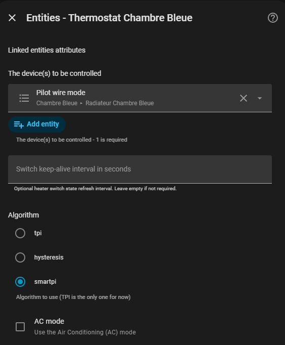
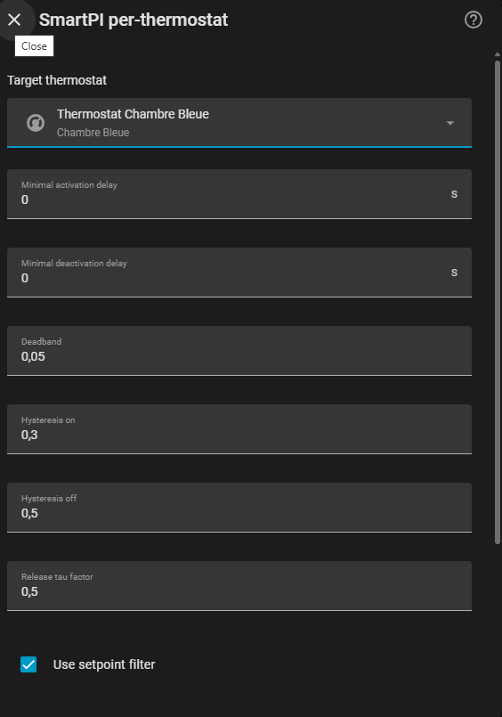

# SmartPI

- [SmartPI](#smartpi)
  - [What SmartPI does](#what-smartpi-does)
  - [Before you start](#before-you-start)
  - [Setup](#setup)
    - [Adding the SmartPI integration](#adding-the-smartpi-integration)
    - [Selecting SmartPI in Versatile Thermostat](#selecting-smartpi-in-versatile-thermostat)
      - [Per-thermostat configuration](#per-thermostat-configuration)
  - [Radiator valves and curve linearization](#radiator-valves-and-curve-linearization)
    - [Why a valve can be hard to regulate](#why-a-valve-can-be-hard-to-regulate)
    - [What linearization does](#what-linearization-does)
    - [When to enable it](#when-to-enable-it)
    - [Choosing the values](#choosing-the-values)
    - [Versatile Thermostat valve settings](#versatile-thermostat-valve-settings)
  - [Dead time and emitter lag](#dead-time-and-emitter-lag)
  - [Operating phases](#operating-phases)
    - [Learning phase](#learning-phase)
      - [How bootstrap heats](#how-bootstrap-heats)
      - [Step 1 — Measuring dead times](#step-1--measuring-dead-times)
      - [Step 2 — Learning heat loss (`b`)](#step-2--learning-heat-loss-b)
      - [Step 3 — Learning heating gain (`a`)](#step-3--learning-heating-gain-a)
      - [Leaving bootstrap](#leaving-bootstrap)
      - [Direct start](#direct-start)
    - [Stable phase](#stable-phase)
    - [Calibration](#calibration)
    - [Emitter lag learning](#emitter-lag-learning)
    - [Room model](#room-model)
  - [Recommended settings](#recommended-settings)
  - [Configuration](#configuration)
  - [Diagnostics and Markdown card](#diagnostics-and-markdown-card)
  - [Regulation panel with Equinox](#regulation-panel-with-equinox)
  - [Services](#services)
    - [`set_smartpi_learning`](#set_smartpi_learning)
    - [`reset_smartpi_learning`](#reset_smartpi_learning)
    - [`force_smartpi_calibration`](#force_smartpi_calibration)
    - [`reset_smartpi_integral`](#reset_smartpi_integral)

## What SmartPI does

SmartPI is an alternative to the classic TPI algorithm for Versatile Thermostat.

Its goal is simple: instead of using fixed behavior, it learns how your room really heats up and cools down, then adjusts regulation automatically. Each SmartPI VTherm remains mono-mode: HEAT or COOL, never both at once. When a thermostat switches between HEAT and COOL (for example a heat pump that heats in winter and cools in summer through the same emitter), SmartPI keeps what it learned for each mode: the heating or cooling rate `a`, the dead times and the emitter response come back when their mode returns, and the heat-loss coefficient `b` is shared by both modes.

In practice, SmartPI learns:

- how strongly the active equipment heats or cools the room,
- how quickly outdoors passively heats or cools the room,
- how long the room takes to react after the equipment starts or stops.

From that, SmartPI builds a heating or cooling command that is usually more
precise than a fixed TPI:

- it corrects the current temperature error,
- it estimates the power needed to hold the target,
- it applies protections near the setpoint to reduce overshoot and limit unnecessary oscillations.

You do not need to understand PI control theory to use SmartPI effectively. The important idea is simply that SmartPI needs a first learning period before it can regulate in its normal mode.

## Before you start

For SmartPI to learn correctly, make sure the thermostat has:

- a reliable indoor temperature,
- an outdoor temperature source,
- enough time to observe normal heating and cooling behavior.

For the first learning phase, try to avoid:

- opening windows for long periods,
- major schedule changes,
- unusual heat gains such as strong sun, fireplace use, or many guests,
- changing many SmartPI settings while learning is still in progress.

Two practical recommendations help a lot:

- let SmartPI run without interruption during the first day or two,
- in HEAT, use a setpoint sufficiently above outdoor temperature; in COOL, an outdoor temperature sufficiently above the setpoint helps make active and passive responses observable.

In practice, learning may take from a few hours to 48 hours on slow or highly inertial systems.

## Setup

Install the integration via HACS (or manually) as described in the [README](../../README.md), then restart Home Assistant.

Two steps are required after the restart: adding the SmartPI integration in Home Assistant, then enabling it in Versatile Thermostat.

### Adding the SmartPI integration

Go to **Settings → Integrations → Add integration**, then search for *SmartPI*.

On first install, SmartPI automatically creates a default configuration entry with sensible defaults. You can edit these global defaults later from **Settings → Integrations → SmartPI → Configure**.

### Selecting SmartPI in Versatile Thermostat

Once the SmartPI integration is added, open the configuration of the Versatile Thermostat device you want to control with SmartPI. In the **Underlyings** step, locate the algorithm selector and choose **SmartPI**.



Repeat this step for each thermostat you want to run with SmartPI.

#### Per-thermostat configuration

To add SmartPI to an additional thermostat, open the SmartPI integration configuration and add a new thermostat entry. Select the target thermostat from the list, then adjust the parameters as needed.



The parameters available are the same as for global defaults. Any parameter set here overrides the corresponding global default for the selected thermostat only.

A disabled SmartPI entry is ignored. A thermostat whose dedicated entry is disabled uses the enabled defaults entry, or the built-in defaults when there is none, and the thermostats depending on an entry are reloaded when it is disabled or removed. If the defaults entry has been deleted, it is recreated when you add the SmartPI integration again.

## Radiator valves and curve linearization

This section only applies to thermostats that directly drive a valve, for example a radiator TRV.

### Why a valve can be hard to regulate

A radiator valve does not always behave like an electric heater.

With an electric heater, asking for `40%` usually gives about twice as much heat as asking for `20%`. With many radiator valves, the response is less regular: the first few percent may do almost nothing, then a small extra opening can let a lot of hot water through.

On some installations, a valve can already pass most of the flow when it is only around `20%` open. Opening it further then changes the flow much less.

In practice, it may feel like this:

| Command sent to the valve | Possible radiator effect                              |
| ------------------------- | ----------------------------------------------------- |
| `0%` to a few percent     | no visible heat                                       |
| small opening             | the radiator just starts heating                      |
| around `15%` to `25%`     | most of the flow is already present                   |
| above that                | smaller change, sometimes mostly more hydraulic noise |

The exact values depend on the valve, the valve body, radiator balancing and the hydraulic installation. Do not try to find a perfect value on the first attempt.

### What linearization does

Valve curve linearization translates the SmartPI demand into a valve position.

SmartPI still works with a simple heating demand:

- `0%` means no heating,
- `50%` means medium demand,
- `100%` means maximum demand.

Linearization then transforms that demand into a valve opening better suited to the real radiator behavior. The goal is to use the small area where the valve really changes the flow more precisely, instead of sending the raw demand directly to the valve.

Simplified example:

| SmartPI demand | Opening sent to the valve         |
| -------------- | --------------------------------- |
| `0%`           | `0%`                              |
| low demand     | around the useful minimum opening |
| `80%`          | around the knee opening           |
| `100%`         | allowed maximum opening           |

This correction does not replace SmartPI learning. It only helps SmartPI speak more naturally to a non-linear valve.

### When to enable it

Enable this option if:

- your VTherm thermostat is a valve thermostat,
- SmartPI directly drives a valve opening,
- the radiator seems to go quickly from cold to very hot with only a few percent of opening,
- small command changes create reactions that are too strong or too irregular.

The option is offered only for thermostats that expose a valve command.

### Choosing the values

Default values give a reasonable starting point. Adjust them only if you have observed the behavior of your radiator.

| Parameter                 | What it means                                                             | Starting value |
| ------------------------- | ------------------------------------------------------------------------- | -------------- |
| **Minimum valve opening** | First opening where the radiator really starts heating.                   | `7%`           |
| **Demand at knee**        | SmartPI demand where the valve is considered to reach its high-flow area. | `80%`          |
| **Valve opening at knee** | Physical valve position at that demand.                                   | `15%`          |
| **Maximum valve opening** | Maximum allowed opening.                                                  | `100%`         |

To find the minimum opening, the simplest method is to observe the radiator:

1. Let the radiator cool down.
2. Start a heating demand.
3. Increase the valve opening slowly, in small steps.
4. Wait at least one minute between attempts.
5. Note the first value where the pipe or radiator really starts warming up.

The values only need to satisfy minimum opening < knee opening < maximum opening, with a demand at knee strictly between `0%` and `100%`. Otherwise the form shows the field to correct.

If you do not want to test carefully, keep the defaults. If your valve reacts very quickly, a knee opening around `20%` to `25%` can be a reasonable trial. If the radiator becomes noisy at full opening, lower the maximum opening.

After changing a value, let SmartPI run for several cycles before judging the result. One heating cycle is not always enough to conclude.

### Versatile Thermostat valve settings

In valve mode, Versatile Thermostat can filter, delay or remap the opening requested by SmartPI before it reaches the valve. SmartPI uses the retained opening reported by Versatile Thermostat for learning. This is a command value, not a measurement of the physical valve position. Filtering still limits command resolution, and an opening remap can conflict with the SmartPI valve linearization.

| Versatile Thermostat setting                                                                                              | Effect on SmartPI commands                                                                                                          | Recommended value                           |
| ------------------------------------------------------------------------------------------------------------------------- | ----------------------------------------------------------------------------------------------------------------------------------- | ------------------------------------------- |
| **Regulation threshold** (`auto_regulation_dtemp`)                                                                          | Filters small changes in the requested opening and forces to `0%` any opening below the threshold.                                   | `0` if the device allows it; at least `3%` for the Sonoff TRVZB, as recommended by VT |
| **Regulation minimum period** (`auto_regulation_periode_min`)                                                               | Holds back a change of the valve command until the period has elapsed since the previous change, except when a cycle restarts.        | `0` if the device allows it; otherwise keep its required period |
| **Opening threshold degree**, **Min opening degrees**, **Max opening degrees**, **Max closing degree**                     | Remap the opening sent to the valve. This conflicts with the SmartPI valve linearization, which inverts its curve on the opening.     | `0`, `0`, `100`, `100` (no remap) when linearization is enabled and the device allows these values |

For the Sonoff TRVZB, the [Versatile Thermostat documentation](https://github.com/jmcollin78/versatile_thermostat/blob/10.6.2/documentation/en/over-climate.md#self-regulation) recommends a regulation threshold of at least `3%` to avoid a possible loss of valve calibration. Keep this threshold even if SmartPI raises a filtering warning. A non-zero threshold does not, by itself, demonstrate that learning has failed.

With direct valve control in `over_climate` mode, VT also raises the opening threshold to at least the regulation threshold. If this required setting causes an opening remap, keep it and disable the SmartPI valve linearization.

The integer rounding of the valve position (`1%` steps) always applies. A regulation threshold below `1` therefore has no additional effect.

SmartPI checks these settings when the thermostat starts and raises a warning in Home Assistant **Settings > Repairs** when the regulation threshold is `1` or more, the regulation minimum period is above `0`, or an opening remap is active while the valve linearization is enabled. A filtering or delay warning can remain when the device requires these settings; it does not, by itself, establish a learning failure. The warnings are checked again at the next thermostat start. The checked values and the issue codes (`dpercent_filter`, `period_filter`, `opening_remap`) are also published under `live.valve` in the [diagnostics](diagnostics.md).

The regulation threshold and regulation minimum period are configured in the **Underlyings** menu of the Versatile Thermostat settings. Set them to `0` only if the device allows it. If the radiator only starts heating above a given opening and your device allows the default VT opening settings, set that opening as **Minimum valve opening** in the SmartPI valve curve. If you need to keep a VT opening remap, disable the SmartPI valve linearization.

## Dead time and emitter lag

SmartPI describes the time between a command and its effect with two quantities only, and every part of this documentation, of the diagnostics and of the cards uses these two names.

- **Dead time**: the time from a change of the command to the first visible move of the room temperature. There are two values: the heating dead time after a start of heating (`model.deadtime_heat_s`) and the cooling dead time after a stop (`model.deadtime_cool_s`: the emitter keeps giving heat for a while). The bootstrap measures them (see [Step 1](#step-1--measuring-dead-times)) and SmartPI keeps measuring the heating dead time at each heating start. They are read by the gain rule (it expects an apparent dead time), the start of the learning windows, the integral hold after a resume and the fallback horizon of the anticipation.
- **Emitter lag** (`T_ar`, the average residence time of Astrom and Hagglund): the mean time the commanded heat takes to arrive in the room, that is the dead time plus the inertia of the emitter. It is always at least the dead time, typically about twice. Three methods estimate this same quantity: the heating phases at constant power (`analysis.learning.response_lag`), the heating balance (`analysis.learning.heating_balance`), and the learning on morning setpoint rises and on several days of quiet periods ([Emitter lag learning](#emitter-lag-learning), `tar_learning`). The emitter lag is read by the correction of the delivered power when `a` is learned, by the delay before a learning window starts (3 lags) and, from the heating balance, by the horizon of the anticipation in heating. The emitter lag learning also gives the heating dead time in force for the regulation (`tar_learning.applied_s`), derived from the learned emitter lag.

## Operating phases

### Learning phase

SmartPI starts in a learning phase that lasts until it has published a first thermal model. The **Start of the learning** option chooses how this phase runs:

- **Bootstrap** (default): hysteresis cycles at full power, then the regulation once the model is learned (a few hours to two days). It is described below.
- **Direct start**: PI regulation from the first minute with at most three light measurement pulses near the setpoint (see [Direct start](#direct-start)).

The choice applies when the learning starts from a blank state: a new thermostat, or a thermostat whose learning was reset with `reset_smartpi_learning`. A thermostat that has already learned keeps its model and the start its learning began with; changing the option takes effect at its next learning reset.

With the bootstrap start, SmartPI uses a simple heating strategy to observe how the room behaves, then extracts the physical parameters it needs to regulate properly.

#### How bootstrap heats

During bootstrap, SmartPI does not try to hold the temperature precisely. Instead, it alternates between full heating and full cooling in order to observe clear thermal responses:

- heating starts when the temperature drops below `setpoint - 0.3°C`,
- heating stops when the temperature rises above `setpoint + 0.5°C`.

This produces visible temperature swings which are expected and intentional at this stage.

#### Step 1 — Measuring dead times

The first thing SmartPI needs to learn is **how long the room takes to react** after heating starts or stops. These times are the *dead times* (see [Dead time and emitter lag](#dead-time-and-emitter-lag)):

- **heating dead time**: the time between the moment SmartPI sends a heating command and the moment the indoor temperature starts rising,
- **cooling dead time**: the time between the moment heating stops and the moment the temperature starts dropping.

Dead times depend on the emitter type, room size, and sensor placement. They must be measured before SmartPI can interpret heating and cooling observations correctly.

SmartPI keeps measuring the heating dead time at each heating start that follows a long enough stop, and publishes the median of the last measurements. A room that is already warming before the heater starts, for example when people get up, would make the heating seem to act sooner than it does. SmartPI therefore compares the temperature with the course it followed before the start. When that course is too steep or too irregular to tell the heating apart, the measurement is dropped and the previous dead time is kept. A room that was warming before the start, or a start that follows too short a stop to judge its course, never shortens the dead time: only a measurement at least as long as the current value is kept.

#### Step 2 — Learning heat loss (`b`)

Once the dead times are considered reliable, SmartPI starts collecting **cooling observations**: it measures how fast the room loses heat when the heater is off.

From these observations, it calculates `b`, the heat-loss coefficient. This parameter represents how quickly the room cools down depending on the difference between indoor and outdoor temperature.

SmartPI needs at least 5 valid cooling observations before `b` is considered usable.

#### Step 3 — Learning heating gain (`a`)

Once `b` has enough observations to be considered reliable, SmartPI starts collecting **heating observations**: it measures how quickly the room warms up for a given heating command.

From these observations, it calculates `a`, the heating gain. This parameter represents how effectively your heating system raises the indoor temperature.

After a heating start, the room warms up progressively: the emitter, the air and
the sensor take some time before the temperature rises at its full rate. SmartPI
measures the *emitter lag* on the first heating phases at constant power and
ignores the start of each phase until the response has settled, then accounts
for the heat actually delivered. `a` is only published once this emitter lag is known (or after 4
heating phases where it could not be measured, for example with a sensor that
reports too rarely). A heating phase is a period of continuous heating; short
interruptions of less than 10 minutes do not start a new one.

SmartPI needs 5 valid heating observations for `a`, or 4 when they agree closely.

Bootstrap therefore takes longer in slow rooms or with slow sensors: SmartPI
favours an accurate `a` over a fast exit.

#### Leaving bootstrap

SmartPI leaves bootstrap and switches to its normal regulation mode once both `a` and `b` have enough observations to publish a first thermal model.

While it heats and stops during bootstrap, SmartPI also reads each full heating phase and the temperature peak that follows it as a whole. When two such readings agree, their heating rate and loss rate serve as starting values of the model until the continuous learning has its own. They are replaced by the learned values as soon as these are available.

The observation buffers then continue filling up to 31 samples during normal regulation, so the model keeps consolidating after bootstrap. Full model confidence remains stricter than bootstrap exit — until enough observations are available for full confidence, SmartPI regulates with the published model while keeping some internal corrections frozen.

What to expect during bootstrap:

- temperature swings are normal and expected,
- regulation is intentionally simple at this stage,
- diagnostics are especially useful to follow progress,
- `model.confidence` reports `ab_bootstrap` until the first thermal model is available (`ab_learning` with the direct start),
- speed depends on the quality of real observations, not only on elapsed time.

#### Direct start

With the direct start there are no hysteresis cycles: SmartPI regulates with its PI from the first minute, on safe default gains, and the room stays close to the setpoint. To get the measurements the bootstrap would give, it makes at most three light measurement pulses per mode (heating or cooling). A pulse starts when the room is at the setpoint or at most 0.3 °C under it (mirrored in cooling), and has three steps:

1. a rest without heating, for 45 minutes at most or until the room is 0.5 °C under the setpoint,
2. heating at full power until the room has clearly responded and is back at the setpoint (at most 0.1 °C under it); once the step has lasted 30 minutes it ends as soon as the room has clearly responded; it lasts 2 hours at most and ends when the room is 0.3 °C over the setpoint,
3. a stop until the temperature peak that follows is confirmed, for 4 hours at most; the peak is confirmed once the room has fallen from it by the largest of 0.05 °C, two sensor steps and half its rise since the stop, and about 30 minutes after it at the latest; the regulation takes back control during this stop once the room is 0.5 °C under the setpoint and lower than at the start of the stop, and in any case at 0.8 °C under it.

Two pulses are at least 6 hours apart. The dead time after a stop is read on that peak, also on the stops of the regulation: when the heating starts again before the confirmation, the peak still counts if the room has already fallen enough from it.

During the learning stage, a measure of the loss rate `b` after a stop starts once the peak of the stop is confirmed or, when the emitter lag is known (learned, or kept from the pulses), three emitter lags after the stop.

SmartPI reads each pulse as a whole, like the heating phases of the bootstrap (see [Leaving bootstrap](#leaving-bootstrap)). When two pulses agree, their heating rate `a`, loss rate `b` and emitter lag are kept. Until the learning publishes its own model, the kept values stand for it: they give the gains of the regulation, the horizon of the anticipation and the starting values of `a` and `b`. When the first model is published, the integral term of the regulation starts from zero. In simulation the first model is published in about 8 to 24 hours.

What the direct start implies:

- the room is regulated from the first minute; there are no swings of the bootstrap,
- the learning needs scheduled setpoint changes every day (a daily setback is enough) to keep measuring dead times and to learn `a` and `b`: a setpoint held constant around the clock does not give it what it needs,
- it works best with a precise sensor reporting 0.01 °C,
- the pulses and the kept values are summarised in `live.learning.start` (see [Diagnostics](diagnostics.md)).

### Stable phase

When the thermal model becomes reliable, SmartPI switches to its normal regulation mode.

At that point, SmartPI:

- computes PI gains automatically from the learned model,
- adds an anticipative holding term based on the room and outdoor conditions (from the learned model, or from the [room model](#room-model) once published),
- adapts behavior near the setpoint with a deadband and additional protections.

Near the target temperature, SmartPI tries to avoid constant micro-corrections. The result should be steadier regulation with fewer unnecessary corrections than a fixed TPI.

SmartPI anticipates the temperature, in HEAT and in COOL: the proportional and integral branches read the measured temperature plus the distance the room is about to travel during the time between a command and its effect, estimated from the slope of the temperature. This lowers the command before the room reaches the setpoint, which limits the overshoot of slow emitters (underfloor heating, hydronic radiators) and of cooling that keeps acting after it stops. The horizon is the emitter lag measured by the heating balance in HEAT; until one is measured, and always in COOL, it is derived from the dead times: the longer of the dead time of the active mode and half the dead time of the passive response. The correction is limited to 1 °C, and fades in as the room approaches the setpoint from far away, so that a rise or a fall from far from the setpoint is not slowed. When the room enters the deadband around the setpoint, the correction is kept until it dies out, then there is none as long as the room stays there: the command does not step at the arrival, and a small quick move of the sensor does not move it afterwards. Both branches use the raw setpoint.

### Calibration

A calibration runs only on request, with the [`force_smartpi_calibration`](#force_smartpi_calibration) service, once the first model is published, whatever the start of the learning was. It measures the room again with at most three measurement pulses near the setpoint and corrects the learned model when the measure shows that it is clearly off.

The pulses are sized from what SmartPI already knows of the room (its dead times and the horizon of the anticipation):

- a pulse starts when the room is between 0.2 °C over the setpoint and 0.3 °C under it (mirrored in cooling) and the command is under 80 %; until then the regulation runs as usual,
- rest: no heating for the dead time after a stop plus 20 minutes, the time the dead-time learning needs to measure the next start; the rest ends earlier when the lowest point the room is heading to (its present fall continued over the dead time after a start) reaches 0.5 °C under the setpoint,
- full power until the response to the start is seen and the room is back at the setpoint (at most 0.1 °C under it), or as soon as the response is seen once the step has lasted 30 minutes, or the room is 0.3 °C over the setpoint, at most twice the dead time after a start plus the anticipation horizon (between 2 and 4 hours),
- stop until the temperature peak that follows the heating is confirmed and the dead time after the stop is measured; the regulation takes back control earlier only when the room is 0.5 °C under the setpoint and still falling, and in any case at 0.8 °C under it,
- no step lasts more than 4 hours; two pulses are twice the anticipation horizon apart (between 1 and 6 hours).

Each pulse gives the dead-time learning a start and a stop from full power, measured as in regulation: these dead times join the learned ones. SmartPI reads each pulse as a whole, like the pulses of the direct start. When two pulses of the calibration agree, their heating rate, loss coefficient and emitter lag form the reading of the calibration, which is compared with the values in use in the mode of the calibration:

- heating rate: when the value in use is off the reading by more than 30 % of the reading (the reading is the best estimate of the true value), the learning of the heating rate of that mode starts again and the reading stands in for it until the learning publishes its own value,
- loss coefficient: it is read and published (`reading_b`), not corrected: the loss coefficient read on a pulse is biased in a room with heavy walls. The learning keeps its own,
- emitter lag: with the direct start, when the horizon of the anticipation in use is off the lag read by more than 30 %, that lag replaces the lag kept from the start in the learning of the response lag (until that learning measures its own); it never changes the horizon of the anticipation. With the bootstrap start it is published only.

A value in use within 30 % of the reading is left as it is: a calibration of a well-learned room changes nothing. When a value is corrected, the change of the holding power is moved into the integral term, so the feed-forward and the integral term do not jump (the proportional term follows its new gain as usual), and the progress of the feed-forward ramp is kept. Corrected values are kept across a restart. The heating balance and the learning of the response lag observe the pulses like any other heating phase. While a calibration is in progress, the learning takes no measure of the heating rate (the pulses and the recoveries after them would bias it); the loss coefficient and the dead times go on being learned. After each pulse the integral term is held until the room is back at the setpoint, so that the recovery after the pulse does not build up an integral that would overheat the room afterwards.

A calibration ends when two of its pulses agree, when its three pulses are done and read, or after 48 hours. When that end comes during a pulse, a pulse at rest hands back to the regulation at once, a pulse heating at full power goes to its stop step, and a pulse in its stop step goes on: the calibration ends, and applies its corrections, when that pulse ends. A pulse counts once it has started heating; one that ends during its rest (a setpoint change, for example) does not count. Switching the thermostat off (or a window, or power shedding) ends the pulse in progress; the calibration goes on with its next pulse. A change between heating and cooling, a learning reset or a pause of the learning cancels it at once, with its pulse. A restart keeps the calibration in progress and its pulse count; the pulse in progress ends.

The service can be called by an automation: a request that cannot start a calibration is refused or ignored without error, and the reason is published in `live.calibration.last_request`. A request is refused while the first model is learned, while learning is paused, while the thermostat is off, and less than 24 hours after the end of the last calibration (a cancelled one does not count); it is ignored while a calibration is running. An open window, power shedding or a cut of the heating after an overshoot does not refuse it: the pulses wait until the room can be measured. For example, a room whose setpoint rarely changes gives its learning few occasions to measure; a weekly automation can check its model:

```yaml
triggers:
  - trigger: time
    at: "10:00:00"
conditions:
  - condition: time
    weekday: sun
actions:
  - action: vtherm_smartpi.force_smartpi_calibration
    target:
      entity_id: climate.my_thermostat
```

The calibration is summarised in `live.calibration` (see [Diagnostics](diagnostics.md)).

### Emitter lag learning

The emitter lag `T_ar` is the mean time the commanded heat takes to arrive in the room: the dead time plus the inertia of the emitter (see [Dead time and emitter lag](#dead-time-and-emitter-lag)). The bootstrap measures only the heating dead time (`deadtime_heat_s`), about half of it. SmartPI also learns the emitter lag during normal regulation and derives from it the dead time used by the regulation. This learning is always on and needs no setting.

**Quiet periods**

The learning uses only quiet periods: stretches without sun, at a constant setpoint, with valid data. They come from the recorded data and the position of the home in Home Assistant; no hour is fixed and nothing has to be declared.

- **No sun.** The sun is computed from the latitude and longitude of the home. A period ends a few minutes before sunrise and starts a few minutes after sunset, never after sunrise: a low sun on a window facing it already heats the room. Without a valid home position, no period is found and the learning stays silent; the diagnostics say so.
- **Low setpoint.** A period starts at the setpoint drop (or at nightfall when the setpoint was already low, or never changes) and ends at the next setpoint rise, or at sunrise. A rise that stays below the setpoint before the drop, while the room is still above the new setpoint, calls for no heat and does not end it. Each night gives at most one period. A setpoint change or missing or excluded data cut it, and the longest piece is kept (at least 1 hour).
- **Regulated part.** The part of a period from the first heater start with the room within 0.3 °C of its low setpoint. A room that never cools to its low setpoint (sleepers, a warmer neighbour) has no regulated part.

**What it learns**

- **Fast value.** A comfort step is a setpoint rise of at least 1 °C, at any hour, after a low setpoint held in the dark with valid data for 2 hours, to a setpoint not below the room temperature. Two hours after the step, SmartPI fits the rise of the temperature. The fit stops at sunrise: when the part left before sunrise is too short for the usual checks (duration, heat delivered, rise), the step gives no value. A rise cut by sunrise gives a value only when the part fitted lasts at least 3 times the larger of the fitted emitter lag and the longest emitter lag known before the step (the refined value in force, the published fast value, the lower bound in force, or twice the bootstrap dead time): a slow emitter fitted on a short window gives an emitter lag that is too short. A shorter cut rise that passes every other check gives a **lower bound** instead, 0.6 times the fitted emitter lag, never a value. A room with thermal mass (recognised on its periods without heating) gets an air-walls model in that fit. The fast value is published once 3 confirmed steps agree: median of the last 5, with a spread of at most 25 %. The lower bound in force is the median of the last 5 confirmed lower bounds; it never enters the fast value.
- **Confirmation.** A step (or a lower bound) is confirmed only when the regulated part before it lasted at least 1.5 hours and the heater started at least once every hour of it. A regulated part that is missing or shorter than 1.5 hours leaves the step unconfirmed: nothing proves that no occupant warmed the room. Sleepers who get up during the fit window bias the rise, and a room that stays without heating while it should regulate is the visible sign of that risk. An unconfirmed step is shown in the diagnostics and never used.
- **Refined value.** Each time a period ends, SmartPI fits a model of the room with its walls and its emitter over the last 3 periods, and compares it with the fit of the 3 periods before them. Each period is fitted with the response to the setpoint rise that ends it, for up to 2 hours while it is still dark and the new setpoint constant: that response is what reveals the emitter. When both agree, they give the room class (thermal mass or not), the wall parameters and an emitter time constant `τe`.
- **Regulated periods only.** `τe` replaces the fast value only when the 6 periods of both fits were regulated over their regulated part, from its start to the setpoint rise or sunrise: at least 4 hours, constant setpoint, a heater start in every half hour, temperature within 0.3 °C of the setpoint, steady power, no data gap. Otherwise `τe` is a diagnostic only.
- **One period counts once.** A period has one key, set by its events. A second rise the same night, a new computation or a restart never counts it twice, neither for the room class nor for the confirmed values.

**What it changes**

- The learned emitter lag is the refined value when published, else the fast value. A lower bound above it (or without it) takes its place.
- The gain rule expects an apparent dead time, which is what the bootstrap measures; the learned value is the emitter lag, about twice as long. The rule therefore compares half the learned value with a **reference**: the larger of the first bootstrap value measured once the learning started (kept, so it never follows a bootstrap value that later falls, for example under sleepers who warm the room before the heater starts) and the current bootstrap value.
  - Half the learned value shorter than the reference: the gains keep the reference. A learned value alone never makes the gains more aggressive than the reference.
  - Between 1 and 2 times the reference: the gains use half the learned value.
  - Above 2 times the reference: the gains use half the learned value only when the fast value and the identification value (the refined value, else the `τe` of the last evaluation whose two fits agree) agree within a factor of 1.25. Otherwise they use twice the reference. A lower bound is never confirmed this way.
- When the gains use the learned value, the near band and the integral hold after a heater start or a resume use the learned value itself as their heating dead time (`applied_s`); otherwise they keep the bootstrap dead time. The learning of `a` and `b` always keeps the bootstrap dead time.
- The bootstrap dead time is never modified. Without a learned value the regulation uses it as it is.

**Data quality**

The learning only uses data recorded while SmartPI controls the heater. These periods are excluded, and they cut a quiet period or a comfort step like missing data (they are never filled in):

- no data for more than 20 minutes, an unavailable indoor or outdoor temperature, or an unknown command;
- the downtime of a restart of Home Assistant or of the thermostat that is not bridged (see [Restarts](#restarts)); a bridged restart is only a missing sample;
- a temperature jump of more than 0.5 °C at more than 20 °C/h, which no heating produces (the value is ignored; a new level confirmed by 3 readings is kept);
- window open, power shedding, safety mode, HVAC mode other than heating, or a command overridden by Versatile Thermostat.

A comfort step is evaluated only when the 2 hours before it and the 2 h 15 after it (or the time left until sunrise) are valid. A setpoint restored within 5 minutes after a restart is not a comfort step. A period counts as regulated only when its whole regulated part is valid. An identification fit uses only the 10-minute bins wholly inside its periods and needs at least 50 of them in runs of at least one hour.

**Requirements and limits**

- Heating only (nothing is learned or applied in cooling), and heaters driven by PWM cycles. In valve mode nothing is learned or applied and the diagnostics show `valve_mode_not_supported`: the heating power of a valve is known only through the valve curve, and a curve that is missing or does not match the valve gives a wrong emitter lag; on a slow emitter, the learned emitter lag also left the morning rise short of the comfort setpoint.
- The position of the home set in Home Assistant, a comfort step of at least 1 °C before sunrise, and a bootstrap dead time already measured.
- The fast value needs 3 confirmed steps. A room that does not regulate at its low setpoint for 1.5 hours before the step (late or no return to the low setpoint) stays unconfirmed: the fast value is not published there.
- The refined value needs 6 consecutive regulated periods, which requires a low setpoint reached at least 4 hours before the comfort step or sunrise, and held until then.
- A step after sunrise, a low setpoint only in daylight, or a home with only short nights (summer at high latitudes) gives no value. A setpoint held all night gives periods for the refined value and the room class, but no step.
- An occupant present only while the setpoint is high is not detected.
- The computations run in the background: up to a few seconds per day and per thermostat, about 20 MB at peak. SmartPI keeps 7 days of signals in its own storage file.
- They use the `numpy` and `scipy` packages, installed with the integration and loaded only by the background computations. If they cannot be loaded, nothing is learned, the bootstrap value stays in use and the diagnostics show `dependencies_unavailable`.

The `live.tar_learning` block of the [diagnostics](./diagnostics.md#emitter-lag-learning) shows the learned values, their status and the applied value.

### Room model

SmartPI also maintains a room model. The model describes the room with its air, its walls and its emitter. SmartPI uses it to forecast the room temperature and checks these forecasts against the measured temperature. Once published, it gives the holding power of the regulation in heating (see **What it changes** below).

**What it computes**

- **Identification, on the quiet periods.** The model is fitted on the same quiet periods as the emitter lag learning (see **Quiet periods** above: no sun, constant setpoint, valid data), from the signals it keeps; no hour is fixed. Each time a period ends, SmartPI fits the model in the background on the last 3 periods, each with the response to the setpoint rise that ends it for up to 2 hours while it is still dark. A series of periods is computed once, at most one per hour; after a long stop the series not computed yet follow one another, oldest first. The model holds the heating response `a` through the emitter (with its learned emitter lag), the loss of the air to the outside and to the walls, and the slow response of the walls. The state of the walls at the start of each period is estimated, never assumed settled, and two periods are never joined.
- **Heat balance, once a day.** About 20 minutes after midnight, whatever the quiet periods, SmartPI computes the heat balance of each whole day kept in its storage (up to 7): the mean heating power, with the change of the indoor temperature removed, against the mean indoor-outdoor difference. A straight line through these daily points gives the static model of the room. Its slope is the power needed per °C of indoor-outdoor difference, in the units of `model.b / model.a`. Its offset is a constant free heat gain, in % of full power: heat from a warmer room next door or from steady occupants, or a loss to a colder room when negative. Once a model is published, the static loss SmartPI uses is slope × (setpoint − outdoor temperature) − free gain. Without the gain, the integral would have to carry it for good. The heat balance does not depend on the emitter response time.
  - A day counts when at most 20 % of its data are missing or invalid and it has some heating (2 % of full power on average): a day without heating says nothing about the losses.
  - The model needs at least 4 such days, a mean heating of at least 5 % of full power and a mean indoor-outdoor difference of at least 6 °C.
  - The slope must be known within ±5 % (95 % confidence, from the scatter of the days around the line and from how much it moves when any one day is left out), since the model's own heat loss is checked against it within 5 %.
  - A free gain can be told apart from the losses only when the indoor-outdoor difference has varied between the days (a standard deviation of at least 1 °C). Until then the slope alone is used: the mean power over the mean difference, with no gain. It is right at the usual conditions of the room, less so far from them. Once the difference has varied, the line with its gain must be determined; otherwise the day gives no new value (`free heat gains detected; the outdoor temperature has not varied enough yet to separate them from the losses` when the days show a gain, `the heating need varies too much from one day to the next` otherwise).
  - The days must not drift: when the heating need moves in one direction from day to day by more than 2.5 % beyond what the line explains, the walls are still storing or releasing heat (start of the heating season, a cold spell), and the day gives no new value.
  - Otherwise the last kept model stays in force.
- **Emitter search.** Each identification fits the model with an emitter lag (the first moment of its response) on a fixed scale from 1 minute to 1 hour (13 values, each 1.41 times the previous), refined around the best one. The dead time in force does not set the scale. A faster emitter is not resolved by the 1-minute steps of the fit; a slower one would be confused with the walls, whose time constant is at least 3 hours. The rise of the fit error away from the best value is weighed against the residual noise, counted in independent measurements. When the best value is at either end of the scale and the rise is significant, the true emitter lag lies outside the scale and the series publishes nothing (`the heating response delay does not match the measured temperature`). When the rise is not significant, these periods do not determine the emitter lag: the identification goes on with the learned emitter lag when the emitter lag learning has refined it, otherwise with the best value of the scale, and the agreement with the heat balance judges the result.
- **Information.** The periods must determine the model, whatever their duration. From each fit, SmartPI computes how precisely the measurements fix what the fit gives: `a` and `b_eq / a` for the simple model, `a`, the loss of the air and the share the walls take for the model with walls (its `b_eq / a` is checked against the heat balance instead), the emitter search included, and counting correlated errors as fewer measurements. A fit whose uncertainty (95 %) is wider than the tolerance used to compare two series of periods (15 % on `a`, 25 % on `b_eq / a` and on the loss of the air, 35 % on the wall share) is refused (`the quiet periods do not determine the model precisely enough yet`): two such series would agree or disagree by chance. Long nights with some heating usually determine the walls; a few short periods may not.
- **Publication.** The values of a series are published only when the model follows the measured temperature closely and without systematic error, the values agree with those of the 3 periods before (other periods, never shared), and those earlier values also predict the new periods. The check of the error looks for a bias, a large spread, long runs of hourly means of the same sign, a correlation over one hour, and a link with the heating, the setpoint or the outdoor temperature. Shorter ripples, from the sensor response or the heating cycles, do not matter at the scale of the model. A model whose heating response `a` is more than twice or less than half the `a` learned by the regulation is refused (`the heating response differs too much from the one measured by the regulation`): such a model lumps the walls into the air. The fits take the free gain of the heat balance in force as a known heat input. Once a heat balance is in force, a model whose ratio `b_eq / a` differs from its slope by more than 5 % is refused too (`the model's heat loss disagrees with the measured heat balance`): with heavy walls, `b_eq` is the small difference between the loss of the air and the share the walls take, and a slightly wrong emitter response time shifts it by several %. The walls of such a model would not match the measured losses either. Two agreeing results are averaged, and the published values are the median of the last 3 accepted results; both are taken on `a`, the ratio `b_eq / a`, the wall share of the air loss and the wall rate, so the static ratio keeps the value the fits agree on. Otherwise the last published values are kept.
- **Simple model.** The walls are kept in the model only with a precise temperature sensor (steps of 0.015 °C or less), when they carry a real share of the losses in both series of periods, when their time constant is at least 3 hours, and when they predict the following periods better than the simple model. Otherwise the model is the simple one, with `a` and `b_eq` only, like the A/B model.
- **Disturbances.** Once a model is published, the tracking (below) measures the heat gains or losses that the model does not explain. A quiet period whose mean over its fitted part differs by more than 0.08 °C/h from the median of the recent periods (at least 4 hours tracked) is left out of the identification. A gain present in every period (sleepers every night, for example) is not detected.
- **Tracking.** Once a model is published, SmartPI follows the state of the room (air, walls and unexplained gains) at each regulation tick, with the power actually applied and the outdoor temperature. It corrects that state at each new temperature value; a value repeated by the sensor is not a new measurement. With a sensor in steps of 0.1 °C, a change is read as the crossing of the midpoint between the two values. Tracking pauses outside heating and when SmartPI is not in control (safety mode, command overridden). After a pause or a restart of up to 3 hours the state is resumed; after a longer one it restarts with the walls in balance with the air, and settles for about 3 hours. A bridged restart (see [Restarts](#restarts)) is not a pause: the tracking goes on as if nothing had happened.
  - **Power shedding** does not pause the tracking: the heater is known to be off, so the state goes on being corrected with zero heating from the start of the shedding (the rest of the interrupted cycle is not counted) until SmartPI's command resumes.
  - **Open window.** The window changes the air, not the exchange between the air and the walls. While it is open, the air of the model follows the measured temperature and the walls follow that air. When it closes, the tracking resumes from the measured temperature and is `ok` again at once; the holding power brings the wall extra power back in over 30 minutes. A window open for more than 3 hours restarts the tracking as above.

**What it changes**

The holding power is the part of the command that compensates the losses for the setpoint and the outdoor temperature (the feed-forward). Without a published room model it comes from the learned A/B model. In heating, with heaters driven by PWM cycles, a published room model gives it instead, once a heat balance is in force. Its static loss is the heat balance slope times the difference between the setpoint and the outdoor temperature, minus the free gain, never the `b_eq / a` of the model; the model gives the wall part.

- **Walls identified and tracking `ok`:** the static loss, plus the extra power the walls currently absorb (or minus the heat they give back). After a night setback the walls are cold: the morning rise gets more power and the room reaches the setpoint without a long plateau. During the day, when the walls give heat back, the power is reduced.
- **Walls identified, tracking not `ok`** (paused, settling after a restart, measurements drifting away from the model): the static loss only.
- **Simple model:** the static loss only.
- **Model published but no heat balance in force yet, or a heat balance that came into force later and whose slope differs from the model's `b_eq / a` by more than 5 %:** the holding power of the A/B model, unchanged, without the wall extra power.
- **Nothing published, cooling or valves:** the holding power of the A/B model, unchanged. The heat balance alone is not used: without the wall extra power it would give the wrong holding power in a room with heavy walls.

The room model holding power applies at once at full weight. A change of the static loss (switch between the A/B model and the room model, between the simple model and the model with walls, or a new heat balance value) is absorbed by the integral, so the command does not jump; the integral then gives its share back at the pace of the regulation. The wall extra power is never absorbed by the integral: when it starts, stops (tracking no longer `ok`, after an open window for example) or changes with a new publication, it moves gradually over 30 minutes from its last value to the new one. After a window, the morning rise therefore gets its wall power back within 30 minutes once the tracking is `ok` again. The source in force and the wall power being applied are kept across restarts.

The cost is a slight overshoot, around 0.1 °C, at the end of a morning rise in a room with heavy walls.

**What it shows**

- The forecast of the room temperature in 1, 2, 6 and 12 hours if the current heating power were kept.
- The error of the past forecasts against the measured temperature, over the last 7 days, next to the error of a forecast that keeps the temperature unchanged.
- With a precise sensor and identified walls: the extra power the walls currently absorb beyond their steady share, in % of full power. It is positive while the walls warm up (after a morning rise, for example) and negative while they give heat back.
- The heat balance in force (slope, free gain and number of days), the day it was computed, and why the last day gave no new value.

**Requirements and limits**

- Heaters driven by PWM cycles; valves are not supported yet.
- The position of the home set in Home Assistant: without it there is no quiet period and nothing is identified (the heat balance still runs).
- A first publication needs 6 quiet periods with some heating that determine the model (about 6 days with a night setback), and a heat balance in force: the model's heat loss is checked against it within 5 % when it is published, and nothing is published before a first heat balance (it needs 4 usable whole days of recorded signals). A home with only short nights (summer at high latitudes) may give none. A model published by an earlier version stays in force; it gives no holding power while no heat balance is in force or while it disagrees with it.
- It uses the same `numpy` and `scipy` packages as the emitter lag learning, in the background: up to about a minute per identification and per thermostat.
- Its parameters and state are kept in their own storage file and survive restarts. The `reset_smartpi_learning` service clears them.

The `live.room_model` block of the [diagnostics](./diagnostics.md#room-model) shows the model status, its values, the heat balance in force, the forecasts and their errors. `live.feedforward.source` shows which model gives the holding power, and `live.feedforward.wall_power_percent` the wall part of it.

### Restarts

When Home Assistant restarts or the integration reloads, Versatile Thermostat leaves the heater as it was: a heater that was on stays on until SmartPI's first command after the restart. A short restart is therefore only a gap of a few measurements, and SmartPI **bridges** it: it carries on as if nothing had happened.

A restart is bridged when all of these hold:

- the stop lasted at most 10 minutes;
- the thermostat was in the same mode before and after it, heating or cooling, with the same cycle settings;
- SmartPI was in control before and after it (no open window, power shedding, safety mode or command overridden);
- the indoor temperature did not jump during the stop;
- the stored data are recent (a crash that lost the last writes makes the stop look long).

The decision is taken at the first calculation that has the indoor temperature: a sensor that reports a few seconds after the restart does not prevent it, and the stop counts up to that moment. While SmartPI waits for that temperature, it keeps the command of before the stop as long as the other conditions above hold; the heating is not interrupted. If the temperature is still missing 10 minutes after the stop, the command goes to 0 until it comes and the restart is not bridged.

After a bridged restart, the measurements in progress resume (dead time, learning windows, emitter lag), the heater is taken as unchanged over the stop, nothing is excluded from the emitter lag learning or the room model (both heating only), and learning is not paused. A setpoint changed during the stop is handled at the first tick like any setpoint change. After any other restart SmartPI starts again carefully: the measurements in progress are dropped, learning pauses for one cycle, and only the stop itself is excluded from the learning data.

The diagnostic sensor shows the last restart in `control.last_restart`.

## Recommended settings

Default settings are suitable for most installations.

Start simple:

- keep the default hysteresis thresholds if your sensor is accurate and reports often (see below otherwise),
- adjust the deadband first if the temperature oscillates too much around the target,
- enable the Versatile Thermostat window detection (window sensor or automatic detection).

When Versatile Thermostat detects an open window, SmartPI freezes its integral term during the opening and holds it after the window closes, while the heating takes effect again. An opening that Versatile Thermostat does not detect is seen as an ordinary heat loss: the integral term compensates it, then the room can overshoot the setpoint slightly after the window closes.

Do not try to tune several parameters at once during the first learning period. It is better to let SmartPI complete a clean first learning cycle, then adjust only what is really needed.

### Bootstrap hysteresis by sensor

During bootstrap, SmartPI runs bang-bang heating between setpoint − *on hysteresis* and setpoint + *off hysteresis*, and learns `a` during heating phases and `b` during cooling phases. Each phase must contain enough distinct readings from the sensor. With a coarse-resolution sensor or one that reports rarely, the default thresholds produce phases that are too short, and bootstrap can last several days or never complete.

| Temperature sensor | Recommended on / off hysteresis |
| --- | --- |
| Resolution 0.1 °C or better, reporting at least every 5 minutes | `0.3 / 0.5 °C` (default) |
| Resolution 0.1 °C reporting a few times per hour, or resolution 0.2 °C | `0.5 / 0.8 °C` |
| Resolution 0.2 °C reporting every 30 minutes or less often | `0.5 / 0.8 °C`, but initial learning may not complete, especially in mid-season: a more precise or more frequent sensor is recommended |

Widening them further does not speed up learning and degrades the accuracy of `a`. These thresholds only apply during bootstrap: once SmartPI is in normal regulation, they no longer have any effect. During bootstrap, the temperature varies between the two thresholds.

The more slowly the room loses heat (good insulation, mild weather), the longer the cooling phases and the longer bootstrap takes.

### PWM cycle by installation

The PWM cycle duration is the Versatile Thermostat cycle setting. It is the period over which SmartPI spreads its heating power: at 30 %, the heater is on for 3 minutes of a 10-minute cycle. A longer cycle switches the heater less often, but lets the temperature swing during each cycle and slows the regulation, because SmartPI sizes its response to at least two cycles. A shorter cycle than needed gives no comfort gain and only wears the relay.

| Installation | Sensor 0.1 °C reporting on change | Precise sensor (0.01 °C) reporting every 5 min | Sensor 0.2 °C |
| --- | --- | --- | --- |
| Convector or radiant panel in a light room | 5 min | 5 min | 5 min |
| Fast electric emitter in a heavy or well insulated room | 15 min | 30 min | 30 min |
| Water or oil radiator | 10 min | 30 min | 30 min |
| High-inertia water radiator | 15 min | 30 min | 60 min |
| Electric floor heating | 20 min | 15 min | not recommended: the initial learning rarely completes |

Why these values:

- in a light room the temperature reacts within minutes: from 10 minutes, the swing within each cycle exceeds the deadband and the error doubles,
- with a 0.1 °C sensor that reports often, a longer cycle mainly delays the initial learning,
- a precise or slow sensor tolerates long cycles with the same comfort, with far fewer switchings (48 per day at 30 minutes against 288 at 5 minutes),
- with floor heating, cycles longer than 15 to 20 minutes degrade the initial learning: the heating gain is learned less accurately, and with a sensor reporting every 5 minutes the learning may not complete.

These values come from simulations of each installation type. A cycle within one step of the table is fine; keep the shortest one when in doubt about how fast the room reacts.

## Configuration

| Parameter                      | Role                                                                                              | Default value |
| ------------------------------ | ------------------------------------------------------------------------------------------------- | ------------- |
| **Minimal activation delay**   | Minimum time the heater stays on once activated. Switch outputs only; ignored for valves.                                                  | `0 s`         |
| **Minimal deactivation delay** | Minimum time the heater stays off once deactivated. Switch outputs only; ignored for valves.                                               | `0 s`         |
| **Deadband**                   | Tolerance zone around the setpoint.                                                               | `0.05°C`      |
| **Allow P inside deadband**    | Allows the proportional branch to remain active inside the deadband.                              | `disabled`    |
| **Allow PWM cycle restart on band transitions** | Allows SmartPI to restart the current PWM cycle when entering or leaving deadband or near-band. | `disabled` |
| **Start of the learning** | How the learning starts from a blank state: `Bootstrap` (hysteresis cycles at full power until the model is learned) or `Direct start` (PI regulation from the first minute with light measurement pulses). See [Start of the learning](#start-of-the-learning). | `Bootstrap` |
| **Hysteresis on** | Restart threshold during bootstrap learning: heating restarts at setpoint − threshold in HEAT, cooling restarts at setpoint + threshold in COOL. Bootstrap start only. | `0.3°C`       |
| **Hysteresis off** | Stop threshold during bootstrap learning: heating stops at setpoint + threshold in HEAT, cooling stops at setpoint − threshold in COOL. Bootstrap start only. | `0.5°C`       |
| **SmartPI debug mode**         | Records the complete live diagnostic payload for historical analysis.                             | `disabled`    |
| **Valve curve linearization**  | Adapts SmartPI demand to non-linear radiator valves.                                              | `disabled`    |
| **Minimum valve opening**      | First useful opening when linearization is enabled.                                               | `7%`          |
| **Demand at knee**             | SmartPI demand corresponding to the valve slope change.                                           | `80%`         |
| **Valve opening at knee**      | Physical valve opening at the slope change.                                                       | `15%`         |
| **Maximum valve opening**      | Maximum allowed opening when linearization is enabled.                                            | `100%`        |

### Start of the learning

The option chooses how SmartPI learns the room when it starts from a blank state:

- **Bootstrap** (default): hysteresis cycles at full power until the model is learned, a few hours to two days, then the regulation. The temperature swings between the two hysteresis thresholds meanwhile.
- **Direct start**: PI regulation from the first minute, with at most three light measurement pulses near the setpoint (the room is allowed at most 0.5 °C under the setpoint before a pulse). The first model is published in about 8 to 24 hours in simulation. It needs scheduled setpoint changes every day to keep learning, and works best with a precise 0.01 °C sensor.

The option applies to a new thermostat and after `reset_smartpi_learning`. A thermostat that has already learned keeps its model and the start its learning began with; a changed value takes effect at its next learning reset. The hysteresis thresholds only apply to the bootstrap.

### PWM cycle restart on band transitions

When this option is disabled, a deadband or near-band transition updates the next SmartPI command but does not interrupt the PWM cycle already in progress. This is the recommended behavior for short cycles, because restarting cycles too often can create unnecessary switching.

Enable it only on very slow thermal systems with long PWM cycles, where waiting for the next cycle boundary can delay the physical response too much after entering or leaving deadband or near-band.

## Diagnostics and Markdown card

For the diagnostic schema and Recorder profiles, see the [SmartPI Diagnostics Guide](./diagnostics.md).

The SmartPI diagnostic sensor publishes a versioned envelope. Dashboards and
Markdown cards read complete diagnostics from `attributes.live`; historical
graphs read the stable eighteen-series contract from `attributes.history`.

This is the main place to check:

- whether SmartPI is still learning or already stable,
- whether the model is considered reliable,
- whether a calibration is running and what it measured.

The most useful live block during learning is `live.learning`.

Important fields:

- `stage`: overall state such as `bootstrap`, `measurement pulses` (direct start, first model not published), `learning`, `monitoring`, or `degraded`,
- `bootstrap_progress_percent`: bootstrap progress,
- `bootstrap_status`: current bootstrap step,
- `start`: the start of the learning, the measurement pulses done and the values kept from them (see [Diagnostics](diagnostics.md)),
- `accepted_updates_a`: accepted heating-model updates,
- `accepted_updates_b`: accepted heat-loss-model updates,
- `history_target`: target history size for the A/B buffers,
- `last_reason`: last learning accept or reject reason.

Other useful blocks under `live`:

- `control`: current regulation phase and mode,
- `power`: current and next cycle command information,
- `temperature`: measured temperature, error, integral state,
- `model`: learned `a`, `b`, confidence, and dead times,
- `feedforward`: holding power source and wall part,
- `setpoint`: setpoint boost state,
- `calibration`: the calibration in progress or the last one: its state, pulses, result, last request, dead times, reading, the values it was compared with and what it corrected.

The `setpoint` block shows:

- `boost_active`: whether the setpoint boost is active.

Advanced values used by the supplied card are always available under
`live.analysis`. Debug mode does not add or remove published fields: it allows
Home Assistant Recorder to retain the complete `live` block. In normal mode,
Recorder retains only `history` while all live values remain visible.

A Home Assistant Markdown card is also available to display SmartPI diagnostics in a simpler way in the dashboard.

https://github.com/KipK/vtherm_smartpi/tree/master/cards

## Regulation panel with Equinox

SmartPI also publishes the `specific_states.smart_pi` summary and the `specific_states.regulation_diagnostics` entity reference on the thermostat entity. The [Equinox Lovelace card](https://github.com/KipK/equinox) uses these attributes to show a dedicated **Regulation** panel from the climate card menu.

With Equinox, you can follow SmartPI learning progress, model confidence, power breakdown, setpoint governance, history graphs, and available maintenance actions without copying the Markdown diagnostic card.


Install Equinox from its repository or HACS, configure it for the same Versatile Thermostat climate entity, and keep `additional_dashboards` on its default `auto` value. Equinox detects SmartPI automatically when the published diagnostics are available.

## Services

SmartPI exposes four services in the `vtherm_smartpi` domain.

Each service uses the standard Home Assistant `target:` and accepts Versatile Thermostat climate entities. Targets that are not SmartPI thermostats are ignored, and the call fails with a validation error when none of the targeted entities is a SmartPI thermostat.

### `set_smartpi_learning`

Use this service to pause or resume thermal learning for one SmartPI thermostat. Set the required `learning_enabled` field to `false` to pause learning or `true` to resume it.

While learning is paused, regulation continues with the model already learned, but SmartPI does not collect A/B or dead-time observations. Pausing does not erase the learned parameters or dead-time history. SmartPI starts fresh observation windows when the setting changes, and the setting is preserved across Home Assistant restarts.

The current setting is available as `specific_states.smartpi_learning_enabled` on the climate entity and as `live.learning.enabled` in the diagnostic sensor attributes.

### `reset_smartpi_learning`

Use this when the thermal behavior of the room has significantly changed, for example after insulation work or after changing emitters.

This service clears SmartPI learning and starts it again from a blank state, with the start of the learning set in the configuration (bootstrap by default). A calibration in progress is cancelled.

### `force_smartpi_calibration`

Use this when you want SmartPI to measure the room again with a few measurement pulses near the setpoint, and to correct its model when the measure shows it is clearly off (see [Calibration](#calibration)).

This service is useful when:

- reported dead times seem inconsistent,
- regulation behaves worse than before,
- you want to check the heating rate, the loss coefficient and the emitter lag of the room against the learned model,
- the setpoint of the room rarely changes (a weekly call from an automation).

The call never fails on a SmartPI thermostat: the request is refused while SmartPI is still learning its first model, while learning is paused, while the thermostat is off, or less than 24 hours after the end of the last calibration, and ignored while a calibration is already running (`live.calibration.last_request` gives the reason). Pausing learning cancels a calibration in progress.

### `reset_smartpi_integral`

Use this when the integral term has kept an unsuitable value after an exceptional event.

Typical examples:

- a long heating outage,
- a window left open for a long time,
- any situation where you want to keep the learned model but restart from a neutral integral state.
