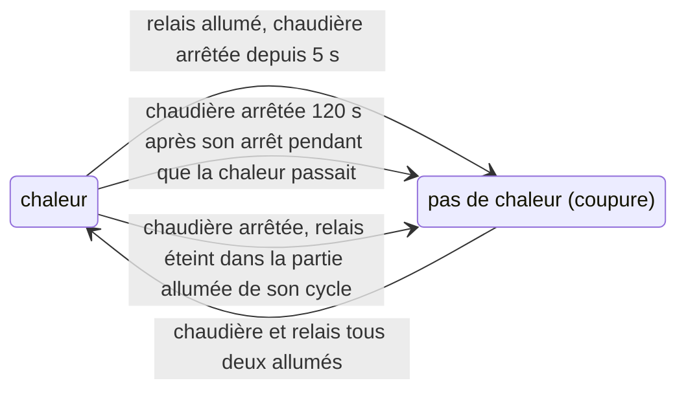

# Smart-PI: Documentation Technique et Scientifique

## 1. Introduction

**Smart-PI** est un régulateur proportionnel-intégral discret auto-adaptatif, disponible sous forme d'intégration autonome pour *Versatile Thermostat*. Il vise à remplacer un TPI à coefficients fixes par une boucle qui apprend en ligne le comportement thermique réel de la pièce.

Le code actuel repose sur trois idées directrices :

1. identifier un modèle thermique simple du premier ordre avec temps mort,
2. adapter la commande PI à partir de ce modèle,
3. accepter ou rejeter chaque fenêtre d'apprentissage selon le régime physique
   qui l'a produite.

Ce document décrit le comportement réellement implémenté dans le code SmartPI actuel.

---

## 2. Modèle thermique et loi de commande

### 2.1 Modèle thermique utilisé

Le modèle thermique appris est :

$$ \frac{dT_{int}}{dt} = a \cdot u(t) - b \cdot (T_{int}(t) - T_{ext}(t)) $$

Avec :

- $T_{int}$ : température intérieure,
- $T_{ext}$ : température extérieure,
- $u(t) \in [0,1]$ : commande normalisée de l'actionneur actif,
- $a$ : gain thermique signé de l'actionneur, positif en HEAT et négatif en COOL,
- $b > 0$ : coefficient d'échange passif avec l'extérieur.

Un VTherm SmartPI est mono-mode : il apprend soit un modèle HEAT, soit un
modèle COOL. L'équation reste identique dans les deux cas ; le signe de $a$
porte le sens de l'action active.

La constante de temps associée est :

$$ \tau = \frac{1}{b} $$

Le modèle est volontairement simple. Le temps mort est appris séparément et injecté dans les heuristiques de réglage et dans les protections.
Pour les procédés physiques d'ordre supérieur, le `a` appris est donc un gain 1R1C
effectif et local au régime d'exploitation représenté par les fenêtres acceptées,
et non une constante physique unique de toute l'installation. Il doit être validé
sur des conditions d'exploitation représentatives, et non réglé à partir d'un seul
historique.

### 2.2 Chaîne de commande

La commande courante suit la structure :

$$ u = u_{FF} + u_{PI} $$

avec :

- `u_ff1` : feed-forward structurel dérivé de $b/a$,
- `u_ff2` : biais lent `FFTrim`,
- `u_ff3` : correction prédictive bornée de court horizon, activée par défaut et nulle hors contexte éligible,
- `u_pi` : terme PI discret.

La sortie réellement injectée dans le calcul est `u_ff_eff + u_pi`, puis elle passe par :

- limitation de vitesse,
- anti-windup,
- contraintes de cycle et protections.

---

## 3. Identification en ligne

### 3.1 Ordre de bootstrap

En phase `HYSTERESIS`, l'apprentissage suit un ordre strict :

1. le temps mort de la réponse active doit être fiable avant toute collecte
   utile pour `a` (`heat` en HEAT, `cool` en COOL),
2. le temps mort de la réponse passive doit être fiable avant toute collecte
   utile pour `b` (`cool` en HEAT, `heat` en COOL),
3. `b` doit progresser avant `a` via un soft gate.

Règles effectivement codées :

- `AB_MIN_SAMPLES_B = 5`,
- `AB_MIN_SAMPLES_A = 5`,
- `AB_A_SOFT_GATE_MIN_B = 5`.

SmartPI quitte `HYSTERESIS` lorsque `b` dispose de 5 mesures et que `a` est publié.
`a` est publié à 5 mesures, ou dès `AB_MIN_SAMPLES_A_CONSISTENT = 4` mesures lorsqu'elles
concordent : leur écart absolu médian est au plus `AB_A_CONSISTENT_MAX_REL_MAD = 0.10`
de leur médiane. La première publication de `a` attend aussi le modèle de puissance
délivrée (3.7) : tant que le retard de réponse n'est pas résolu, les mesures sont
collectées sans publication, jusqu'à ce que la collecte atteigne `AB_HISTORY_SIZE = 31`
mesures : la mesure admise suivante publie alors `a`. Les deux buffers continuent ensuite à se remplir jusqu'à
`AB_HISTORY_SIZE = 31` pendant la régulation SmartPI normale. Après un redémarrage,
l'état restauré du retard de réponse fixe la phase dès le premier calcul ; un état
sauvegardé sans bloc de retard de réponse attend la première mise à jour de l'apprentissage.

Dans la bande d'hystérésis, la sortie conserve son état tout-ou-rien précédent. Une
sortie modulée laissée par une autre phase n'est pas un état d'hystérésis : elle est
ramenée à 0 jusqu'au prochain seuil. L'état tout-ou-rien est persisté avec l'heure
murale du dernier calcul. Au redémarrage, le premier calcul disposant de la température intérieure et de la consigne le reprend dans la bande
lorsque l'arrêt a duré au plus `RESPONSE_LAG_RESTART_MAX_GAP_S = 600 s` (3.7) et que
le mode HVAC est inchangé, comme l'aurait fait une hystérésis jamais interrompue.
Hors de la bande, les seuils décident. Sinon, et pour un état sauvegardé sans cet
état, la sortie repart à 0. Une phase de chauffe en cours peut ainsi reprendre après
un redémarrage court.

La convergence de `b` utilisée pour l'apprentissage `a` avec détection de dérive repose sur `b_converged_for_a()` :

1. `learn_ok_count_b >= 11`,
2. `len(_b_hat_hist) >= 5`,
3. `MAD(b_hat)/Med(b_hat) <= 0.30`,
4. `range(last_5_b_hat)/Med(b_hat) <= 0.10`.

### 3.2 Fenêtre d'apprentissage réelle

Le code n'utilise plus de constante `WINDOW_MIN_MINUTES`. L'apprentissage repose aujourd'hui sur `LearningWindowManager` et sur une fenêtre glissante qui :

- exige une température extérieure disponible,
- respecte la gouvernance thermique sauf en calibration,
- rejette ou réinitialise une fenêtre ON/`a` sur l'observation exacte du changement
  de consigne utilisateur, afin qu'une fenêtre ne puisse pas couvrir les deux
  régimes,
- conserve l'éligibilité de la montée active initiale suivant cette observation
  pour `a`, sous les garde-fous existants de temps mort, stabilité de puissance,
  pente robuste, FF3 et gouvernance,
- conserve l'apprentissage passif OFF/`b` sous ses garde-fous physiques existants ;
  la calibration conserve son contrat dédié et les réponses dues uniquement à une
  perturbation ne sont pas bloquées par ce gate de consigne,
- bloque la collecte en bootstrap tant que les temps morts requis ne sont pas fiables,
- applique une pause après reprise (`LEARNING_PAUSE_RESUME_MIN = 20`),
- ancre le début de fenêtre après la fin du temps mort quand c'est nécessaire,
- retarde le début de fenêtre jusqu'à l'extinction de la réponse transitoire (`skip: response transient (a|b)`) : une fois le retard de réponse publié (3.7), une fenêtre `a` débute au moins `min(3 retard, moitié de l'épisode actif médian)` après l'échelon de puissance ; une fenêtre `b` débute après la coupure de puissance au moins du plus long de `3 retard` (retard publié) et de `AB_SETTLE_K_PASSIVE_DEADTIME = 1.5` temps morts passifs fiables : l'émetteur continue de chauffer après une coupure, et comme la pièce ne commence à se refroidir que lorsque cette chaleur résiduelle passe sous les pertes, le temps mort passif borne sa décroissance même lorsque le retard est inconnu. Pendant le bootstrap et la calibration, seul le terme `3 retard` s'applique,
- ne soumet pas une fenêtre active plus courte qu'un cycle PWM (`active_window_shorter_than_cycle`) : sa durée est fixée avant ses données, car arrêter dès qu'une fenêtre courte paraît significative favorise les pentes les plus fortes parmi les données bruitées. Pendant le bootstrap, le chauffage fonctionne à pleine puissance entre les seuils d'hystérésis et une phase de chauffe peut être plus courte qu'un cycle : le minimum est alors plafonné à la moitié de la phase de chauffe médiane (`AB_SETTLE_ACTIVE_CAP_FRAC`), mesurée sur les phases précédentes,
- clôt la fenêtre à sa dernière observation lorsque deux mises à jour ne sont pas contiguës (intervalle plafonné à un cycle) : la fenêtre est soumise sur les données jusqu'à cet instant lorsque sa pente y est robuste, sinon abandonnée (`skip: observation gap`) ; elle ne couvre jamais la période non observée,
- surveille la stabilité de puissance via le coefficient de variation (`U_CV_MAX`),
  évalué dès que la puissance moyenne de la fenêtre atteint `U_CV_MIN_MEAN = 0.05`
  (en dessous, une puissance qui revient dans une fenêtre OFF n'est pas détectée par ce contrôle),
- prolonge la fenêtre tant que la pente n'est pas jugée robuste,
- abandonne la pente après `DT_MAX_MIN = 240` minutes si aucun signal robuste n'émerge.

En pratique, la décision de soumettre ou d'étendre la fenêtre dépend de la robustesse de la pente, pas d'une durée minimale fixe. Une fenêtre fermée sans pente robuste n'est pas perdue : son bilan intégral alimente les pools décrits en 3.5.

### 3.3 Estimation robuste de pente

`ABEstimator.robust_dTdt_per_min()` applique des garde-fous sur la pente :

- amplitude minimale : `DT_DERIVATIVE_MIN_ABS = 0.05°C`,
- nombre minimal de changements de niveau : `OLS_MIN_JUMPS = 3`,
- significativité statistique : `OLS_T_MIN = 2.5`,
- étendue minimale : une fois la pente significative, la variation ajustée sur la
  fenêtre (`|pente| × durée`) doit couvrir au moins `OLS_MIN_SPAN_STEPS = 1.5` pas
  de capteur ; le pas est le plus petit changement observé dans la fenêtre, avec un
  plancher `OLS_SPAN_MIN_STEP_C = 0.05°C` qui sert de marge de bruit pour les
  capteurs à résolution fine. Sinon la fenêtre est prolongée
  (`span_below_resolution`).

La pente étant testée à chaque mise à jour, une fenêtre trop courte au regard de la
quantification serait soumise dès que sa pente paraît significative : avec un
capteur de 0,1 °C qui bascule entre deux niveaux et une pièce qui refroidit
lentement, l'échantillonnage déclenché par les publications domine alors
l'ajustement et `b` peut être faux de ±50 %. Sur une fenêtre couvrant plusieurs pas,
la pente est sans biais quel que soit le profil du capteur.

Les pentes sont calculées sur la température intérieure brute mesurée, et non sur les signaux filtrés, car le garde-fou de robustesse compte les sauts de valeur distincts de la mesure. L'historique brut (et l'historique filtré utilisé par la détection du temps mort) garde les échantillons des `TIN_HISTORY_RETENTION_MIN = 300` dernières minutes (`DT_MAX_MIN` + 60), dans la limite de `TIN_HISTORY_MAX_SAMPLES = 1800` échantillons. Un échantillon est ajouté à chaque changement de valeur ou après 60 s : toute la durée est couverte tant que les échantillons arrivent en moyenne au plus toutes les 10 s ; au-delà, le plafond d'échantillons raccourcit la durée couverte (environ 150 minutes avec un échantillon différent toutes les 5 s) et la pente d'une longue fenêtre n'utilise que ses échantillons les plus récents. Les pentes validées alimentent ensuite `ABEstimator.learn()` qui :

- rejette les outliers physiques (`max_abs_dT_per_min = 0.35`),
- apprend `b` si `u < U_OFF_MAX`,
- apprend `a` si `u > U_ON_MIN`,
- exige `a > 0` en HEAT et `a < 0` en COOL,
- publie les valeurs avec une agrégation robuste (median ou weighted median selon la configuration).

### 3.4 Estimation de `a` et `b`

Le calcul suivi par `learn()` est :

- phase OFF :

$$ b = -\frac{dT/dt}{T_{int} - T_{ext}} $$

- phase ON :

$$ a = \frac{dT/dt + b \cdot (T_{int} - T_{ext})}{u} $$

Les historiques sont filtrés par median/MAD. La magnitude publiée de `a` est
bornée tout en conservant le signe du mode ; `b` reste strictement positif.

Pour une fenêtre active, `u` est la puissance délivrée moyenne de la fenêtre (3.7), et non la commande appliquée.

Chaque mesure de `a` conserve son observation (`dT/dt`, `T_int - T_ext`, `u`). À
chaque publication d'une nouvelle valeur de `b`, toutes les mesures conservées sont
recalculées avec ce `b`, puis `a` est agrégé à nouveau s'il a déjà été publié : une
mesure de `a` faite avant que `b` soit précis suit donc ses corrections. Une mesure
restaurée sans observation, ou dont le recalcul contredirait le signe du mode,
garde sa valeur.

### 3.5 Bilan intégral des fenêtres sans pente robuste

Avec un capteur grossier (pas de 0,2 °C) ou publiant rarement, une phase de
chauffe ou de refroidissement contient rarement les trois sauts de valeur
exigés par la pente OLS. Le modèle intégré entre deux instants donne pourtant
l'information sans pente significative :

$$ T(t_2) - T(t_1) = a \cdot U - b \cdot D, \quad U = \int u\,dt, \quad D = \int (T_{int} - T_{ext})\,dt $$

`ABWindowBalance` (`ab_window_balance.py`) suit chaque fenêtre acceptée :

- il enregistre à chaque pas de la température brute les intégrales cumulées
  de `u`, de `T_int - T_ext` et de `T_ext` ;
- à la fermeture d'une fenêtre par une garde, un timeout ou l'absence de pente
  robuste, il retient le segment entre le premier et le dernier pas : `b` si la
  puissance moyenne est inférieure à `U_OFF_MAX`, `a` si elle dépasse `U_ON_MIN` ;
- une fenêtre soumise par la pente OLS n'est jamais réutilisée, et une
  réinitialisation externe (reprise, apprentissage désactivé) l'écarte ;
- un timeout de pente ne ferme pas le segment, qui se poursuit dans la
  fenêtre suivante jusqu'à une garde.

Un segment n'est retenu que si :

- tous les pas de la fenêtre vont dans le sens de la réponse (sinon le
  capteur est bruité à l'échelle du pas et la fenêtre reste du ressort de l'OLS),
- il dure au moins `AB_BALANCE_MIN_SEGMENT_MIN = 15` minutes,
- la puissance n'a pas changé pendant la collecte : celle-ci s'arrête au
  premier tick qui s'écarte de la puissance moyenne, afin que l'inertie de
  l'émetteur après une coupure ne soit pas attribuée à la puissance précédente,
- pour `b`, les gardes de gradient intérieur/extérieur et de marge extérieure
  de la fenêtre passive sont respectées.

Les deux extrémités sont des pas dans le même sens. Un capteur qui publie au
changement franchit alors le même seuil de quantification, et la variation
mesurée est exacte ; un capteur échantillonné périodiquement fournit des valeurs
à un demi-pas près. Le modèle d'incertitude retient un demi-pas par extrémité :

$$ \sigma_{rel} = \frac{q \sqrt{n / 6}}{|N|} $$

avec `q` le plus petit pas observé (borné à `AB_BALANCE_MIN_RESOLUTION_C = 0.05`,
`AB_BALANCE_DEFAULT_RESOLUTION_C = 0.1` tant qu'aucun pas n'a été vu), `n` le
nombre de segments et `N` le numérateur (`ΔT + b·D` pour `a`, `ΔT` pour `b`).

Les segments sont cumulés par paramètre (au plus `AB_BALANCE_POOL_MAX_SEGMENTS = 12`,
âgés d'au plus 24 h, vidés au changement de mode HVAC). Dès que
`σ_rel <= AB_BALANCE_MAX_REL_UNC = 0.25`, le pool est soumis à `ABEstimator.learn()`
comme une mesure unique, avec la pente, la puissance et l'écart
intérieur/extérieur équivalents (moyennes sur la durée cumulée) ; l'agrégation
médiane/MAD, la détection de dérive et le soft gate s'appliquent sans changement.
Le pool `a` attend que `b` dispose de `AB_A_SOFT_GATE_MIN_B` mesures. Le seuil
est plus strict que celui de la pente OLS (`t >= 2.5` accepte une erreur
relative jusqu'à 0,40).

### 3.6 Estimation du temps mort

`DeadTimeEstimator` implémente une FSM indépendante. Les canaux décrivent la
réponse physique de la pièce, pas le sens de la transition de puissance :

- `deadtime_heat` : délai avant une montée de température,
- `deadtime_cool` : délai avant une baisse de température.

Ainsi, OFF -> ON apprend `heat` en mode HEAT mais `cool` en mode COOL.
La transition ON -> OFF apprend la réponse passive opposée.

La puissance que voit l'estimateur est la commande engagée de SmartPI. Pour un
thermostat que compte la chaudière centrale de Versatile Thermostat, c'est la
chaleur que la chaudière donne réellement : la commande tant que la chaudière
est allumée, et aucune puissance tant qu'elle est arrêtée (3.8). L'arrêt de la
chaudière est alors une coupure de puissance, et son démarrage un démarrage de
puissance, y compris pour une pièce qui demandait avant le démarrage de la
chaudière.

L'estimateur reçoit un démarrage ou un arrêt au moment où Versatile Thermostat
applique la commande, et non au calcul suivant de SmartPI. Versatile Thermostat
applique une commande après le calcul qui l'a produite : la position d'une
vanne aussitôt, la commande d'un relais au début de son cycle suivant (aussitôt
quand le cycle est forcé ou inactif), et confirme chaque application par un
reçu. SmartPI engage la puissance appliquée à ce reçu et, quand elle franchit le
seuil de l'estimateur (0,01) dans un sens ou dans l'autre, la donne alors à
l'estimateur (`SmartPI._feed_dead_time_at_commit`), avec la dernière mesure brute
reçue par SmartPI : l'historique brut ne contient que les mesures du capteur,
comme l'attendent les fenêtres d'apprentissage (3.3), un même traitement pour
toute la série, comme les recommandations le demandent pour tous les signaux
d'un modèle (référence 11, §3.2, p. 12). Dans la première phase, l'estimateur
est alimenté au calcul, et sans reçus (un Versatile Thermostat plus ancien) au
début d'un cycle et à un changement de la puissance appliquée. Un temps mort compte depuis
le début de l'échelon du signal de commande (référence 5, §2.4, p. 16). Donnés
au calcul suivant, le démarrage et l'arrêt propres d'une pièce arrivaient à
l'estimateur jusqu'à une période de calcul (60 s) en retard, et ses deux temps
morts sortaient plus courts d'autant. Une calibration donne à l'estimateur sa
propre commande : un reçu pendant une calibration ne donne rien.

La détection suit la température intérieure filtrée, y compris pendant une calibration forcée : une mesure brute qui oscille d'un pas de capteur détecterait sinon une réponse dès l'échelon de puissance. Une détection en cours n'est pas reprise après un redémarrage, et la durée minimale OFF doit être observée dans la session en cours avant qu'une détection puisse être armée.

La température filtrée suit encore un moment un basculement d'un pas du capteur : elle monte avec le basculement et redescend après. Pendant l'attente d'une réponse, un pas de la mesure brute ne compte donc qu'une fois confirmé : tenu pendant `DEADTIME_RAW_CONFIRM_S = 120 s` (deux calculs périodiques de SmartPI), suivi d'un second pas dans le même sens, ou prolongeant un mouvement confirmé moins de 120 s plus tôt (une pièce qui bouge de plus d'un pas toutes les deux minutes). Jusque-là, le suivi suit la température filtrée bloquée à sa valeur d'avant le pas, et après un basculement, jusqu'à ce que la température filtrée y soit revenue. Un pas non confirmé ne déplace ni le creux (chauffe) ni le pic (refroidissement) et ne donne aucune détection ; un pas qui revient est le bruit du capteur, pas la réponse de la pièce. L'estimateur garde le niveau qu'a suivi son suivi (`tin_track_history`) : une réponse armée à un moment antérieur, comme un arrêt daté de celui de la chaudière (3.8.2), y prend son creux ou son pic, et non dans l'historique propre du filtre. Une attente armée pendant qu'un pas n'est pas confirmé part de la température d'avant le pas ; si le pas est ensuite confirmé, la pièce a bougé avant la transition de puissance, et le creux ou le pic est repris de la température filtrée depuis la transition, comme sans la confirmation (`_rebase_after_confirmed_step`). Une réponse indicielle doit être « easily visible above the noise level » (référence 5, §6.4, p. 237). Un régulateur adaptatif du commerce, le Foxboro EXACT, ne commence son adaptation que lorsque l'erreur dépasse deux fois sa bande de bruit, l'amplitude crête à crête de la mesure (référence 5, §6.6, p. 245–246 ; référence 4, §4, p. 1174). Un capteur arrondi à un pas qui bascule a une bande de bruit d'un pas : un pas peut être un basculement, deux pas sont un vrai mouvement, comme pour la tendance avant un démarrage, décrite ci-dessous. Un relais à hystérésis fonctionne de la même façon : le bruit ne le fait basculer que s'il dépasse la largeur de l'hystérésis (référence 5, §2.6, p. 39). L'instant de la réponse est toujours pris dans l'historique (la rétrospection de `0.01 °C`) : confirmer un pas retarde la détection, pas sa datation. Un détecteur plus rapide se trompe plus souvent (référence 8, §7.2, p. 573) : sans la confirmation, un basculement de la mesure brute contre la réponse pouvait raccourcir un temps mort de plusieurs fois. Attendre qu'un changement se maintienne avant d'agir est la temporisation d'une alarme (référence 12, §3.3, p. 30 ; p. 97) ; la valeur de 120 s, deux périodes de calcul, est choisie par ce raisonnement et vérifiée dans un test synthétique, et non tirée d'une publication. Limite : une réponse dont le premier pas est suivi d'une transition de puissance avant que le pas soit confirmé n'est pas mesurée (issue `aborted`) ; la transition suivante mesure de nouveau.

Il en va de même après une réinitialisation de l'estimateur : une réinitialisation de l'apprentissage (`reset_smartpi_learning`) et la réinitialisation lors d'un passage entre chauffage et refroidissement font partir la durée minimale OFF (`min_off_time_seconds = 600 s`) de la réinitialisation. Le passé de la pièce est alors inconnu : une pièce qui se réchauffe encore après sa dernière chauffe monte juste après un démarrage, et l'estimateur prendrait cette montée pour la réponse et donnerait un temps mort d'environ 0 s. Une réponse indicielle se mesure sur un procédé au repos : « il est nécessaire que le procédé soit en équilibre au début de l'essai » (référence 5, §6.4, p. 237). Un nouveau thermostat sans état sauvegardé n'a pas non plus de dernier arrêt : son premier démarrage n'est pas retardé par la durée minimale OFF.

Limite : une pièce sans chauffe depuis 600 à 900 s qui se réchauffe encore après sa dernière chauffe peut encore donner un temps mort plus court que le vrai. La durée minimale OFF est écoulée, et la tendance avant le démarrage demande `DEADTIME_PRESTART_MIN_SPAN_S = 900 s` d'historique.

Une réponse est détectée dès que la température s'est écartée de `0.05 °C` de son creux (chauffe) ou de son pic (refroidissement) depuis la transition de puissance. Le temps mort court de la transition au dernier instant à moins de `0.01 °C` de ce creux ou de ce pic, suivi pendant l'attente : il ne dépend donc pas de la rétention de l'historique de température. L'attente abandonne après `DEADTIME_ACTIVE_TIMEOUT_S = 14400 s` pour une réponse active (puissance démarrée) et `DEADTIME_PASSIVE_TIMEOUT_S = 43200 s` pour une réponse passive (puissance coupée) : après une coupure, un émetteur qui stocke beaucoup de chaleur (plancher chauffant) continue de réchauffer la pièce, puis plafonne, et la baisse peut arriver plusieurs heures plus tard. Pendant le bootstrap, l'attente passive se termine par une détection ou par une reprise de chauffe, qui exige une baisse que la détection voit d'abord ; la limite ne fait que borner le délai au-delà duquel une baisse n'est plus attribuée à la coupure. Une transition de puissance abandonne une attente en cours, y compris un démarrage qui n'est pas mesuré (trop peu de temps sans chauffe, ou trop peu de puissance). L'issue de la dernière attente de chaque réponse et l'âge de l'attente en cours sont publiés (`analysis.deadtime`).

La réponse à un démarrage de puissance est l'écart de la température par rapport à l'évolution qu'elle suivait avant le démarrage. Sans chauffe, la température d'une pièce reste stable ou baisse : le suivi du creux ci-dessus date alors la réponse. Une pièce qui se réchauffe déjà avec le chauffage éteint (occupants, soleil, pièce voisine) s'éloigne par elle-même du niveau de démarrage, et le suivi du creux daterait la réponse trop tôt (en COOL, il en va de même pour une pièce qui se refroidit déjà avant le début du refroidissement). Ainsi, à un démarrage actif (puissance activée), `deadtime_trend.prestart_trend()` ajuste une droite sur la température brute de la période OFF précédant le démarrage :

- fenêtre : les `DEADTIME_PRESTART_WINDOW_S = 1800 s` précédant le démarrage, commençant au plus tôt à la dernière coupure de puissance augmentée du temps mort passif (l'émetteur agit encore sur la pièce avant ce délai) ;
- avec moins de `DEADTIME_PRESTART_MIN_SPAN_S = 900 s` ou moins de `DEADTIME_PRESTART_MIN_SAMPLES = 4` échantillons, aucune tendance n'est retirée ;
- une tendance dont la variation ajustée reste dans un pas de capteur (la plus petite variation observée dans la fenêtre, au moins `DEADTIME_PRESTART_STEP_FLOOR_C = 0.01 °C`), ou qui va à l'encontre de la réponse, n'est pas non plus retirée : la détection est le suivi du creux (ou du pic) ci-dessus, inchangé. C'est le cas habituel pendant le bootstrap, où la chauffe reprend parce que la pièce s'est refroidie ;
- une tendance dans le sens de la réponse est ajustée sur toute la fenêtre et sur sa moitié récente (au moins `DEADTIME_PRESTART_MIN_HALF_SAMPLES = 3` échantillons par moitié). La détection est rejetée si la tendance n'est pas une droite : un résidu rms supérieur à la moitié du seuil de détection (et supérieur à un pas de capteur), ou une pente qui, de la première moitié à la seconde, croît dans le sens de la réponse de plus du seuil de détection par demi-fenêtre. Une droite sous-estimerait alors la tendance au démarrage ;
- sinon, le détecteur suit la température moins la tendance extrapolée, avec la pente la plus forte des deux ajustements : en retirer trop ne fait que retarder la détection. Le creux, le seuil de `0.05 °C` et la rétrospection de `0.01 °C` s'appliquent à cette différence ;
- au moment de la détection, la mesure est rejetée si la tendance seule couvre au moins le seuil de détection depuis le démarrage : la réponse n'est alors pas séparable de la tendance.

Une mesure rejetée publie l'issue `rejected` et laisse les détections inchangées : le temps mort conserve sa valeur précédente. Une réponse passive (coupure de puissance) n'est pas concernée : la tendance précédant une coupure est celle de la chauffe elle-même.

Une mesure qui ferait baisser le temps mort publié est aussi ignorée (issue `ignored`, le temps mort garde sa valeur) lorsque la preuve est faible : la tendance avant le démarrage va nettement dans le sens de la réponse (variation ajustée d'au moins `DEADTIME_PRESTART_RISE_MIN_STEPS = 2` pas du capteur sur la fenêtre, même si elle a été retirée plutôt que rejetée), ou la fenêtre est trop courte pour évaluer une tendance. Une pièce qui se réchauffe avant le démarrage ne peut que faire paraître la réponse plus précoce : elle ne raccourcit donc jamais le temps mort. Une mesure égale ou plus longue que la valeur publiée suit les règles ci-dessus, de même que toute mesure avant la première valeur publiée.

Une réponse passive n'est mesurée qu'après une période active établie. Une réponse indicielle se mesure sur un procédé au repos (référence 5, §6.4, p. 237). Une pièce chauffée à puissance constante est proche d'un procédé à action intégrale, qui n'atteint pas d'état établi, sa sortie variant à vitesse constante (p. 21) ; une chauffe qui se termine est une impulsion, et un essai en impulsion admet un procédé avec intégrateur (p. 237). SmartPI part donc d'une montée régulière établie : c'est son propre choix, pas celui du livre. Une réponse indicielle s'établit après environ son temps de séjour moyen $T_{ar} = L + T$ (p. 14, 16 ; environ 3,3 $T_{ar}$ dans l'exemple du livre, p. 38). La période active qui se termine à la coupure doit avoir duré :

- le temps mort actif fiable, tant qu'aucun retard de réponse n'est publié (3.7) ;
- avec un retard publié, le plus long du temps mort actif et du temps d'établissement d'une fenêtre d'apprentissage active (`ResponseLagEstimator.active_settle_s` : trois retards, au plus la moitié de l'épisode actif médian, 3.2). SmartPI attend déjà ce seuil, et jamais moins que le temps mort, avant d'apprendre `a` sur une réponse active. Trois retards placent la réponse à moins de 5 % de sa valeur établie, comme le temps de réponse à 95 % utilisé pour les systèmes de chauffage (référence 7, p. 5).

Sans temps mort actif fiable, aucune réponse passive n'est mesurée. Une période plus courte enregistre la coupure (la durée minimale OFF compte à partir d'elle), termine une détection encore en attente (issue `aborted`) et n'arme rien. La période commence au dernier démarrage de puissance vu par l'estimateur ; pour un thermostat que compte la chaudière centrale, au démarrage de la chaudière (3.8). SmartPI transmet le temps d'établissement à l'estimateur à chaque calcul. En COOL les rôles s'inversent : la montée après une période de refroidissement est mesurée une fois le refroidissement établi.

Limites :

- avec des épisodes actifs courts, la limite à la moitié de la médiane abaisse la bande sous 95 %, comme pour les fenêtres d'apprentissage ;
- là où aucun retard de réponse n'est publié, le temps mort actif seul reste le seuil ;
- la première phase n'apprend `b` qu'une fois le temps mort passif fiable (3.1, 3.2) : une pièce dont les périodes de chauffe s'arrêtent avant le seuil, par exemple à cause du soleil ou de la chaleur stockée d'un plancher chauffant, peut rester plus longtemps dans sa première phase. Une calibration (4.6) est aussi concernée : son refroidissement ne mesure une réponse passive qu'après une montée en température plus longue que le seuil.

La fiabilité devient vraie dès qu'au moins une mesure valide a été capturée sur le canal correspondant. Chaque canal garde ses 6 dernières détections ; la valeur publiée est leur médiane, de sorte qu'une détection aberrante isolée ne la déplace pas (avec une ou deux détections, la médiane vaut leur moyenne). Au redémarrage, la valeur publiée est recalculée à partir des détections restaurées.

### 3.7 Retard de réponse et puissance délivrée

À l'échelle d'une fenêtre d'apprentissage, la pièce se comporte comme un intégrateur derrière des retards rapides (actionneur, émetteur, brassage de l'air, boîtier de la sonde) et un retard pur (réponse intégratrice du premier ordre avec temps mort). Après un échelon de puissance, la pente se stabilise progressivement et son asymptote de rampe croise la trajectoire passive extrapolée à $t = T_{ar} = L + \sum \tau_i$, le temps de séjour moyen de la réponse (Åström et Hägglund). Une fenêtre qui débute $k \cdot T_{ar}$ après l'échelon présente un déficit de pente d'au plus $e^{-k}$ pour un retard unique, quelle que soit la part du retard pur. Une fenêtre comprise dans le régime transitoire sous-estime `a`, d'autant plus que les retards sont longs ou que la sonde rapporte en retard.

`ResponseLagEstimator` (`response_lag.py`) mesure $T_{ar}$ sur les épisodes actifs à puissance constante (écart d'au plus `RESPONSE_LAG_U_TOL = 0.05`) :

- l'épisode doit suivre une période passive d'au moins `max(RESPONSE_LAG_MIN_OFF_S = 1800 s, RESPONSE_LAG_MIN_OFF_LAGS = 5 × retard connu)`, afin que la puissance de l'épisode précédent soit retombée ;
- la référence passive est la pente OLS robuste de la fin de cette période OFF (sur `RESPONSE_LAG_PASSIVE_SPAN_S = 3600 s` au plus), à défaut le `b` publié ;
- la droite tardive est ajustée sur les franchissements de niveau de l'historique brut (au moins `RESPONSE_LAG_MIN_CROSSINGS = 3`). Pour un saut d'un pas de capteur, le franchissement est daté au milieu des deux échantillons ; un saut de plusieurs pas conserve la valeur brute. Cela supprime les biais en escalier et de seuil de déclenchement des capteurs qui rapportent sur changement ;
- l'ordonnée à l'origine d'une droite OLS ajustée sur un segment transitoire tombe avant $T_{ar}$ : l'estimateur inverse la forme close de l'ordonnée à l'origine d'une réponse à retard unique sur l'intervalle ajusté (monotone en le retard). Un épisode n'est pas utilisé lorsque l'inversion est trop plate (`RESPONSE_LAG_MIN_INVERSION_SLOPE = 0.05`) ou lorsque l'ordonnée à l'origine atteint `RESPONSE_LAG_RESOLVABLE_FRAC = 0.9` de sa limite pour un retard infini. Une estimation au-delà de `RESPONSE_LAG_MAX_S` (`DT_MAX_MIN` × 60 = 14 400 s) est également écartée (`intercept not resolvable`) ;
- chaque estimation porte son écart-type, propagé à partir des résidus de l'ajustement et d'une incertitude relative supposée de `b` égale à `RESPONSE_LAG_B_REL_UNC = 0.10`.

Les `RESPONSE_LAG_HISTORY = 7` dernières estimations sont conservées. Le retard est publié lorsqu'au moins `RESPONSE_LAG_MIN_ESTIMATES = 3` estimations donnent un écart-type combiné de leur médiane pondérée par l'inverse des variances au plus égal à `RESPONSE_LAG_MAX_REL_UNC = 0.15` de cette médiane (plancher `RESPONSE_LAG_UNC_FLOOR_S = 30 s`) ; les estimations situées à plus de trois écarts-types de la médiane ne sont pas combinées. Un ensemble incohérent conserve la valeur publiée, afin que des estimations dispersées n'activent et ne désactivent pas le modèle de puissance délivrée. Une discontinuité de plus de 1 s entre deux mises à jour termine l'épisode au dernier instant observé, et la coupure de puissance est datée à la reprise.

Un redémarrage reprend la période passive ou l'épisode actif en cours lors de la sauvegarde. Le contexte est persisté en temps mural (dernier instant observé, puis début de la période passive, ou début, puissance, constance, durée passive préalable et température extérieure de l'épisode) et reconverti en horloge monotone au chargement. Il s'applique à la première observation qui suit, lorsque l'arrêt a duré au plus `RESPONSE_LAG_RESTART_MAX_GAP_S = 600 s` et que le mode HVAC est inchangé. Pendant un arrêt court, l'actionneur conserve son dernier état ; au-delà (hôte arrêté, coupure de courant, mise à jour), la puissance n'est pas connue. Une période passive reprend, et l'arrêt compte comme passif. Un épisode reprend lorsque la première puissance appliquée après le redémarrage est égale à la sienne à `RESPONSE_LAG_U_TOL` près. Sinon, il se termine sans estimation (`episode interrupted by restart`), et une puissance non nulle ouvre un nouvel épisode sans période passive connue. Les franchissements viennent de l'historique brut du détecteur de temps mort, persisté de la même façon ; il ne contient aucun échantillon pendant l'arrêt. Un état sauvegardé sans ce contexte ne reprend rien.

L'inversion suppose une réponse à retard unique (premier ordre). Elle ne restitue le temps de séjour moyen que pour un tel émetteur, ou lorsque l'épisode dure plusieurs fois le retard. Sur un émetteur qui combine un retard pur et une inertie, ou deux inerties successives, l'ordonnée à l'origine d'un épisode court est plus tardive que celle d'un retard unique de même temps de séjour : le retard publié est alors surestimé, d'environ 1,3 fois sur les formes simulées, ou n'est jamais publié lorsque l'épisode reste dans le régime transitoire.

L'ordonnée à l'origine fixe le retard moyen de la réponse, pas sa forme. Le modèle de puissance délivrée la répartit en un retard pur $L = \min(\text{temps mort actif}, T_{ar})$, puis en un retard du premier ordre de $T_{ar} - L$. Le temps mort est détecté après le début de la réponse ; il borne donc le retard pur par le haut : le modèle ne délivre jamais de puissance plus tôt qu'un retard pur de même ordonnée à l'origine. Sans retard publié ni temps mort fiable, la puissance délivrée est égale à la puissance appliquée. Pour une fenêtre active qui débute $t_0$ après l'échelon et dure $W$, la fraction délivrée moyenne vaut, avec $\tau = T_{ar} - L$ :

$$ \eta = \frac{1}{W}\int_{t_0}^{t_0+W} \left(1 - e^{-(t-L)/\tau}\right)\mathbb{1}_{t>L}\,dt $$

Le modèle est résolu dès que le retard est publié, ou après `RESPONSE_LAG_RESOLVE_EPISODES = 4` phases de chauffe sans publication (la puissance appliquée est alors utilisée). Une phase de chauffe regroupe les épisodes actifs séparés par des coupures de puissance inférieures à `RESPONSE_LAG_PHASE_MIN_OFF_S = 600 s` : un épisode qui commence moins de 600 s après la fin du précédent ne compte pas comme une phase supplémentaire. Jusque-là, les mesures de `a` sont collectées sans publication. Lorsque le retard publié apparaît ou varie de plus de `RESPONSE_LAG_MODEL_CHANGE_REL = 0.5` avant la première publication de `a`, les mesures collectées sont recalculées avec la nouvelle puissance délivrée. Seules les fenêtres admises par la porte de stabilisation sont recalculées ; les autres sont écartées, puisque leur correction dépend de la forme de la réponse.

L'état est publié dans `analysis.learning.response_lag` (`lag_s`, `estimates`, `episodes`, `episodes_target`, `episode_median_s`, `last_reason`) et persisté avec l'état d'apprentissage. `episodes` compte les phases de chauffe terminées depuis le début de l'apprentissage, y compris après la publication du retard ; `episodes_target` vaut `RESPONSE_LAG_RESOLVE_EPISODES`. Lorsque les deux collectes ont atteint leur seuil et que `a` attend ce modèle, `learning.bootstrap_status` vaut `step2 - waiting response lag: estimates N, heating phases K/4`.

Le retard est appris sur des épisodes à puissance constante, que fournit le bootstrap par hystérésis. En régulation PWM, le rapport cyclique change d'un cycle à l'autre : une installation déjà sortie du bootstrap en fournit donc rarement.

### 3.8 Chaudière centrale : pause d'apprentissage et chaleur que donne la chaudière

La chaudière centrale de Versatile Thermostat ne chauffe les pièces des
thermostats qu'elle compte que lorsqu'elle est allumée. Versatile Thermostat
l'allume lorsque le nombre d'équipements actifs (têtes de vanne ou
interrupteurs), ou leur puissance totale, atteint un seuil, après un délai
d'activation facultatif, et l'éteint dès qu'on repasse sous ce seuil. Tant
qu'un thermostat compté demande de la chaleur alors que la chaudière est
arrêtée, la pièce ne reçoit pas de chaleur et refroidit bien que la commande
dise qu'elle chauffe. Apprendre pendant ce temps compterait l'attente de la
chaudière comme le temps mort de la pièce (3.6). SmartPI calcule son gain à
partir du temps mort, $K_p = 1/(|a|(\lambda + L))$ (4.1) : un temps mort quatre
fois trop long donne un gain environ quatre fois plus petit et une régulation
bien plus lente. Cela compte surtout pendant que SmartPI apprend à partir de
ses valeurs par défaut (3.1).

Pour un tel thermostat, SmartPI met donc son apprentissage en pause tant que la
chaudière est arrêtée (3.8.1), et son estimateur du temps mort voit la chaleur
que la chaudière donne réellement, et non la commande (3.8.2 à 3.8.4). La
régulation ne change pas, et le trim FF n'apprend d'aucune fenêtre où la
chaudière a retenu la chaleur (3.8.5).

#### 3.8.1 La pause d'apprentissage

L'apprentissage (les fenêtres `a`/`b` (3.2) et la mesure du retard de réponse
(3.7), y compris pendant une calibration (4.6)) se met en pause dès que toutes
ces conditions sont vraies, sans interruption, depuis une période de calcul de
SmartPI ; la détection du temps mort (3.6) continue, en suivant la chaleur que
donne la chaudière (3.8.2) :

- Versatile Thermostat compte le thermostat pour sa chaudière centrale
  (`is_used_by_central_boiler`),
- SmartPI demande de la chaleur (puissance engagée supérieure à 0),
- la chaudière centrale de Versatile Thermostat est arrêtée (son capteur
  binaire `central_boiler_state`, lu par `boiler_call.py` ; un état illisible
  ne met pas en pause), telle qu'elle chauffe la pièce : un arrêt court maintenu
  comme chaleur (3.8.2, 3.8.4) ne compte pas, et un arrêt confirmé à la fin du
  maintien compte depuis l'arrêt de la chaudière, de sorte que la pause commence
  alors aussitôt.

La période (`BOILER_PAUSE_CONFIRM_S` : 60 s, moins 1 s pour la gigue de
l'horloge) couvre le démarrage propre d'une pièce : Versatile Thermostat
n'allume la chaudière qu'une fois qu'il compte l'équipement du thermostat, après
que l'équipement a signalé son nouvel état, quelques secondes plus tard avec une
vraie tête de vanne, et une vérification pendant ce temps ne doit pas mettre en
pause. La valeur suit la période de calcul de SmartPI, pas une publication.

Le handler vérifie cela avant chaque calcul, à chaque changement d'état de la
chaudière, qu'il suit, et de celui d'un relais, aux vérifications qu'il
planifie (un démarrage tenu 5 s, la fin d'un maintien), et au moment où la
période se termine
(`SmartPIHandler._update_boiler_learning_pause()` règle
`SmartPI.set_boiler_learning_paused()`) : la pause commence alors, et non au
calcul suivant, jusqu'à une période plus tard. L'adaptation doit être
interrompue aussi vite que possible dès que la mesure ne suit plus le signal de
commande (référence 4, §5, p. 1175). L'apprentissage reprend une fois que le
démarrage de la chaudière compte pour l'estimateur du temps mort, quand la
chaudière a fonctionné 5 s (`BOILER_BLINK_S`, 3.8.3), ou au premier calcul où
SmartPI cesse de demander. Un fonctionnement plus court de la chaudière n'a
donné aucune chaleur à la pièce : la pause continue, de même que le temps compté
pour elle. Une alarme s'efface de la même façon, seulement une fois que son
signal est resté revenu pendant un temps fixé (référence 12, §3.3, p. 30). Un
changement de la pause abandonne la fenêtre `a`/`b` en cours et termine
l'observation du retard de réponse à son dernier échantillon avant le
changement, comme la pause de l'utilisateur (`set_smartpi_learning`),
sans modifier ce réglage : le prochain épisode de l'apprentissage commence au
plus tôt au changement, donc SmartPI n'apprend pas pendant le temps mort de la
pièce après le démarrage de la chaudière (3.2).

La pause ne fait que suspendre l'apprentissage ; elle n'efface pas ce que sait
la détection du temps mort (3.6). L'estimateur garde l'instant du dernier arrêt
de la chauffe et son historique de température, et il continue d'enregistrer la
température pendant la pause : la pièce ne reçoit alors pas de chaleur, c'est
donc du temps sans chauffe. Rien ne peut s'armer tant que la chaudière est
arrêtée (3.8.2) ; par précaution, le début de la pause abandonne tout de
même une détection de chauffe en attente (issue `aborted`). Une détection de la
réponse passive à l'arrêt de la chaudière reste.

#### 3.8.2 La chaleur que donne la chaudière

Pour un thermostat que compte la
chaudière, l'estimateur du temps mort ne voit pas la commande de SmartPI mais la
chaleur que la chaudière donne réellement : la commande tant que la chaudière
est allumée, et aucune puissance tant qu'elle est arrêtée
(`SmartPI.set_boiler_state()`). Le handler lit l'état de la chaudière avant
chaque calcul et transmet chaque changement à SmartPI aussitôt, depuis son
écouteur, sans attendre le calcul suivant. Un changement qui modifie la
puissance vue par l'estimateur lui est transmis à ce moment, sur la dernière
température filtrée de SmartPI et la dernière mesure du capteur, et les propres règles de l'estimateur en jugent
(3.6), comme pour tout arrêt ou démarrage. Avec un état de chaudière illisible,
ou un thermostat que la chaudière ne compte pas, l'estimateur voit la commande,
comme sans chaudière.

Cela vaut aussi pendant une calibration (4.6). La calibration alimente
l'estimateur avec sa propre commande, et sans puissance tant que la chaudière
est arrêtée ; un changement de la chaudière parvient à l'estimateur aussitôt,
avec la commande de la calibration. Une calibration qui commence chaudière
arrêtée n'arme rien, et sa chauffe compte depuis le démarrage de la chaudière,
comme tout démarrage (ci-dessous).

Un état qui devient connu, ou inconnu, n'est ni un arrêt ni un démarrage :
l'estimateur voit la puissance à sa prochaine alimentation, selon ses propres
règles. Deux cas sont traités aussitôt :

- **L'état de nouveau connu après une interruption.** On ne sait pas si la pièce
  a reçu de la chaleur pendant que l'état était illisible. Comme après un
  redémarrage de Home Assistant, une réponse qui chevauche l'interruption ne
  peut pas être attribuée : l'observation de l'estimateur repart de la
  puissance qu'il voit alors (une détection en cours est abandonnée, ainsi que
  son historique de température, que lisent aussi les fenêtres `a`/`b` et la
  tendance avant le démarrage suivant : la fenêtre de cette tendance est alors
  trop courte, ce qui compte comme un indice faible, 3.6), et sa durée minimale
  sans chauffe compte à
  partir de ce moment : une estimation qui reprend part des valeurs actuelles
  (référence 4, §8, p. 1178). Aucune réponse passive n'est mesurée avant
  qu'une nouvelle chauffe ait été comptée. C'est journalisé (« SmartPI central boiler
  state known again: dead-time observation restarted »).
- **La première lecture indique la chaudière arrêtée, alors que l'estimateur voyait une puissance**
  (il recevait la commande de SmartPI avant que l'état soit lisible). La chaleur
  s'est arrêtée à un moment inconnu : l'arrêt est enregistré, de sorte que la
  durée minimale sans chauffe compte à partir de lui, et une détection de
  chauffe en attente est abandonnée, mais aucune réponse passive n'est mesurée,
  car la pièce refroidissait peut-être déjà depuis un moment.

Les cas :

- **La chaudière s'arrête pendant que la pièce demande.** La chaleur de la pièce
  s'arrête à ce moment, bien que la commande de SmartPI ne change pas. Pour une
  pièce sur vanne, ou sur relais dont la chaleur passait, l'arrêt compte une
  fois que la chaudière est restée arrêtée pendant 120 s, et il est alors daté de
  l'arrêt de la chaudière (ci-dessous, « Le maintien d'une vanne »). Une
  détection de chauffe encore en attente est d'abord abandonnée (issue
  `aborted`) : une montée ultérieure ne répondrait pas à cette chaleur.
  L'estimateur voit alors la puissance tomber à 0. Il enregistre l'arrêt, de
  sorte que la durée minimale sans chauffe (`min_off_time_seconds`, 600 s)
  compte à partir de l'arrêt de la chaudière, et il mesure la réponse passive
  de la pièce à partir de lui si la chauffe était établie (3.6). L'arrêt est
  journalisé (« SmartPI heat stopped with the central boiler », avec
  « (heating dead-time detection aborted) » lorsqu'une détection est
  abandonnée) et publié aussitôt. La pause, qui commence aussitôt après un
  maintien et une période de calcul après tout autre arrêt (3.8.1), conserve
  cette détection passive.
- **La chaudière reste arrêtée.** L'estimateur ne voit aucune puissance, quoi
  que fasse la pièce. L'arrêt propre de la pièce ne change rien, une nouvelle
  demande non plus : rien ne s'arme, et une détection passive mesurée depuis
  l'arrêt de la chaudière va jusqu'à son terme. Une pièce qui cesse de demander
  pendant la pause n'a reçu aucune chaleur depuis l'arrêt de la chaudière : sa
  réponse passive n'est donc pas mesurée depuis son propre arrêt, car la pièce
  refroidit déjà et ce temps mort serait trop court.
- **La chaudière démarre pendant que la pièce demande.** La chaleur de la pièce
  commence au démarrage de la chaudière. Cela vaut pour une pièce qui a attendu
  la chaudière, et pour une pièce dont la propre demande allume la chaudière :
  son démarrage compte depuis le démarrage de la chaudière, et non depuis sa
  demande, y compris lorsque la chaudière démarre quelques secondes après la
  demande (une fois que l'équipement de la pièce l'a signalé) ou après un délai
  d'activation. L'estimateur en juge comme de tout démarrage :
  - il ne s'arme que si la chauffe est restée arrêtée au moins la durée
    minimale depuis son dernier arrêt, et l'attente de la chaudière compte dans
    cette durée. Une pièce qui redemande peu après sa dernière chauffe, puis
    attend la chaudière, ne mesure rien ;
  - la tendance avant le démarrage vient de l'historique conservé pendant la
    pause ;
  - une détection passive encore en attente se termine par `aborted` : la
    chaleur est revenue.
- **La pièce demande pendant que la chaudière chauffe déjà.** Son démarrage
  compte au moment où Versatile Thermostat applique la commande (3.6) ; dans la
  première phase, au calcul.

**Le maintien d'une vanne.** La chaudière peut s'arrêter quelques secondes
pendant qu'une pièce sur vanne demande : avec un seuil d'équipements, par
exemple, dans chaque partie éteinte du relais d'une autre pièce. L'eau de
l'émetteur de la pièce continue alors de chauffer : le long d'un radiateur à
panneau, un changement de son eau apparaît après un temps mort de 1,5 à 8
minutes et s'établit en un temps d'équilibrage de 9,5 à 16,5 minutes
(référence 9, tableau 2, p. 2754, un modèle de la montée au débit nominal). Pris comme un
arrêt, chacun de ces arrêts courts abandonnerait la détection de chauffe de la
pièce et relancerait sa durée minimale sans chauffe : une pièce dont la
chaudière s'arrête à chacun de ces cycles ne mesurerait jamais son temps mort
de chauffe et resterait dans sa première phase (3.1). Donc, pendant qu'un
thermostat qui n'est pas sur relais demande et que sa chaleur passe (un démarrage
que l'estimateur du temps mort a vu, la chaudière ayant fonctionné 5 s, 3.8.3),
l'arrêt de la chaudière est maintenu comme chaleur pendant `BOILER_VALVE_HOLD_S`
(120 s, deux périodes de calcul) :

- la chaudière revenue pendant ce temps n'est ni un arrêt ni un démarrage : la
  chauffe, et une détection en cours, continuent ;
- la chaudière encore arrêtée ensuite est un arrêt daté de l'arrêt de la
  chaudière : le handler le vérifie 120 s après l'arrêt (ou au calcul suivant).
  L'estimateur enregistre l'arrêt à partir de ce moment, la durée minimale sans
  chauffe compte donc depuis lui, et une réponse passive armée par lui compte
  aussi depuis lui, si la chauffe était établie à l'arrêt de la chaudière (sinon
  elle est abandonnée sans issue), son pic étant pris dans le niveau suivi par le suivi de
  l'estimateur depuis (`DeadTimeEstimator.tin_track_history`,
  `SmartPI._heat_stopped_at`), où un pas du capteur non encore confirmé ne compte
  pas (3.6) : un temps mort compte depuis le début de l'échelon (référence 5,
  §2.4, p. 16). La pause commence aussitôt, 120 s après
  l'arrêt de la chaudière ;
- une pièce qui cesse de demander pendant ce temps a vu sa chaleur arrêtée par
  la chaudière : son arrêt est daté de l'arrêt de la chaudière de la même façon.

Une pièce sur relais reçoit le même maintien quand la chaudière s'arrête pendant
que sa chaleur passe, le relais allumé (3.8.4). Une demande chaudière arrêtée
n'est pas maintenue : elle attend la chaudière, comme tout démarrage ; ni un
fonctionnement de la chaudière de moins de 5 s, qui n'a donné aucune chaleur à
la pièce.

La durée du maintien vient de mesures de radiateurs et de planchers chauffants.
Quand la chaudière s'arrête, l'eau reste dans le radiateur, ou la pompe de la
chaudière continue de faire circuler l'eau chaude de l'installation : le
radiateur refroidit lentement. Des radiateurs à panneaux mesurés par
thermographie ne perdent 63 % de leur chaleur qu'après 18 à 22,4 minutes, alors
qu'ils montent à 63 % en 3,6 à 4,3 minutes ; les radiateurs à éléments et
tubulaires refroidissent plus lentement encore (référence 10, tableau 6, p. 77).
Mesuré par thermocouples après la fermeture de sa vanne, un radiateur à panneau a
perdu 63 % de sa chaleur après 19,8 minutes, sans retard (référence 13,
tableau 8, p. 62). Un plancher chauffant évolue sur plusieurs heures : dans une
pièce mesurée, le plancher a atteint 63 % d'un changement après 4,5 à 5 heures
(référence 7, tableau 4, p. 6). Le refroidissement d'un radiateur suit une
courbe du premier ordre, sa montée une courbe d'ordre plus élevé (référence 10,
p. 37). Avec les valeurs des radiateurs dans un modèle du premier ordre
(référence 5, §2.4, p. 16, équation 2.8), et pour la montée le retard de 50 s et
la constante de temps de 178 s mesurés sur un radiateur à panneau de 500 × 1000
mm (référence 10, p. 77), un radiateur à panneau donne encore au moins 89 % de
sa chaleur après un arrêt de 120 s. Des arrêts répétés à chaque cycle du relais
d'une autre pièce en laissent moins : au cycle par défaut de Versatile
Thermostat, 5 minutes, 82 à 85 % en moyenne pour des arrêts de 120 s, et 65 à 69
% pour des arrêts de 180 s. L'estimateur du temps mort de SmartPI ne mesure un
démarrage qu'à une commande d'au moins 80 %
(`DeadTimeEstimator.min_power_heat_threshold`) : un arrêt qu'il maintient doit
donc laisser à la pièce au moins cette chaleur en moyenne. Cette limite se situe
vers 130 s pour les radiateurs à panneau qui refroidissent le plus vite (18
minutes) et 145 s pour les plus lents (22,4 minutes) ; le maintien est de 120 s,
deux périodes de calcul. Un test synthétique d'une pièce sur vanne dont la
chaudière s'arrêtait une à deux minutes à chaque cycle le vérifie : avec un
maintien de 59 s, la pièce a mis son apprentissage en pause plusieurs fois par
jour, avec 120 s presque jamais, et les arrêts maintenus ont allongé son temps
mort de chauffe mesuré de moins d'une minute en moyenne.

#### 3.8.3 Les clignotements de la chaudière

Versatile Thermostat peut éteindre puis rallumer sa chaudière en quelques
millisecondes, lorsqu'il recompte les équipements : quelques dizaines de
millisecondes lors d'un arrêt dans des tests synthétiques avec Versatile
Thermostat 10.6. Le maintien d'une vanne (3.8.2) les couvre ; un
arrêt que l'estimateur voit compte aussitôt, comme ci-dessus. Un démarrage compte une fois que la chaudière a
fonctionné `BOILER_BLINK_S` (5 s) sans interruption : le handler le vérifie à ce
moment, ou au calcul suivant, et date le démarrage du démarrage de la chaudière
(pas avant le dernier échantillon de température de l'estimateur). Ainsi :

- la chaudière arrêtée, rallumée et de nouveau arrêtée en moins de 5 s est un
  seul arrêt : la détection passive mesurée depuis lui continue ;
- la chaudière allumée, arrêtée et rallumée en moins de 5 s est un
  clignotement : l'estimateur voit de nouveau la commande de SmartPI sans
  nouveau démarrage, la période de chauffe continue donc (3.6), et la détection
  passive armée lors du court arrêt se termine par `aborted`. C'est journalisé
  (« SmartPI heat back with the central boiler after a blink (no new start) »).
  Un clignotement suppose un arrêt que l'estimateur a vu, d'allumée à arrêtée,
  pendant que la chaleur de la pièce passait (l'estimateur voyait une
  puissance) : la chaudière lue arrêtée pour la première fois, après un
  redémarrage de Home Assistant ou une fois son état lisible, n'est pas un
  arrêt, et son démarrage dans les 5 s est un démarrage ; et pour une pièce dont
  la chaleur ne passait pas à l'arrêt de la chaudière (elle ne demandait pas
  encore, la chaudière chauffait d'autres pièces), le retour de la chaudière est
  le début de sa chaleur, un démarrage, aussi lorsque la pièce commence à
  demander pendant le clignotement ou dans les 5 s qui suivent : un temps mort
  compte depuis le début de l'échelon (référence 5, §2.4, p. 16) ;
- un démarrage de moins de 5 s n'est pas vu : l'estimateur ne voit aucun
  démarrage, la chaleur d'un relais n'est pas maintenue après lui (3.8.4), et une
  pause de l'apprentissage continue pendant lui (3.8.1).

5 s est deux ordres de grandeur plus long que les clignotements observés, un
douzième du pas de temps de l'estimateur (le calcul de SmartPI, 60 s), et moins
de 1 % du temps mort d'une pièce (un radiateur seul met des minutes à répondre :
référence 10, tableau 6, p. 77). La valeur
est choisie par ce raisonnement, et non tirée d'une publication. Une attente
plus longue laisserait passer moins de faux changements mais verrait les vrais
plus tard. Attendre qu'un changement se maintienne avant d'agir est la
temporisation des systèmes d'alarme : une alarme n'est levée qu'une fois que son
signal est resté au-delà de la limite pendant un temps fixé, et ne s'efface
qu'une fois qu'il est resté revenu pendant un temps fixé ; moins de fausses
alarmes se paient d'une détection plus tardive (référence 12, §3.3, p. 30 ;
chapitre 3, p. 22 ; p. 97).

#### 3.8.4 Une pièce sur relais

SmartPI pilote un interrupteur par cycles : à une
commande de 60 %, le relais est allumé 60 % de chaque cycle et éteint le reste.
Versatile Thermostat ne compte un interrupteur pour sa chaudière que lorsqu'il
est allumé. Ainsi, quand le relais maintient seul la chaudière allumée, la
chaudière s'arrête dans chaque partie éteinte du cycle et revient, quelques
millisecondes après le relais, à la partie allumée suivante. Cette partie
éteinte appartient au cycle : la commande de SmartPI, que l'estimateur et
l'apprentissage voient comme la moyenne du cycle, la compte déjà. Ce n'est pas
la chaudière qui retient la chaleur. Pour un thermostat dont SmartPI pilote
l'équipement par cycles marche/arrêt (le planificateur de cycles de Versatile
Thermostat, hors mode vanne), tant que SmartPI demande :

- relais allumé, la chaudière coupe la chaleur une fois le relais allumé depuis 5 s
  (`BOILER_BLINK_S`) avec la chaudière arrêtée : Versatile Thermostat a alors eu
  le temps de la démarrer, et ne l'a pas fait (son seuil n'est pas atteint, ou
  son délai d'activation court). Le handler suit l'état du thermostat lui-même,
  que Versatile Thermostat écrit à chaque changement du relais, et vérifie de
  nouveau 5 s après l'allumage du relais ;
- après une coupure, la chaleur ne revient que lorsque la chaudière et le relais
  sont tous deux allumés (pour un relais éteint là où son cycle l'allume, avec la
  chaudière telle qu'elle est lue, ci-dessous). Une chaudière démarrée par une autre pièce dans la
  partie éteinte du relais ne chauffe pas encore cette pièce : le démarrage de
  la chaleur compte depuis la partie allumée suivante du relais, et non jusqu'à
  un demi-cycle trop tôt (30 minutes dans un cycle d'une heure) ;
- entre les deux, le dernier état est conservé : dans la partie éteinte propre
  au relais, et tant que la chaudière peut encore suivre un relais qui vient de
  s'allumer. L'apprentissage ne se met pas en pause dans un cycle normal, et
  l'estimateur n'y voit ni arrêt ni démarrage ; une coupure venue de l'extérieur
  tient pendant les parties allumées et éteintes du relais, sans clignoter ;
- l'arrêt de la chaudière pendant que la chaleur de la pièce passe (le relais et
  la chaudière allumés), comme dans la partie éteinte d'une autre pièce avec un
  seuil d'équipements, est maintenu comme chaleur pendant `BOILER_VALVE_HOLD_S`
  (120 s), comme pour une vanne (3.8.2) : l'eau du radiateur continue de
  chauffer, quel que soit ce qui le pilote. La chaudière revenue pendant ce temps n'est ni
  une coupure ni un démarrage ; encore arrêtée ensuite, y compris pendant la
  partie éteinte propre au relais, c'est une coupure datée de l'arrêt de la
  chaudière, et la pause compte depuis lui. Un relais qui s'allume alors que la
  chaudière est déjà arrêtée n'est pas maintenu : la chaudière n'a pas démarré
  pour lui, et la règle des 5 s ci-dessus s'applique. Pas plus qu'un
  fonctionnement de la chaudière de moins de 5 s : comme pour une vanne, le
  maintien demande un démarrage que l'estimateur du temps mort a vu (3.8.3).



Le diagramme montre la chaleur de la pièce, pour l'estimateur du temps mort et
la pause d'apprentissage, tant que SmartPI demande : tout autre changement
conserve l'état. Le troisième chemin vers une coupure est expliqué au paragraphe
suivant.

La partie éteinte n'appartient au relais que là où le cycle appliqué de SmartPI
éteint le relais. SmartPI connaît ce cycle par les reçus de chaque commande de
Versatile Thermostat : le début du cycle, et la durée pendant laquelle le relais
est allumé à partir de lui, la commande appliquée fois le cycle, après les
corrections de Versatile Thermostat (une impulsion trop courte pour être
appliquée, par exemple). Un actionneur marche/arrêt reçoit à chaque cycle une
impulsion dont la largeur suit la sortie du régulateur (référence 5, §3.4, p. 78,
équation 3.23). Un relais trouvé éteint là où son cycle l'allume, de 5 s après
le début de la partie allumée (Versatile Thermostat signale le début d'un cycle
juste avant de commuter le relais) jusqu'à 5 s avant sa fin, n'est pas dans sa
propre partie éteinte : il est indisponible, ou il n'a pas commuté. Sa chaudière
est alors suivie telle qu'elle est lue, sans le maintien d'une vanne : chaudière
arrêtée, la chaleur s'arrête et l'apprentissage se met en pause.
L'apprentissage suppose que les variations de la température sont causées par
la commande (référence 4, §5, p. 1175). Un relais qui ne commute pas rompt cette
hypothèse, comme toute panne d'un actionneur, qu'il faut trouver avant de régler
un régulateur (référence 5, §6.7, p. 262 et p. 269).

Un relais maintenu éteint par sa propre protection n'a pas manqué de commuter.
Versatile Thermostat garde un relais éteint tant qu'il n'a pas été éteint pendant
son délai minimal de désactivation (`minimal_deactivation_delay`, 0 par défaut),
ce qui épargne à l'appareil des commutations rapides. Quand un cycle repart peu
après la partie éteinte du relais (une nouvelle commande), il commence la partie
allumée plus tard, de ce qui reste de ce délai, et depuis Versatile Thermostat
10.6.5 en garde la durée (la documentation de son ordonnanceur de cycles). La
partie allumée compte alors depuis la fin de cette protection, la dernière
extinction du relais plus le délai, quand elle vient après le début du cycle ;
les 5 s comptent depuis là.

Une coupure trouvée seulement à la partie allumée suivante du relais a commencé
plus tôt : la chaudière s'est arrêtée pendant la partie éteinte (une autre pièce
a cessé de demander), et la dernière chaleur de la pièce a pris fin avec la
dernière partie allumée du relais, tous deux allumés. L'arrêt est daté de ce
moment, de sorte que la durée minimale sans chauffe compte depuis la vraie fin
de la chaleur. La réponse passive armée à la coupure commence en retard : elle
ne peut donc sortir que plus courte qu'elle n'est. Comme pour un démarrage sur
des indices faibles (3.6), elle n'est gardée que si elle n'abaisse pas le temps
mort passif publié ; sinon elle est ignorée (issue `ignored`). Sans temps mort
passif publié, il n'y a rien pour la juger, et aucune n'est mesurée : une
détection passive alors en attente est abandonnée sans issue. Dans un
cycle d'une heure, la partie éteinte dure jusqu'à des dizaines de minutes : une
mesure prise depuis la coupure pourrait donc sortir bien trop courte.

Quand SmartPI ne demande pas, l'état de la chaudière est suivi tel qu'il est lu :
une nouvelle demande chaudière arrêtée l'attend donc comme tout démarrage. Une
vanne n'est pas concernée : elle est ouverte pendant tout le cycle tant qu'elle
demande, et Versatile Thermostat ne la compte qu'une fois son ouverture signalée,
quelques secondes après la demande ; le démarrage d'une vanne doit donc compter
depuis celui de la chaudière. Un thermostat sans planificateur de cycles (un
climat sous-jacent) n'est pas concerné non plus.

#### 3.8.5 Régulation et diagnostic

La pause et l'état de la chaudière ne changent rien d'autre que
l'apprentissage. Contrairement à la pause de l'utilisateur, la pause ne redémarre pas l'épisode de chauffe de la régulation :
la fenêtre de temps mort pendant laquelle le régulateur tient son intégrale
compte depuis le début de la chauffe, et la commande et l'intégrale sont les
mêmes que sans la pause. La pause apparaît dans le diagnostic sous
`learning.boiler_paused`, publié dès qu'il change, et chaque changement est
journalisé (« SmartPI learning paused (central boiler off) »). La puissance
que voit l'estimateur du temps mort et l'âge de la chauffe en cours sont publiés
sous `analysis.deadtime.last_power` et `analysis.deadtime.active_elapsed_s`
(documentation du diagnostic).

**Le trim FF.** La correction lente de l'anticipation (`FFTrim`, 4.2) apprend
de quelle puissance la pièce a besoin pour tenir sa température, à partir de
fenêtres d'au moins 30 minutes (5.4). Elle compare la puissance appliquée à
l'évolution de la température : une pièce qui refroidit sous une puissance
constante en a besoin davantage. La puissance appliquée est celle que Versatile
Thermostat a appliquée à l'équipement (l'ouverture de la vanne, le cycle du
relais), pas la chaleur donnée par la chaudière. Pendant que la chaudière est
arrêtée, la pièce refroidit sous cette puissance : le trim y verrait une pièce
qui a besoin de plus de puissance pour de bon, et la chaufferait trop une fois la
chaudière revenue. Le trim n'a pas de pause d'apprentissage propre : ni la
pause de la chaudière ni celle de l'utilisateur ne l'arrêtent. Donc, pendant
que la chaudière qui chauffe le thermostat est arrêtée et que la puissance
appliquée est supérieure à 0, SmartPI marque ce temps dans la trace de
puissance du trim comme une puissance que la pièce n'a pas reçue
(`central_boiler_off`), comme il le fait pour une vanne dont la position n'est
pas connue (5.4). Une fenêtre de trim qui chevauche ce temps est rejetée
(`causal_power_not_covered`). Le reste du trim, et la commande, ne changent pas.

La marque suit l'état de la chaudière tel que l'estimateur du temps mort le
voit (3.8.2, 3.8.4) : la partie éteinte propre d'un relais n'est pas marquée,
et une coupure trouvée en retard est marquée depuis la dernière chaleur de la
pièce. Elle commence quand la chaudière s'arrête, ou quand la puissance
appliquée passe au-dessus de 0 chaudière arrêtée, et finit au démarrage de la
chaudière. Un temps sans chaleur plus court que la confirmation de la pause
(`BOILER_PAUSE_CONFIRM_S`, 59 s) est abandonné en entier, même lorsque les
puissances engagées pendant ce temps découpent sa marque en morceaux : un clignotement de la
chaudière, ou les secondes pendant lesquelles le démarrage propre d'une pièce
l'attend, changent peu la chaleur face à une fenêtre de 30 minutes ou plus,
comme pour la pause. Un radiateur à panneau donne encore environ 95 % de sa
chaleur après un arrêt de 59 s (référence 10, tableau 6, p. 77) ; un convecteur
à ventilateur en perd bien plus (3.8.7).

#### 3.8.6 Sources

- N'apprendre que lorsque le chauffage fait varier la température. Un
  estimateur suppose que la variation de la sortie est causée par le signal de
  commande. Lorsqu'une autre cause domine, les estimations « will not converge
  to their true values », et l'adaptation doit être « interrupted as quickly
  as possible » (référence 4, §5, p. 1175). C'est la conclusion principale de
  l'article : n'adapter que lorsque les variations de la mesure sont causées
  par le signal de commande (§10, p. 1179). Une chaudière qui ne chauffe pas
  est une telle autre cause.
- Le début compte le plus. Un régulateur adaptatif apprend d'abord l'échelle de
  temps du procédé, son temps mort et sa constante de temps, et le reste en
  dépend (référence 4, §3, p. 1172–1173). Une initialisation erronée de
l'estimateur donne des « bumps » dans les estimations (§8, p. 1178).
- Une régulation lente apprend de plus en plus lentement. Lorsque les
  estimations donnent une régulation très lente, la température bouge peu, et
  l'adaptation devient « very slow » (référence 4, §9, p. 1179).
- Un temps mort trop long ne rend pas la régulation instable ; il la rend
  lente. Une constante de temps en boucle fermée égale au temps mort est un bon
  compromis entre rapidité et robustesse (référence 6, p. 296) ; avec trois à
  quatre temps morts, SmartPI est déjà du côté prudent.
- Après une pause, repartir de données fraîches. Lorsque le signal mesuré
  sature, l'estimation est interrompue et « kept off for a while » ensuite
  (référence 4, §7, p. 1178) ; lorsqu'elle reprend, ses signaux « should be
  initialized by actual values » (§8, p. 1178).
- Un régulateur adaptatif doit trouver pourquoi la régulation a changé avant de
  se réajuster : un mauvais réglage n'est qu'une cause parmi d'autres
  (référence 5, §6.7, p. 262 et p. 269).
- Une anticipation qui apprend a besoin d'un bon modèle. L'adaptation « has
  proven particularly useful for feedforward control », parce que
  l'anticipation « requires good models » (référence 5, §6.3, p. 233). Une
  anticipation adaptative est identifiée à partir de la mesure, du signal de
  commande et de la perturbation (référence 5, §6.6, p. 249, équation 6.7) :
  elle suppose, comme tout estimateur, que la mesure suit le signal de commande
  qu'elle voit (référence 4, §5, p. 1175). La chaleur de la chaudière retenue
  rompt cette hypothèse : le trim FF n'apprend d'aucune fenêtre de ce genre.
- Mesurer une réponse depuis le vrai changement de l'entrée. Un temps mort est
  le temps entre le début de l'échelon et la réponse (référence 5, §2.4,
  p. 16) : un arrêt confirmé en retard est donc daté de l'arrêt de la
  chaudière. L'eau d'un émetteur continue de chauffer pendant des minutes après
  un changement (référence 9, tableau 2, p. 2754), et un radiateur ne perd 63 %
  de sa chaleur qu'après une vingtaine de minutes (référence 10, tableau 6,
  p. 77 ; référence 13, tableau 8, p. 62) : un arrêt d'une minute ou deux n'est pas un échelon de la
  chaleur de la pièce.
- Confirmer un changement avant d'agir. Un détecteur de changements se juge à
  la rapidité avec laquelle il détecte les vrais et à la façon dont il évite les
  faux (référence 8, p. 561–562, sur les détecteurs de pannes dans les réseaux
  informatiques) ; l'attente de 5 s pour un démarrage de la chaudière est un tel
  choix, de même que le maintien d'une vanne : plus long, il allonge davantage
  le temps mort mesuré ; plus court, il prend davantage de parties éteintes
  d'une autre pièce pour des arrêts. La temporisation d'un système d'alarme fait
  le même compromis, quand elle lève une alarme comme quand elle l'efface
  (référence 12, §3.3, p. 30) : la pause de l'apprentissage ne se termine qu'une
  fois que le démarrage de la chaudière compte.

#### 3.8.7 Limites

- SmartPI suit la commande de Versatile Thermostat à la chaudière, pas le
  brûleur : une chaudière qui ne s'allume pas pour une autre raison (une panne,
  l'eau chaude sanitaire) n'est pas vue. Versatile Thermostat change l'état de
  sa chaudière quand il décide, sans attendre l'intégration qui pilote la
  chaudière ; la chaudière elle-même démarre plus tard, du délai de cette
  intégration (Home Assistant interroge un appareil toutes les 15 s par défaut)
  et de son propre démarrage (une prévention par le ventilateur et un essai
  d'allumage : de quelques secondes à quelques dizaines de secondes dans les
  notices des fabricants). Ce délai fait partie du temps mort de la pièce tel que
  SmartPI le mesure, depuis la commande (référence 5, §2.4, p. 16), et change peu
  d'un démarrage à l'autre ; la médiane de six mesures absorbe le reste (3.6).
  Une commande plus courte que le démarrage propre de la chaudière ne donne
  aucune chaleur à la pièce, bien que SmartPI la compte dès 5 s : sa détection de
  chauffe se termine alors `aborted`.
- Un démarrage de la chaudière est daté du démarrage de la chaudière, mais pas
  avant le dernier échantillon de température de l'estimateur : lorsqu'un
  calcul a échantillonné la température dans les 5 s avant que le démarrage
  soit vu, le démarrage compte depuis cet échantillon, au plus 5 s en retard.
- Une pièce qui commence à demander dans les 5 s après le démarrage de la
  chaudière compte son démarrage depuis celui de la chaudière, jusqu'à 5 s avant
  sa demande.
- Une pièce sur vanne, ou sur relais dont la chaleur passait, reçoit moins de
  chaleur pendant que sa chaudière est arrêtée moins de 120 s, ce que l'estimateur ne voit pas : son temps mort de
  chauffe sort plus long, au plus de la durée de ces arrêts. Des arrêts de plus
  de 120 s à chaque cycle du relais d'une autre pièce arrêtent toujours la
  chaleur de la pièce à chaque fois, et une telle pièce peut rester dans sa
  première phase. La durée du maintien repose sur des mesures de radiateurs et
  de plancher chauffant (3.8.2). Un convecteur sans ventilateur refroidit à peu
  près comme un radiateur à panneau, à 63 % en 15 à 18 minutes ; un convecteur à
  ventilateur (un ventilo-convecteur) en 1 à 5 minutes (valeurs typiques,
  référence 14, fig. A.30, p. 37). Une telle pièce garde peu de sa chaleur
  pendant un arrêt de 120 s : son temps mort de chauffe mesuré sort plus long, ce
  qui rend seulement le réglage plus prudent, et le trim FF, qui ne reçoit pas de
  marque pour un arrêt que couvre le maintien (3.8.5), peut apprendre plus de
  puissance que la pièce n'en a besoin.
- Un arrêt de la chaudière peu après le début de la chaleur de la pièce (une
  fois que la chaudière a fonctionné 5 s) est aussi maintenu comme chaleur, bien
  qu'un émetteur ne donne de la chaleur qu'après son retard apparent : 46 s pour
  un radiateur à panneau, 54 s pour un radiateur à éléments en aluminium, 42 s
  pour un radiateur tubulaire et 104 s pour un radiateur en fonte (référence 13,
  tableau 6, p. 57 ; référence 10, p. 77). Ne pas maintenir un tel arrêt
  supprimerait toute la mesure, car l'arrêt fait repartir la durée minimale sans
  chauffe : une pièce qui commence à demander au milieu du cycle de relais d'une
  autre pièce ne mesurerait souvent rien. Maintenu, son temps mort de chauffe
  sort plus long d'au plus la durée de l'arrêt : le temps de boucle fermée de
  SmartPI croît avec le temps mort (4.1), et un temps plus long favorise la
  stabilité et la robustesse (référence 6, p. 296).
- Un arrêt que l'estimateur a vu abandonne une détection de chauffe encore en
  attente, même lorsque la chaudière revient juste après.
- Une pièce sur relais dont la chaudière ne démarre pas pour elle est coupée 5 s après
  l'allumage du relais, et non aussitôt ; avec plusieurs relais sur un même
  thermostat, les 5 s comptent depuis le premier relais allumé, et le cycle
  appliqué est celui du premier relais.
- Avant Versatile Thermostat 10.6.5, une partie allumée retardée par le délai
  minimal de désactivation du relais était raccourcie, et omise quand elle
  devenait plus courte que le délai minimal d'activation : SmartPI voit alors le
  relais éteint là où son cycle l'allume, et une courte coupure.
- Une coupure qui commence dans la partie éteinte propre d'un relais perd sa
  mesure passive lorsque cette mesure sort plus courte que celle publiée, ou
  qu'aucune n'est encore publiée.
- Une chaudière arrêtée pendant que la pièce demande moins longtemps que le
  maintien (120 s : une vanne, ou un relais dont la chaleur passait), ou sinon
  moins de 59 s,
  n'arrête pas la fenêtre du trim FF ; un temps sans chaleur plus long rejette toute fenêtre
  qui le chevauche, et une fenêtre qui se termine pendant que la chaudière est
  encore arrêtée est rejetée aussi. Une pièce dont la chaudière est souvent arrêtée pendant
  qu'elle demande, des minutes durant, apprend son trim plus lentement.
- Après une interruption de l'état de la chaudière, aucune réponse passive
  n'est mesurée avant qu'une nouvelle chauffe ait été comptée, ni aucune
  réponse active pendant la durée minimale sans chauffe.
- Après un redémarrage de Home Assistant, Versatile Thermostat montre la
  chaudière arrêtée jusqu'à ce qu'il ait de nouveau compté les thermostats et,
  avec un délai d'activation, jusqu'à la fin de ce délai : l'apprentissage peut
  être en pause pendant ce temps.
- Après l'installation ou une réinitialisation, le premier apprentissage prend
  plus de temps : SmartPI n'apprend que lorsque la chaudière chauffe. Dans une
  pièce qui commence à chauffer surtout chaudière arrêtée, par exemple quand la
  chaudière reste arrêtée pendant des heures, SmartPI peut rester longtemps dans
  sa première phase (3.1) : il n'apprend le temps mort qu'à partir d'un début de
  chauffe fait pendant que la chaudière est allumée.

---

## 4. Contrôle Smart-PI

### 4.1 Gains PI

`GainScheduler.calculate()` applique la logique suivante :

1. si `tau`, le signe de `a` ou le temps mort actif ne sont pas fiables,
   repli sur `KP_SAFE = 0.55` et `KI_SAFE = 0.010`,
2. sinon calcul IMC/SIMC avec la magnitude du gain actif :

$$ K_p = \frac{1}{|a| \cdot (\lambda + L)} $$

3. calcul du temps intégral SIMC (Skogestad, 2003)
   $T_i = \min(\tau, 4(\lambda + L))$ (`GAIN_TI_LAMBDA_FACTOR = 4`), puis
   $K_i = K_p / T_i$,
4. bornage des gains ($K_p \in [0.10, 5.0]$, $K_i \in [0.001, 0.050]$) puis application des gels de gouvernance.

Pour une pièce, $\tau$ (de plusieurs heures à plusieurs jours) dépasse largement l'horizon
en boucle fermée $\lambda + L$ : la pièce se comporte presque comme un intégrateur et
$T_i = 4(\lambda + L)$. Avec $T_i = \tau$, $K_i$ tomberait sur le plancher `KI_MIN = 0.001`
et l'intégrale mettrait des jours à corriger une erreur de modèle. L'atténuation de $K_i$
près de la consigne est bornée par ce même plancher.

Le temps intégral effectif $T_i = K_p / K_i$ des gains appliqués est publié en
minutes dans `control.ti_min` (`None` quand $K_i \le 0$).

À chaque changement du $K_i$ appliqué, l'intégrale est multipliée par
$K_{i,old} / K_{i,new}$ : la puissance intégrale $K_i \cdot I$ reste inchangée (transfert
sans à-coup). Le rescale s'applique à tout changement, même minime : l'atténuation près
de la consigne fait varier $K_i$ par petits pas, et un seuil laisserait dériver $K_i \cdot I$
pendant les maintiens.

`GainScheduler.generation` compte les changements des gains du modèle non
atténués (IMC/SIMC ou gains de sécurité). Elle n'avance que tant que les gains
ne sont pas gelés et n'est pas avancée par l'atténuation en bande proche. La
fenêtre périodique du trim FF rejette une fenêtre qui couvre plusieurs
générations (`periodic_gains_changed`).

Le temps mort actif est `deadtime_heat` en HEAT et `deadtime_cool` en COOL.

Important :

- l'amortissement near-band est appliqué continûment entre le bord de near-band configuré et la consigne,
- `NEAR_BAND_TAPER_KI_MIN` réduit le gain intégral plus fortement que `NEAR_BAND_TAPER_KP_MIN` près de la consigne.

### 4.2 Feed-forward

Le feed-forward structurel est calculé à partir de :

$$ k_{ff} = \frac{b}{a} $$

et :

$$ u_{ff1} = clamp(k_{ff} \cdot (SP - T_{ext}), 0, 1) \cdot warmup\_scale $$

En COOL, $a < 0$ et donc $k_{ff} < 0$. Lorsque l'extérieur est plus chaud que
la consigne, les deux différences négatives produisent bien une puissance de
refroidissement positive.

Le `warmup_scale` n'est pas un simple interrupteur. Il est le produit :

- du nombre d'apprentissages valides,
- du nombre de cycles depuis reset.

Le compteur de cycles est conservé au redémarrage. L'intégrale restaurée ne
porte que la part de la charge que le feedforward ne couvrait pas : le
feedforward repart donc au niveau qu'il avait avant le redémarrage, sans
à-coup.

Le trim FF2 reste gelé (`ff_warmup`) tant que `warmup_scale` est inférieur à 1.

$k_{ff}$ est nul, et donc $u_{ff1}$ l'est aussi, lorsque le modèle n'est pas prêt (`a` non publié avec moins de 5 mesures, ou moins de 5 mesures de `b`), que `tau` n'est pas fiable, ou que le signe de `a` ne correspond pas au mode actif.

$T_{ext}$ est la dernière température extérieure valide reçue par SmartPI. Lorsque la sonde extérieure ne fournit aucune valeur, FF1, le modèle de consigne et la near-band continuent d'utiliser cette dernière valeur, sans limite d'âge. Tant qu'aucune température extérieure n'a été reçue, $u_{ff1}$ et $u_{ff2}$ sont tous deux nuls (`ff_reason` `ff_no_ext_temp`).

À cela s'ajoutent :

- `u_ff2` : correction lente `FFTrim`, gelée tant que `ABConfidence` vaut `AB_DEGRADED` ou `AB_BAD`, ou tant que `warmup_scale` est inférieur à 1 (`ff2_freeze_reason` `ff_warmup`), et nulle tant qu'aucune température extérieure n'a été reçue.

### 4.3 FF3

`ff3.py` ajoute une correction prédictive activée par défaut et désactivable par configuration :

- horizon calculé par `ff3_predictor.compute_ff3_horizon()` : `deadtime_cycles + FF3_RESPONSE_LOOKAHEAD_CYCLES`, borné entre `FF3_MIN_HORIZON_CYCLES` et `FF3_MAX_HORIZON_CYCLES`,
- prédiction ouverte locale avec le modèle discret exact 1R1C ZOH, sans appel à `ThermalTwin1R1C.step()` et sans mise à jour de l'observateur du jumeau,
- autorité max `FF3_MAX_AUTHORITY = 0.20`, multipliée par `authority_factor`,
- pas d'exploration `FF3_DELTA_U = 0.05`,
- scoring local quadratique avec coût de suivi, coût terminal, coût d'overshoot et coût de mouvement.

FF3 est désactivé si l'une des conditions suivantes n'est pas satisfaite :

- configuration activée,
- mode chauffage,
- température extérieure disponible,
- `tau` fiable,
- jumeau thermique initialisé et prédiction utilisable,
- pas de warm-up du jumeau,
- état stationnaire du jumeau valide,
- pas de calibration,
- pas de power shedding,
- pas de changement récent de consigne,
- pas en deadband,
- présence en near-band,
- régime de gouvernance compatible,
- pas de trajectoire active de source `setpoint`,
- présence d'un contexte crédible de perturbation externe.

Le contexte de perturbation accepte un modèle structurellement utilisable même si `model_reliable = False`.
Dans ce cas, `prediction_quality = "degraded"` et l'autorité est réduite via `FF3_UNRELIABLE_MODEL_AUTHORITY_FACTOR`.
`warming_up = True` et `T_steady_valid = False` restent des blocages absolus.

Le contexte de perturbation retenu ne repose pas sur `T_steady` comme faux négatif RMSE.
Il repose sur :

- un écart persistant entre la prédiction du jumeau et le comportement observé, interprété comme un résidu crédible (`bias_warning` ou `external_gain_detected` ou `external_loss_detected`),
- puis une cohérence dynamique via `perturbation_dTdt` et, si nécessaire, la pente thermique mesurée.

Dans ce contrat, FF3 n'est plus un optimiseur générique near-band. Il est réservé à la récupération de perturbation, et il ne provoque plus de restart de cycle dédié à l'entrée en deadband.

### 4.4 Gestion de consigne

`SmartPISetpointManager` pilote désormais une trajectoire analytique pour la branche P.
Cette trajectoire s’active uniquement lorsqu’un écart thermique significatif apparaît, que le modèle est jugé fiable et que la consigne évolue dans un sens nécessitant un lissage de la référence P.

Le principe est le suivant :

- la branche I continue d’utiliser la consigne brute,
- la branche P reçoit `filtered_setpoint`,
- la branche P conserve la consigne brute tant que la zone de freinage prédite n'est pas atteinte,
- un changement de consigne significatif arme une seule fois le freinage tardif ; HEAT et COOL utilisent ensuite les mêmes équations signées de fenêtre de freinage,
- un déclenchement dû à une perturbation continue d'exiger le seuil d'écart significatif,
- le modèle 1R1C appris, le temps mort de réponse passive du mode (`deadtime_cool` en HEAT, `deadtime_heat` en COOL), la latence restante du cycle et la puissance engagée sur le cycle servent à détecter cette zone de freinage,
- une trajectoire de freinage tardif douce façonne alors la référence P vers une cible de freinage située en deçà de la consigne brute dans le sens de la demande,
- lorsque le freinage n'est plus nécessaire, la référence filtrée remonte progressivement vers la consigne brute avant l'arrêt de la trajectoire,
- pour une trajectoire issue d'un changement de consigne, l'entrée en phase `release` verrouille ensuite cette phase jusqu'à la fin de la trajectoire, sans retour vers `tracking`,
- pendant `release`, la référence P reste du côté de la demande par rapport à la température mesurée de la pièce, sans franchir la consigne brute : elle ne dépasse jamais la cible en HEAT et ne descend jamais sous celle-ci en COOL,
- la trajectoire se termine une fois en `release`, lorsque la référence P et la pièce sont toutes deux à moins de `0,05 °C` de la cible et que le retour de P à la consigne brute modifie la commande proportionnelle d'au plus `0,03`,
- la trajectoire se termine aussi dès que la pièce atteint ou franchit la cible dans le sens de la demande, ou lors de tout changement réel de consigne ; la branche P utilise alors de nouveau la consigne brute,
- `trajectory_active` indique si la trajectoire analytique est en cours.

Le jumeau thermique, FF3 et la prédiction d'entrée en freinage partagent une
fonction pure de propagation 1R1C à puissance constante. Chaque consommateur
conserve ses horizons, sa politique de retard et ses validations.

La propagation utilise la forme discrète du modèle 1R1C dans l'espace de commande interne linéaire :

$$
\alpha = e^{-b \cdot h}
$$

$$
T_{pred} = T_{ext} + (T - T_{ext}) \cdot \alpha + \frac{a}{b}(1-\alpha) \cdot u
$$

L'entrée en freinage prédit la variation signée dans le sens de la demande active (`+1` en HEAT, `-1` en COOL) sur le reste du cycle, le temps mort passif et l'éventuelle puissance déjà prévue pour le cycle suivant. L'écart de freinage vaut cette variation prédite multipliée par `TRAJECTORY_BRAKE_GAIN = 1.20`.

Le bloc canonique `live.setpoint` publie le résumé :

- `filtered_setpoint`,
- `trajectory_active`,
- `trajectory_source`,
- `boost_active`.

Le même payload dans les deux modes expose les détails de trajectoire dans
`live.analysis.trajectory` :

- `start_setpoint`, `target_setpoint`, `tau_ref_min`, `elapsed_s` et `phase`,
- `pending_target_change_braking`, `braking_needed` et `model_ready`,
- `remaining_cycle_min`, `next_cycle_reference`, `bumpless_delta` et `bumpless_ready`.

Le façonnage de référence est limité à la branche P, ce qui laisse la consigne brute intacte côté intégrale. Aucun plafond de commande n'est appliqué après le calcul PI : la commande PI passe directement par les contraintes douces (limiteur de pente, `max_on_percent`) puis par les contraintes de temporisation.

Après un changement de consigne ou une reprise, l'intégrale suit l'erreur brute
à la consigne sans règle de rattrapage supplémentaire : seuls l'anti-windup
(ci-dessous), les modes de deadband et de near-band, le clamp de dépassement et
la coupure de surchauffe la limitent. La trajectoire de consigne ne freine que
la branche proportionnelle.

Une trajectoire de récupération de perturbation freine la branche P parce que le
modèle prédit que la puissance engagée suffit à combler l'écart. Quand ce modèle
est biaisé, la pièce peut se stabiliser sur un plateau sous la consigne et la
trajectoire ne se termine jamais. Un test de plateau termine alors la
trajectoire :

- l'erreur signée est moyennée par blocs de
  `RECOVERY_PLATEAU_BLOCK_CYCLES = 3` cycles,
- un bloc est stationnaire si sa moyenne reste au-dessus du plancher d'erreur
  résiduelle (le plus grand de `RECOVERY_ERROR_FLOOR_DEADBAND_RATIO = 2` fois la
  deadband et de la deadband augmentée de son hystérésis) et ne varie pas de plus
  de `RECOVERY_PLATEAU_SLOPE_ABS_H = 0.12 °C/h` appliqué sur un bloc,
- il faut `RECOVERY_PLATEAU_BLOCKS = 2` blocs stationnaires consécutifs,
- et aucun progrès net sur `RECOVERY_PLATEAU_PROGRESS_BLOCKS = 4` blocs :
  la moyenne ne doit pas avoir baissé de plus de
  `RECOVERY_PLATEAU_PROGRESS_MIN_C = 0.03 °C`. Une queue de récupération lente,
  vue à travers une sonde quantifiée, n'est donc pas prise pour un plateau.

À la détection, la trajectoire repasse en passthrough. Aucune nouvelle
trajectoire de perturbation ne démarre tant que l'erreur n'est pas redescendue
sous le seuil de déclenchement diminué de l'hystérésis de suivi, ou jusqu'à un
changement de consigne ou une remise à zéro. Une nouvelle perturbation reste
donc freinée normalement.

Les reprises suivant détection d'ouverture et power shedding gèlent l'intégrale
pendant le temps mort en chauffage :

- à la reprise, SmartPI arme un `I:HOLD` explicite (`window_resume` ou
  `power_shedding_resume`),
- ce hold reste actif tant que la réaction de chauffe est encore dans la fenêtre exploitable de `deadtime_heat`,
- à la fin de cette fenêtre, l'intégrale reprend son fonctionnement normal,
- une reprise dont l'erreur résiduelle signée est déjà sous le plancher
  d'erreur résiduelle termine le hold avant le début de la fenêtre de temps mort,
- sans temps mort de chauffe fiable, aucun hold n'est appliqué.

Cette séquence évite de faire apprendre à l'intégrale une dynamique de reprise encore dominée par le temps mort de chauffe.

Les états transitoires de rattrapage ne sont pas restaurés après reboot :

- la trajectoire analytique active est purgée,
- tout `integral_hold_mode` temporaire est effacé.

Le redémarrage repart donc d'un état PI persistant utile, mais sans restaurer des états servo transitoires qui ne sont plus physiquement valides hors de leur session d'origine. Le timestamp mural de la dernière régulation active valide est persisté et n'est pas rafraîchi lorsque le mode HVAC est OFF. Si l'inactivité dépasse 96 heures, la mémoire PI du contrôleur est purgée à la reprise tandis que le modèle A/B appris reste disponible. Si le mode HVAC après un redémarrage diffère du mode du modèle persisté (HEAT versus COOL), l'intégrale est effacée. Lorsqu'une itération de régulation est ignorée parce que le capteur de température est absent ou que `guard_cut` est actif, le suivi du temps repart comme après un passage en OFF, afin que l'erreur ne soit pas intégrée sur la période ignorée.

### 4.5 Deadband, near-band et protections

`DeadbandManager` gère :

- une deadband symétrique avec hystérésis absolue (`DEADBAND_HYSTERESIS = 0.025`),
- une near-band asymétrique en chauffage ; en refroidissement, la near-band utilise la valeur configurée `near_band_deg` des deux côtés de la consigne,
- un calcul automatique de near-band en chauffage uniquement, si `deadtime_heat` et le modèle sont exploitables,
- un repli sur les seuils configurés sinon.

Les protections complémentaires actuellement présentes sont :

- `SmartPIGuards` (chauffage uniquement, hors bootstrap et calibration) : `guard_cut` force la sortie à 0 lorsque la température mesurée dépasse `setpoint + near_band_above` pendant que le chauffage est actif, jusqu'à ce qu'elle redescende à ce seuil diminué du plus grand de `NEAR_BAND_HYSTERESIS_C = 0.05°C` et de `GUARD_CUT_RESET_STEPS = 1.5` pas de capteur observés (sans quoi une mesure qui oscille entre deux paliers autour du seuil relancerait la coupure, et le cycle, à chaque mesure). Pendant une coupure, la sortie reste à 0 (`I:OVERRIDE(guard_cut)`). Tant que le PI demande encore de la puissance, une intégrale positive suit les 0 % imposés par back-calculation, `d(Ki·I)/dt = −v/Ti` avec `v` la demande du PI et `Ti = Kp/Ki`, au plus un cycle par itération. Sa vitesse suit la demande, pas le dépassement : une intégrale qui porte plus que le besoin de chauffe redescend en quelques coupures, même quand la pièce dépasse à peine le seuil. Elle redescend jusqu'au point où elle seule maintiendrait la pièce au seuil de coupure diminué de `NEAR_BAND_HYSTERESIS_C` (`Ki·I/Kp`) ; en dessous, elle est conservée, de même que le besoin de chauffe qui reste après une baisse de consigne. Sans cela, un biais de l'intégrale restituait le même excès de puissance à chaque fin de coupure, et la pièce cyclait entre coupure et reprise. Le filtre de température, le détecteur de temps mort, la température publiée et l'apprentissage continuent de suivre la pièce. La pièce refroidit alors sans chauffage, par exemple pendant toute la descente qui suit une baisse de consigne : c'est une fenêtre passive pour `b` et pour la ligne de base du retard de réponse. La gouvernance y voit une commande nulle hors de toute bande, et les fenêtres `a` sont bloquées (`skip: guard cut`). L'apprentissage reste contigu à la fin de la coupure ; `guard_kick` relance le cycle lorsque, dans la near-band, la température descend sous `setpoint - near_band_below` alors que la commande est inférieure à 99 %. En refroidissement, aucune des deux gardes n'agit et la near-band n'est pas calculée automatiquement. Pendant le bootstrap, le chauffage fonctionne entre ses propres seuils d'hystérésis et une garde en cours est relâchée,
- anti-windup à chaque tick sur la limite haute applicable (voir ci-dessous),
- `I:HOLD` explicite pendant la phase post-reprise liée à `deadtime_heat` pour `window_resume` et `power_shedding_resume` en chauffage,
- `I:HOLD` avec source `vt_safety` pendant que le mode sécurité de Versatile Thermostat applique sa puissance par défaut à la place de la commande SmartPI,
- `I:HOLD` avec source `deadband_hysteresis_shell` tant que l'état de deadband hystérétique est actif et que l'erreur est hors de la deadband centrale,
- `I:HOLD` avec source `governance_sensor_invalid` tant qu'aucune température extérieure n'a été reçue (régime `DEGRADED`),
- gel de P et I dans la deadband centrale.

L'anti-windup agit à chaque calcul, dans l'espace de demande linéaire, sur la limite haute applicable : `1`, ou l'image linéaire de `max_on_percent` lorsqu'elle est plus basse. Il comporte deux parties :

- intégration conditionnelle : l'intégrale cesse de croître lorsque la demande non contrainte dépasse la limite haute applicable. À moins de `NEAR_SETPOINT_UNWIND_STEPS = 1.5` pas de capteur observés de la consigne, une sortie saturée par rapport à l'erreur laisse tout de même l'intégrale revenir vers zéro, sans le franchir (`I:UNWIND(SAT_HI|SAT_LO)`), à condition que la sortie sans le terme proportionnel (`u_ff + Ki·I`) reste dans ses limites : avec un capteur quantifié, une mesure à un pas de la consigne sature la sortie par le seul terme proportionnel, et une intégrale bloquée combinée au gel de deadband maintiendrait un écart permanent. Une sortie tenue à sa limite par `u_ff + Ki·I` (par exemple à `max_on_percent`) conserve l'intégrale, qui porte alors le biais du modèle ;
- rétro-calculation : à chaque tick dont le mode intégral est `I:RUN`, `I:SKIP` ou `I:CLAMP`, l'excès de la sortie PI (`u_ff + u_pi`, bornée à `[0, 1]`) au-delà de l'image linéaire de `max_on_percent` corrige l'intégrale de `beta * excès / Ki`, avec `beta = dt / max(Kp/Ki, dt)` (constante de temps de poursuite égale à `Ti = Kp/Ki`). La correction ne déplace l'intégrale que vers zéro et s'arrête à zéro : un excès porté par le seul terme proportionnel n'entraîne jamais l'intégrale dans l'autre sens. L'intégrale reste bornée à `±2/Ki`. Seule l'intégrale change : `u_pi` conserve la décomposition qui a produit la commande.

Ne sont pas traités comme une saturation : la quantification de Versatile Thermostat et la rétention de vanne (`dpercent`, période), les durées minimales on/off et le limiteur de pente. Le comportement est symétrique en HEAT et COOL, n'utilise pas les accusés de commande de Versatile Thermostat et est identique avec les anciennes versions de Versatile Thermostat. Le diagnostic `aw_du` est la correction (excès, `<= 0`) appliquée au dernier tick.

Le calcul distingue aussi deux zones autour de la consigne :

- la deadband hystérétique, utilisée pour stabiliser l'état `in_deadband`,
- la deadband centrale réelle, définie par `abs(error_i) < deadband_c`, utilisée pour geler effectivement P et I.

Cette séparation évite de garder P et I gelés uniquement parce que l'hystérésis maintient encore l'état de deadband alors que l'erreur a déjà quitté la deadband configurée.

### 4.6 Auto-calibration

`AutoCalibTrigger` supervise l'algorithme hors loi de commande.

Comportement implémenté :

- snapshot initial quand `tau`, `deadtime_heat` et `deadtime_cool` sont fiables,
- fallback snapshot après `AUTOCALIB_DT_COOL_FALLBACK_DAYS = 7` jours sans `deadtime_cool` fiable,
- snapshot roulant tous les `AUTOCALIB_SNAPSHOT_PERIOD_H = 120` heures,
- vérification horaire,
- garde de cooldown `AUTOCALIB_COOLDOWN_H = 24` heures,
- seuils de stagnation `AUTOCALIB_A_MAD_THRESHOLD = 0.25` et `AUTOCALIB_B_MAD_THRESHOLD = 0.30`,
- la stagnation de `b` n'est évaluée que pendant que `b` peut être appris : le gradient intérieur-extérieur est au moins `AB_B_MIN_PASSIVE_GRADIENT_C` et la température extérieure est à au moins `AB_B_OUTDOOR_TARGET_MARGIN_C` de la consigne du côté passif (en dessous en HEAT, au-dessus en COOL), bornes de la fenêtre d'apprentissage ; sans température extérieure ou intérieure, `b` n'est pas évalué,
- la sortie positive est évaluée sur les paramètres qui ont déclenché la calibration (`triggered_params`) : un `a` ou un `b` déclencheur demande au moins `AUTOCALIB_EXIT_NEW_OBS_MIN = 1` nouvelle observation, un temps mort déclencheur doit être fiable ; une demande manuelle (`manual_request`) est jugée sur `deadtime_heat` et `deadtime_cool`,
- jusqu'à `AUTOCALIB_MAX_RETRIES = 3` essais,
- un essai échoué planifie le retry `AUTOCALIB_RETRY_DELAY_H = 6` heures plus tard : jusqu'à cette échéance, la garde de cooldown est remplacée par ce délai et le retry n'attend pas la période du snapshot. L'échéance est publiée sous `autocalib.next_check_ts` et effacée au démarrage du retry, lorsqu'un snapshot est pris ou lorsque la stagnation qui l'exigeait a disparu (le compteur de retry est alors réinitialisé).

`AutoCalibTrigger` publie ses transitions sur le bus d'événements Home Assistant via le handler :
`smartpi_autocalib_snapshot_taken`, `smartpi_autocalib_triggered`, `smartpi_autocalib_success`,
`smartpi_autocalib_retry`, `smartpi_autocalib_degraded` et `smartpi_autocalib_unreachable`. Chaque payload d'événement contient `entity_id`
(l'entité climate, par exemple `climate.salon`) et `name` (le nom du thermostat, par exemple `Salon`),
suivis des champs propres à chaque événement (`smartpi_autocalib_unreachable` : `triggered_params` et `retry_count`).

Le cycle forcé est géré par `CalibrationManager` :

- `COOL_DOWN` jusqu'à `sp - 0.3°C`,
- `HEAT_UP`,
- `COOL_DOWN_FINAL` jusqu'au retour à `sp`.

Avant et pendant chaque phase, le manager vérifie, à partir de la seule température extérieure mesurée, que le cycle peut être mené à terme ; le jumeau thermique n'intervient pas. Une phase passive ne peut que ramener la pièce vers la température extérieure ; à chaque calcul, le manager prend donc le seuil passif à atteindre : le seuil de la phase courante si elle est passive, sinon le seuil de la prochaine phase passive du cycle. En mode HEAT, `COOL_DOWN` utilise `target − HYST_LOWER_C`, et `HEAT_UP` et `COOL_DOWN_FINAL` utilisent `target` (le refroidissement final qui suit `HEAT_UP`). En mode COOL, `COOL_DOWN` et `HEAT_UP` utilisent `target + HYST_UPPER_C` (la remontée passive), et `COOL_DOWN_FINAL` n'est pas vérifiée. Le cycle est inatteignable lorsque la température extérieure est trop proche de ce seuil, à `CALIBRATION_REACHABILITY_MARGIN_C = 0.5°C` près ou au-delà : en mode HEAT `T_ext > seuil − marge`, en mode COOL `T_ext < seuil + marge`. Rien n'est jugé tant que la température extérieure est inconnue, ni tant que la phase courante est passive et que la température mesurée a déjà atteint son seuil (la phase avance). Lorsque le seuil n'est pas atteignable, le cycle se termine immédiatement avec le résultat `Unreachable`, distinct de `Cancelled` (HVAC OFF, timeout de `CALIBRATION_TIMEOUT_MIN = 600` minutes, reset) : `last_calibration_time` n'est pas défini, `AutoCalibTrigger` ne consomme aucun retry et publie `smartpi_autocalib_unreachable`, et la tentative suivante attend `AUTOCALIB_COOLDOWN_H` heures (`autocalib.next_check_ts`). Le résultat n'est pas un diagnostic publié : `calibration.state` ne porte que la phase.

`CalibrationManager.take_completed_result()` renvoie le résultat d'une exécution terminée (`Success`, `Cancelled`, `Unreachable`), afin que le handler signale chaque exécution à `AutoCalibTrigger`, y compris une exécution qui se termine dans le tick qui l'a démarrée.

---

## 5. Architecture logicielle

### 5.1 Orchestrateurs

| Fichier                   | Classe           | Rôle                                                                     |
| ------------------------- | ---------------- | ------------------------------------------------------------------------ |
| `algo.py`                 | `SmartPI`        | façade algorithmique, orchestration complète                             |
| `handler.py`              | `SmartPIHandler` | pont Home Assistant : timer périodique, services, attributs              |
| `state_store.py`          | `SmartPIStateStore` | persistance Home Assistant (`Store`) de l'état de l'algorithme        |
| `boiler_call.py`          | —                | état de la chaudière centrale de Versatile Thermostat, pour la pause d'apprentissage et l'estimateur du temps mort (3.8) |

### 5.2 Modules `smartpi/` réellement utilisés

| Module                 | Rôle principal                                           |
| ---------------------- | -------------------------------------------------------- |
| `const.py`             | constantes, enums, matrice de gouvernance                |
| `ab_estimator.py`      | estimation de pente et `ABEstimator`                     |
| `deadtime_estimator.py` | `DeadTimeEstimator`, débuts d’épisode actif et fenêtre de temps mort |
| `ab_aggregator.py`     | agrégation médiane ou médiane pondérée des mesures `a/b` |
| `ab_drift.py`          | détection et recentrage de dérive persistante sur `a/b`, avec une séquence de candidats par canal |
| `learning_window.py`   | gestion des fenêtres d'apprentissage et de leurs gardes  |
| `ab_window_balance.py` | bilan intégral des fenêtres sans pente robuste et pools `a/b` |
| `response_lag.py`      | `ResponseLagEstimator` : retard de réponse, portes de stabilisation et modèle de puissance délivrée |
| `learning_outcomes.py` | compteurs bornés des issues de fenêtres d'apprentissage  |
| `gains.py`             | calcul et gel des gains                                  |
| `controller.py`        | PI discret, anti-windup, maintien, hystérésis            |
| `deadband.py`          | deadband et near-band                                    |
| `setpoint.py`          | trajectoire analytique de la référence P                    |
| `resume_hold.py`       | maintien I:HOLD pendant le temps mort après reprise de fenêtre ou de délestage |
| `recovery_plateau.py`  | test de plateau d'une trajectoire de récupération de perturbation |
| `feedforward.py`       | orchestration `u_ff1/u_ff2/u_ff3`, gain FF signé `b/a` et facteur de montée en charge |
| `ff_trim.py`           | biais causal et transfert borné trim/intégrale           |
| `ff_trim_runtime.py`   | `FFTrimCoordinator` : décomposition de commande figée des requêtes du scheduler, routage des résultats des observateurs de trim, transactions bumpless trim/intégrale à la frontière de cycle, état de transfert |
| `command_ownership.py` | identifiants de requête, snapshots figés et rattachement des reçus de commande appliquée du scheduler |
| `ff_trim_periodic.py`  | sélection de fenêtres d’équilibre périodique par phase   |
| `ff_ab_confidence.py`  | politique de confiance sur `a/b`                         |
| `ff3.py`               | correction prédictive bornée FF3 et son état d’exécution par cycle (`FF3RuntimeState`) |
| `governance.py`        | décisions de gel                                         |
| `calibration.py`       | FSM de calibration forcée                                |
| `autocalib.py`         | supervision et déclenchement automatique                 |
| `guards.py`            | `guard_cut` et `guard_kick`                              |
| `thermal_twin_1r1c.py` | jumeau thermique et diagnostics prédictifs               |
| `diagnostics.py`       | payload canonique des diagnostics live                  |
| `diagnostic_history.py` | enveloppe versionnée et séries Recorder stables         |
| `tint_filter.py`       | filtrage adaptatif de la température intérieure          |
| `timestamp_utils.py`   | conversion monotonic / wall-clock                        |

### 5.3 Composition interne de `SmartPI`

Les composants instanciés par `SmartPI.__init__()` sont notamment :

```python
self.gov = SmartPIGovernance(name)
self.sp_mgr = SmartPISetpointManager(name, enabled=use_setpoint_filter, release_tau_factor=release_tau_factor)
self.ctl = SmartPIController(name)
self.est = ABEstimator()
self.learn_win = LearningWindowManager(name)
self.deadband_mgr = DeadbandManager(name, near_band_deg)
self.calibration_mgr = CalibrationManager(name)
self.gain_scheduler = GainScheduler(name)
self.tint_filter = AdaptiveTintFilter(name, enabled=ENABLE_ADAPTIVE_TINT_FILTER)
self.resume_hold = ResumeDeadtimeHold()
self.dt_est = DeadTimeEstimator()
self.twin = ThermalTwin1R1C(dt_s=SMARTPI_RECALC_INTERVAL_SEC, gamma=0.1)
self.guards = SmartPIGuards()
self.autocalib = AutoCalibTrigger(name)
self.ff3_state = FF3RuntimeState()
self._ff_trim = FFTrim()
self._fftrim_observer = CausalFFTrimObserver(cycle_min, self._causal_power_trace)
self._fftrim_periodic_observer = PeriodicFFTrimObserver(cycle_min)
self._command_ownership = CommandOwnershipTracker()
self.fftrim_coord = FFTrimCoordinator(self)
self._ab_confidence = ABConfidence()
```

### 5.4 Persistance actuelle

L'observateur causal aligne une seconde timeline, pondérée dans le temps, de
la propriété des termes de commande avec celle de la puissance physique. Une
fenêtre stricte en deadband peut ainsi séparer le biais intégral stable
$J=mean(K_i integral)$ du déficit physique
$D=H-mean(u_{applied})$. Une fenêtre stricte en deadband exige le régime
`DEAD_BAND` avec une intégrale qui ne bouge pas : gelée dans le cœur de la
deadband, ou maintenue dans la bordure d'hystérésis de la deadband (source de
maintien `deadband_hysteresis_shell`). Tout autre maintien de l'intégrale
(fenêtre, délestage, capteur invalide, sécurité) n'est pas éligible. Dans la
bordure, la pièce est écartée de la consigne : le transfert n'y exige pas une
erreur moyenne dans la résolution du capteur (la borne d'erreur par échantillon
et les contrôles de stationnarité restent appliqués) et prend $D=0$ : le déficit
dû à l'écart appartient à la boucle, seule la part intégrale se déplace et la
commande reste inchangée. Après trois fenêtres indépendantes cohérentes, une
transaction bornée applique
`delta_trim = alpha * lambda * (J + D)` et
`delta_u_i = -alpha * lambda * J`, donc
`delta_u_cmd = alpha * lambda * D`. Le même facteur `alpha` respecte l'autorité du
trim, les clamps FF, la capacité intégrale et la marge de commande. La
transaction s'exécute uniquement à la frontière de cycle,
dans le même espace de puissance signé en HEAT et COOL.
Les transferts inférieurs au seuil générique de précision de l'actionneur
restent ignorés, sauf lorsqu'ils réduisent strictement des contributions trim
et intégrale opposées. Ce compactage de propriété conserve les mêmes bornes
atomiques et le même invariant de commande.

Les observateurs stationnaire et périodique réutilisent une seule timeline de
puissance physique et de propriété, mais conservent des mesures thermiques, un
washout et des buffers de persistance séparés. La voie périodique accepte la
saturation basse et le maintien de l’intégrale comme parties d’un cycle créé
par la régulation. Elle ne ferme la fenêtre qu’après un retour à la même phase
thermique et au moins `max(6 cycles VT, 2 × temps mort)` ; elle n’a donc pas de
plancher fixe de trente minutes. Son estimation causale pondérée dans le temps
n’effectue jamais de transfert de propriété de l’intégrale ; les corrections
persistantes restent soumises au même taux d’apprentissage et à la même limite
d’autorité du trim.

Un gel du trim vide le buffer stationnaire. Un gel de raison `saturated`
conserve les mesures et les propositions en attente de la voie périodique, et
la fenêtre périodique reste valide ; le trim lui-même n'est pas modifié tant
qu'il est gelé. Toute autre raison de gel vide le buffer périodique et
invalide la fenêtre.

Le payload actuel de `SmartPI.save_state()` contient notamment :

```python
{
    "version": 2,
    "learning_enabled": ...,
    "last_active_wall_ts": ...,
    "deadtime_skip_count_a": ...,
    "deadtime_skip_count_b": ...,
    "est_state": {...},
    "dt_est_state": {...},
    "gov_state": {...},
    "ctl_state": {...},
    "sp_mgr_state": {...},
    "lw_state": {...},
    "db_state": {...},
    "cal_state": {...},
    "gs_state": {...},
    "twin_state": {...},
    "guards_state": {...},
    "ac_state": {...},
    "ff_v2_trim": {...},
    "ff_trim_delta": ...,
    "tint_filter_state": {...},
    "hysteresis_output": {...},  # bootstrap uniquement
}
```

La boucle de régulation planifie au plus une écriture différée de ce payload par fenêtre de cinq minutes ; Home Assistant vide une écriture en attente à l'arrêt. Les services et la suppression de l'entité écrivent immédiatement un snapshot.

Les timestamps d'événements passés (historiques de température, début de calibration, période passive et épisode du retard de réponse) sont persistés en temps mural et reconvertis en horloge monotonic au chargement, afin de conserver leur position dans le passé après un redémarrage ; en particulier, le délai d'expiration de la calibration continue de s'écouler après un redémarrage.

Les pools de bilan intégral et les compteurs d'issues de fenêtres ne sont pas
persistés : ils repartent vides à chaque démarrage. Les observations des mesures de
`a` sont persistées avec l'état de l'estimateur ; un état qui n'en contient pas se
charge avec des mesures non recalculables.

Seul le trim appris reste persistant. Les fenêtres de propriété, propositions
en attente et transferts d'intégrale sont transitoires ; après redémarrage,
l'observateur est reconstruit et le gel existant de trois cycles est conservé.

La propriété des commandes vient des reçus de commande appliquée du scheduler
de cycles de Versatile Thermostat (`AppliedCommandReceipt` de `vtherm_api`).
Juste avant de soumettre une requête, SmartPI fige sa décomposition de
commande et passe un `request_id` strictement croissant à `start_cycle`. Le
scheduler renvoie cet identifiant dans un reçu pour chaque commande qu’il
applique réellement : un reçu `cycle_start` à chaque début de cycle maître, y
compris son redémarrage automatique, et un reçu `update` pour chaque position
de vanne appliquée en cours de cycle. Aucun reçu n’est émis pour une requête
switch en attente du cycle suivant. Le reçu engage la puissance actionneur
appliquée, convertie dans l’espace linéaire du modèle, et rattache le snapshot
figé de sa requête. Un reçu n’est possédé que si sa requête est connue, garde
son mode HVAC, ne porte aucune altération `min_on_off` ou `valve_retained` et
n’a pas été contrainte par le timing ; une requête rejetée reste rejetée pour
ses reçus suivants. Les commandes non taguées ne sont jamais possédées : les
substitutions de Versatile Thermostat comme la puissance par défaut de
sécurité, et les mises à jour de vanne différées de Versatile Thermostat. Les
32 dernières requêtes sont conservées, de sorte qu’un scheduler qui applique
une requête plus ancienne l’attribue encore à cette requête. Un reçu absent ou
rejeté ne reconstruit jamais la propriété depuis l’état courant du contrôleur.
Un transfert bumpless est engagé dès qu’un reçu possédé porte une requête
préparée après le transfert.

Sans prise en charge des reçus par Versatile Thermostat, SmartPI soumet des
requêtes non taguées et engage la puissance indiquée par le callback de début
de cycle, ou l’ouverture de vanne publiée en mode vanne, sans propriété. Le
trim stationnaire utilise alors le `u_ff1` échantillonné, le trim périodique et
le transfert bumpless restent inactifs, et la régulation PI est inchangée. Une
mise à jour de vanne sans ouverture publiée n’engage rien et ouvre un
intervalle de puissance non observée (`missing_valve_position`) qui dure
jusqu’à la prochaine puissance observée (mise à jour de vanne, début ou fin de
cycle). La trace conserve la dernière puissance connue sur cet intervalle :
une fenêtre de trim qui le chevauche est donc rejetée
(`causal_power_not_covered`) ; un court trou du scheduler comblé par la
puissance précédente (`legacy_gap_fill`) reste utilisable. Il en va de même,
avec ou sans reçus, pendant que la chaudière centrale qui chauffe le thermostat
est arrêtée, telle que SmartPI suit sa chaleur (3.8.2 à 3.8.4 : un arrêt que
couvre le maintien et la partie éteinte propre d'un relais ne sont pas marqués),
et que la puissance appliquée est supérieure à 0
(`central_boiler_off`, 3.8.5) : la puissance a été appliquée, mais la pièce ne
l'a pas reçue.

### 5.5 Diagnostics publiés

`diagnostics.py` expose les vues algorithmiques et live canoniques :

- `SmartPI.get_published_diagnostics()` : renvoie le payload `live` canonique du capteur de diagnostic dédié,
- `build_published_diagnostics()` : la fonction qui construit ce payload.

`diagnostic_history.py` enveloppe ce payload dans `schema_version`, `live` et le
bloc stable de onze séries `history`. Les entités normales excluent `live` du
Recorder ; la sous-classe debug l'enregistre directement. Le mode debug ne fait que sélectionner la classe de capteur enregistrée ; il n'ajoute pas de second bloc de diagnostic.

`analysis.learning.learn_ok_count` et `learn_skip_count` sont des compteurs
d'exécution relatifs au processus Home Assistant courant. Les compteurs
persistés du modèle restent internes et servent aux décisions de qualité du
modèle et de warm-up. `analysis.learning.window_outcomes_24h` liste, pour `a` et
pour `b`, les huit motifs de fermeture de fenêtre les plus fréquents des
dernières 24 heures sous forme de paires `[motif, nombre]` (valeurs numériques
retirées des motifs ; les événements des pools sont préfixés par `pool:`).
`analysis.learning.balance_pool` donne le nombre de segments en attente de
chaque pool et le pas de capteur utilisé pour leur incertitude ; ces valeurs
sont propres à la session Home Assistant courante. Quand le jumeau thermique est exploitable, ses champs
publics sont exposés sous `analysis.twin`.

`feedforward.fftrim.command_ownership` indique si le scheduler émet des reçus
et expose le dernier état de rattachement, son motif de rejet, l’identifiant de
requête (`request_sequence`), le type de reçu, les puissances demandée et
appliquée et leur delta, les durées ON/OFF appliquées, les altérations du reçu,
l’indicateur de contrainte temporelle et les compteurs de rejet de la session
Home Assistant courante. Ces valeurs sont des observations : elles expliquent
une acceptation ou un rejet causal sans modifier la décision d’apprentissage.

---

## 6. Constantes importantes

### 6.1 Apprentissage

| Constante                      | Valeur |
| ------------------------------ | ------ |
| `AB_HISTORY_SIZE`              | `31`   |
| `AB_MIN_SAMPLES_B`             | `5`    |
| `AB_MIN_SAMPLES_A`             | `5`    |
| `AB_MIN_SAMPLES_A_CONSISTENT`  | `4`    |
| `AB_A_CONSISTENT_MAX_REL_MAD`  | `0.10` |
| `AB_A_SOFT_GATE_MIN_B`         | `5`    |
| `AB_CONFIDENCE_MIN_SAMPLES_A`  | `11`   |
| `AB_CONFIDENCE_MIN_SAMPLES_B`  | `11`   |
| `AB_B_CONVERGENCE_MIN_SAMPLES` | `11`   |
| `AB_B_CONVERGENCE_MIN_BHIST`   | `5`    |
| `AB_B_CONVERGENCE_MAD_RATIO`   | `0.30` |
| `AB_B_CONVERGENCE_RANGE_RATIO` | `0.10` |
| `DT_DERIVATIVE_MIN_ABS`        | `0.05` |
| `OLS_MIN_JUMPS`                | `3`    |
| `OLS_MIN_SPAN_STEPS`           | `1.5`  |
| `OLS_SPAN_MIN_STEP_C`          | `0.05` |
| `OLS_T_MIN`                    | `2.5`  |
| `DT_MAX_MIN`                   | `240`  |
| `U_OFF_MAX`                    | `0.05` |
| `U_ON_MIN`                     | `0.20` |
| `AB_BALANCE_MAX_REL_UNC`       | `0.25` |
| `AB_BALANCE_MIN_SEGMENT_MIN`   | `15`   |
| `AB_BALANCE_MIN_RESOLUTION_C`  | `0.05` |
| `AB_BALANCE_DEFAULT_RESOLUTION_C` | `0.1` |
| `AB_BALANCE_POOL_MAX_SEGMENTS` | `12`   |
| `RESPONSE_LAG_HISTORY`         | `7`    |
| `RESPONSE_LAG_MIN_ESTIMATES`   | `3`    |
| `RESPONSE_LAG_RESOLVE_EPISODES` | `4`   |
| `RESPONSE_LAG_PHASE_MIN_OFF_S` | `600` |
| `RESPONSE_LAG_MAX_REL_UNC`     | `0.15` |
| `RESPONSE_LAG_UNC_FLOOR_S`     | `30`   |
| `RESPONSE_LAG_MIN_OFF_S`       | `1800` |
| `RESPONSE_LAG_MIN_OFF_LAGS`    | `5`    |
| `RESPONSE_LAG_MIN_CROSSINGS`   | `3`    |
| `RESPONSE_LAG_MODEL_CHANGE_REL` | `0.5` |
| `RESPONSE_LAG_U_TOL`           | `0.05` |
| `RESPONSE_LAG_RESTART_MAX_GAP_S` | `600` |
| `RESPONSE_LAG_PASSIVE_SPAN_S`  | `3600` |
| `RESPONSE_LAG_MIN_INVERSION_SLOPE` | `0.05` |
| `RESPONSE_LAG_RESOLVABLE_FRAC` | `0.9`  |
| `RESPONSE_LAG_B_REL_UNC`       | `0.10` |
| `RESPONSE_LAG_MAX_S`           | `DT_MAX_MIN` × 60 (`14400`) |
| `AB_SETTLE_K_ACTIVE`           | `3`    |
| `AB_SETTLE_K_PASSIVE`          | `3`    |
| `AB_SETTLE_ACTIVE_CAP_FRAC`    | `0.5`  |
| `BOILER_PAUSE_CONFIRM_S`       | `SMARTPI_RECALC_INTERVAL_SEC` − 1 (`59`) |
| `BOILER_VALVE_HOLD_S`          | 2 × `SMARTPI_RECALC_INTERVAL_SEC` (`120`) |
| `BOILER_BLINK_S`               | `5`    |

### 6.2 Régulation

| Constante                     | Valeur  |
| ----------------------------- | ------- |
| `KP_SAFE`                     | `0.55`  |
| `KI_SAFE`                     | `0.010` |
| `GAIN_TI_LAMBDA_FACTOR`       | `4.0`   |
| `NEAR_SETPOINT_UNWIND_STEPS`  | `1.5`   |
| `RECOVERY_ERROR_FLOOR_DEADBAND_RATIO` | `2.0` |
| `RECOVERY_PLATEAU_SLOPE_ABS_H` | `0.12` |
| `RECOVERY_PLATEAU_BLOCK_CYCLES` | `3` |
| `RECOVERY_PLATEAU_BLOCKS` | `2` |
| `RECOVERY_PLATEAU_PROGRESS_BLOCKS` | `4` |
| `RECOVERY_PLATEAU_PROGRESS_MIN_C` | `0.03` |
| `GUARD_CUT_RESET_STEPS`       | `1.5`   |
| `MAX_STEP_PER_MINUTE`         | `0.25`  |
| `SETPOINT_BOOST_RATE`         | `0.50`  |
| `SMARTPI_RECALC_INTERVAL_SEC` | `60`    |
| `LEARNING_PAUSE_RESUME_MIN`   | `20`    |

### 6.3 Bandes et consigne

| Constante                  | Valeur  |
| -------------------------- | ------- |
| `DEFAULT_DEADBAND_C`       | `0.05`  |
| `DEADBAND_HYSTERESIS`      | `0.025` |
| `DEFAULT_NEAR_BAND_DEG`    | `0.40`  |
| `NEAR_BAND_TAPER_KP_MIN`   | `0.75`  |
| `NEAR_BAND_TAPER_KI_MIN`   | `0.45`  |
| `SETPOINT_BOOST_THRESHOLD` | `0.3`   |
| `SETPOINT_BOOST_ERROR_MIN` | `0.3`   |

### 6.4 Auto-calibration et FF

| Constante                         | Valeur |
| --------------------------------- | ------ |
| `AUTOCALIB_SNAPSHOT_PERIOD_H`     | `120`  |
| `AUTOCALIB_DT_COOL_FALLBACK_DAYS` | `7`    |
| `AUTOCALIB_COOLDOWN_H`            | `24`   |
| `AUTOCALIB_A_MAD_THRESHOLD`       | `0.25` |
| `AUTOCALIB_B_MAD_THRESHOLD`       | `0.30` |
| `AUTOCALIB_MAX_RETRIES`           | `3`    |
| `AUTOCALIB_RETRY_DELAY_H`         | `6`    |
| `AUTOCALIB_EXIT_NEW_OBS_MIN`      | `1`    |
| `FF_TRIM_RHO`                     | `0.15` |
| `FF_TRIM_LAMBDA`                  | `0.05` |
| `FF3_DELTA_U`                     | `0.05` |
| `FF3_MAX_AUTHORITY`               | `0.20` |
| `FF3_NEARBAND_GAIN`               | `0.50` |
| `FF3_MIN_HORIZON_CYCLES`          | `2`    |
| `FF3_RESPONSE_LOOKAHEAD_CYCLES`   | `2`    |
| `FF3_MAX_HORIZON_CYCLES`          | `8`    |
| `FF3_ACTION_SENSITIVITY_EPS_C`    | `1e-4` |
| `FF3_SCORE_EPS_COST`              | `1e-4` |
| `FF3_UNRELIABLE_MODEL_AUTHORITY_FACTOR` | `0.5` |

---

## 7. Gouvernance Safety-First

La matrice réellement utilisée dans `const.py` est :

| Régime           | Thermique (`a/b`) | Gains              |
| ---------------- | ----------------- | ------------------ |
| `WARMUP`         | `ADAPT_ON`        | `FREEZE`           |
| `EXCITED_STABLE` | `ADAPT_ON`        | `ADAPT_ON`         |
| `NEAR_BAND`      | `ADAPT_ON`        | `ADAPT_ON`         |
| `DEAD_BAND`      | `HARD_FREEZE`     | `HARD_FREEZE`      |
| `SATURATED`      | `ADAPT_ON`        | `FREEZE`           |
| `HOLD`           | `HARD_FREEZE`     | `SOFT_FREEZE_DOWN` |
| `PERTURBED`      | `HARD_FREEZE`     | `HARD_FREEZE`      |
| `DEGRADED`       | `HARD_FREEZE`     | `HARD_FREEZE`      |

Cette gouvernance est centrale :

- elle empêche d'apprendre sur des données jugées polluées,
- elle évite de faire bouger les gains dans des régimes peu informatifs,
- elle laisse malgré tout l'apprentissage thermique actif dans certains régimes contraints comme `SATURATED`.

La matrice pilote uniquement la mise à jour des gains et l'apprentissage thermique. Une transition de régime (`REGIME_TRANSITION`) gèle les gains et l'apprentissage mais ne maintient pas l'intégrale. L'intégrale n'est maintenue que par les sources listées dans les protections de la section 4 (deadtime, phases de reprise, `vt_safety`) et par deux sources liées à la gouvernance : `deadband_hysteresis_shell` (état de deadband hystérétique actif, erreur hors de la deadband centrale) et `governance_sensor_invalid` (régime `DEGRADED` avant la réception d'une première température extérieure). Lorsque la sonde extérieure cesse de fournir des valeurs après une première valeur, le régime est `DEGRADED` : les gains, l'apprentissage thermique et le trim FF restent gelés, l'intégrale continue d'intégrer, et la chaîne de commande utilise la dernière température extérieure valide.

---

## 8. Références

1. **Astrom K.J. et Hagglund T.**, travaux sur la régulation PID et l'usage de modèles FOPDT.
2. **Sundaresan K.R. et Krishnaswamy P.R.**, estimation des paramètres de délai et de constante de temps.
3. Régression **OLS** avec test t de Student pour la validation de pente.
4. **Hagglund T. et Astrom K.J.**, Supervision of adaptive control algorithms, *Automatica* 36(8), 2000, 1171–1180 : la pause d'apprentissage et la chaleur que donne la chaudière centrale, et les fenêtres du trim FF pendant que la chaudière est arrêtée (3.8) ; un pas de la mesure brute qui compte une fois confirmé (3.6).
5. **Astrom K.J. et Hagglund T.**, *PID Controllers: Theory, Design, and Tuning*, 2e éd., Instrument Society of America, 1995 : la durée minimale OFF après une réinitialisation et la réponse passive après une période active établie (3.6) ; la pause d'apprentissage, l'impulsion d'un actionneur marche/arrêt à chaque cycle, la panne d'un actionneur, les fenêtres du trim FF pendant que la chaudière est arrêtée, et un arrêt daté de celui de la chaudière (3.8) ; un démarrage ou un arrêt compté depuis l'application de la commande, et un pas de la mesure brute qui compte une fois confirmé (3.6).
6. **Skogestad S.**, Simple analytic rules for model reduction and PID controller tuning, *Journal of Process Control* 13, 2003, 291–309 : pause d'apprentissage pendant que la chaudière centrale est arrêtée (3.8).
7. **Ren J., Su M., Zhao X., Liu J. et Song S.**, Experimental study on the dynamic thermal response of a radiant floor system in an office building, *E3S Web of Conferences* 246, 2021, 10003 : la réponse passive après une période active établie (3.6) ; la réponse d'un plancher chauffant face au maintien d'une vanne (3.8).
8. **Chen W., Toueg S. et Aguilera M.K.**, On the quality of service of failure detectors, *IEEE Transactions on Computers* 51(5), 2002, 561–580 : l'attente avant qu'un démarrage de la chaudière centrale compte (3.8) ; un pas de la mesure brute qui compte une fois confirmé (3.6).
9. **Brembilla C., Soleimani-Mohseni M. et Olofsson T.**, Transient model of a panel radiator, *Proceedings of Building Simulation 2015*, 14e conférence IBPSA, Hyderabad, 2015, 2749–2756 : le maintien d'une vanne pendant les arrêts courts de la chaudière centrale (3.8).
10. **Boháč J.**, *Dynamické chování otopných ploch ve vazbě k řízení jejich tepelného výkonu* (Comportement dynamique des émetteurs de chaleur en lien avec la régulation de leur puissance), thèse de doctorat, Université technique tchèque de Prague, faculté de génie mécanique, 2019 : la durée du maintien d'une vanne pendant les arrêts courts de la chaudière centrale, et les marques du trim FF qu'il abandonne (3.8).
11. **Madsen H., Bacher P., Bauwens G., Deconinck A.-H., Reynders G., Roels S., Himpe E. et Lethé G.**, *Thermal performance characterisation using time series data – statistical guidelines*, IEA EBC Annex 58, rapport de la sous-tâche 3, partie 2, KU Leuven, 2016 : l'historique brut ne contient que les mesures du capteur (3.6).
12. **Adnan N.A.**, *Performance assessment and systematic design of industrial alarm systems*, thèse de doctorat, University of Alberta, 2013 (doi:10.7939/R3930P582) : l'attente de 5 s avant qu'un démarrage de la chaudière centrale compte, et la pause de l'apprentissage qui ne se termine qu'une fois qu'il compte (3.8).
13. **Bartusek J.**, *Dynamika topných ploch a těles včetně regulačních ventilů* (Dynamique des surfaces et corps de chauffe, vannes de régulation comprises), mémoire de master, Université technique de Brno, faculté de génie mécanique, 2014 : le refroidissement des radiateurs après la fermeture de leur vanne, et leurs retards apparents, face au maintien des arrêts courts de la chaudière centrale (3.8).
14. **Oravec J.**, *Dynamika otopných ploch* (Dynamique des surfaces de chauffe), mémoire de master, Université technique de Brno, faculté de génie civil, 2019, fig. A.30, p. 37 (valeurs typiques d'après Šikula O., Charvát P. et Rozehnal D., 2017) : le refroidissement des convecteurs face au maintien des arrêts courts de la chaudière centrale (3.8).

Ce document sert de référence alignée sur l'implémentation SmartPI actuelle.
