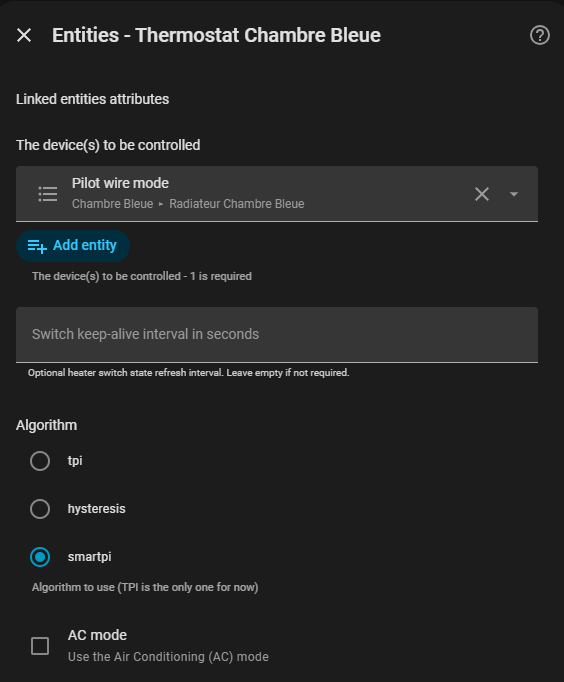
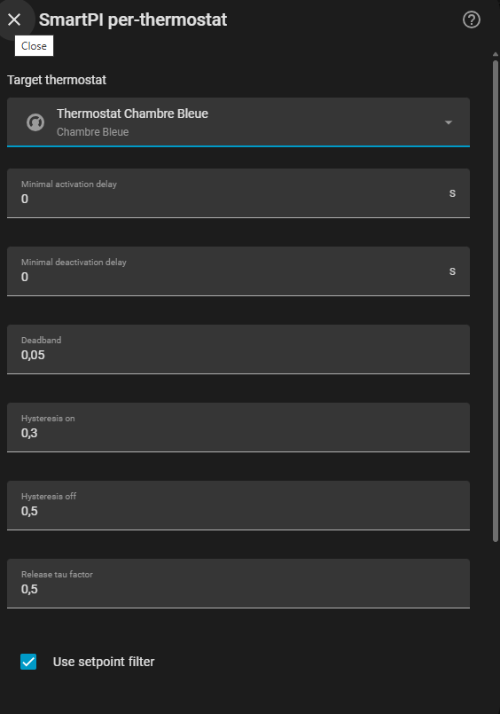

# SmartPI

- [SmartPI](#smartpi)
  - [Ce que fait SmartPI](#ce-que-fait-smartpi)
  - [Avant de commencer](#avant-de-commencer)
  - [Installation et mise en place](#installation-et-mise-en-place)
    - [Ajouter l'intégration SmartPI](#ajouter-lintégration-smartpi)
    - [Sélectionner SmartPI dans Versatile Thermostat](#sélectionner-smartpi-dans-versatile-thermostat)
      - [Configuration par thermostat](#configuration-par-thermostat)
  - [Vannes de radiateur et linéarisation](#vannes-de-radiateur-et-linéarisation)
    - [Pourquoi une vanne peut être difficile à réguler](#pourquoi-une-vanne-peut-être-difficile-à-réguler)
    - [Ce que fait la linéarisation](#ce-que-fait-la-linéarisation)
    - [Quand l'activer](#quand-lactiver)
    - [Choisir les valeurs](#choisir-les-valeurs)
    - [Réglages de vanne dans Versatile Thermostat](#réglages-de-vanne-dans-versatile-thermostat)
  - [Phases de fonctionnement](#phases-de-fonctionnement)
    - [Phase d'apprentissage](#phase-dapprentissage)
      - [Comment le bootstrap chauffe](#comment-le-bootstrap-chauffe)
      - [Étape 1 — Mesure des temps morts](#étape-1--mesure-des-temps-morts)
      - [Étape 2 — Apprentissage des déperditions (`b`)](#étape-2--apprentissage-des-déperditions-b)
      - [Étape 3 — Apprentissage du gain de chauffe (`a`)](#étape-3--apprentissage-du-gain-de-chauffe-a)
      - [Sortie du bootstrap](#sortie-du-bootstrap)
    - [Phase stable](#phase-stable)
    - [Recalibration automatique](#recalibration-automatique)
    - [Apprentissage du retard de l'émetteur](#apprentissage-du-retard-de-lémetteur)
    - [Modèle de pièce](#modèle-de-pièce)
  - [Réglages conseillés](#réglages-conseillés)
  - [Configuration](#configuration)
  - [Diagnostics et carte Markdown](#diagnostics-et-carte-markdown)
  - [Panel de régulation avec Equinox](#panel-de-régulation-avec-equinox)
  - [Services](#services)
    - [`set_smartpi_learning`](#set_smartpi_learning)
    - [`reset_smartpi_learning`](#reset_smartpi_learning)
    - [`force_smartpi_calibration`](#force_smartpi_calibration)
    - [`reset_smartpi_integral`](#reset_smartpi_integral)

## Ce que fait SmartPI

SmartPI est une alternative au TPI classique pour Versatile Thermostat.

Son objectif est simple : au lieu d'utiliser un comportement fixe, il apprend comment votre pièce chauffe et refroidit réellement, puis adapte automatiquement la régulation. Chaque VTherm SmartPI reste mono-mode : HEAT ou COOL, jamais les deux à la fois.

Concrètement, SmartPI apprend :

- à quelle vitesse l'équipement actif chauffe ou refroidit la pièce,
- à quelle vitesse l'extérieur réchauffe ou refroidit passivement la pièce,
- combien de temps la pièce met à réagir quand l'équipement démarre ou s'arrête.

À partir de là, SmartPI construit une commande de chauffage ou de
refroidissement généralement plus précise qu'un TPI fixe :

- il corrige l'écart actuel à la consigne,
- il estime la puissance nécessaire pour tenir la consigne,
- il applique des protections près de la consigne pour limiter les dépassements et les oscillations inutiles.

Il n'est pas nécessaire de connaître la théorie des boucles PI pour utiliser SmartPI. L'idée importante est surtout qu'il a besoin d'une première période d'apprentissage avant de réguler dans son mode normal.

## Avant de commencer

Pour que SmartPI apprenne correctement, le thermostat doit disposer :

- d'une température intérieure fiable,
- d'une température extérieure,
- d'assez de temps pour observer des phases normales de chauffe et de refroidissement.

Pendant la première phase d'apprentissage, essayez d'éviter :

- les fenêtres ouvertes longtemps,
- les gros changements de planning,
- les apports de chaleur inhabituels comme un fort ensoleillement, une cheminée ou beaucoup de présence,
- les modifications répétées des réglages SmartPI alors que l'apprentissage est encore en cours.

Deux conseils pratiques aident beaucoup :

- laissez SmartPI fonctionner sans interruption pendant le premier ou les deux premiers jours,
- en HEAT, utilisez une consigne suffisamment au-dessus de la température extérieure ; en COOL, une température extérieure suffisamment au-dessus de la consigne aide à rendre les réponses active et passive observables.

En pratique, l'apprentissage peut prendre de quelques heures à 48 heures sur les systèmes lents ou très inertiels.

## Installation et mise en place

Installez l'intégration via HACS (ou manuellement) comme décrit dans le [README](../../README.fr.md), puis redémarrez Home Assistant.

Deux étapes sont nécessaires après le redémarrage : ajouter l'intégration SmartPI dans Home Assistant, puis l'activer dans Versatile Thermostat.

### Ajouter l'intégration SmartPI

Allez dans **Paramètres → Intégrations → Ajouter une intégration**, puis recherchez *SmartPI*.

Lors de la première installation, SmartPI crée automatiquement une entrée de configuration par défaut avec des valeurs adaptées. Vous pouvez modifier ces valeurs par défaut globales ensuite depuis **Paramètres → Intégrations → SmartPI → Configurer**.

### Sélectionner SmartPI dans Versatile Thermostat

Une fois l'intégration SmartPI ajoutée, ouvrez la configuration de l'appareil Versatile Thermostat que vous souhaitez piloter avec SmartPI. Dans l'étape **Underlyings**, repérez le sélecteur d'algorithme et choisissez **SmartPI**.

Répétez cette étape pour chaque thermostat que vous souhaitez faire fonctionner avec SmartPI.

#### Configuration par thermostat

Pour ajouter SmartPI à un thermostat supplémentaire, ouvrez la configuration de l'intégration SmartPI et ajoutez une nouvelle entrée de thermostat. Sélectionnez le thermostat cible dans la liste, puis ajustez les paramètres selon vos besoins.

Les paramètres disponibles sont identiques à ceux des valeurs par défaut globales. Tout paramètre défini ici remplace la valeur globale correspondante pour ce thermostat uniquement.

Une entrée SmartPI désactivée est ignorée. Un thermostat dont l'entrée dédiée est désactivée utilise l'entrée de valeurs par défaut activée, ou les valeurs intégrées s'il n'en existe pas, et les thermostats qui dépendent d'une entrée sont rechargés lorsqu'elle est désactivée ou supprimée. Si l'entrée de valeurs par défaut a été supprimée, elle est recréée lorsque vous réajoutez l'intégration SmartPI.

## Vannes de radiateur et linéarisation

Cette section concerne uniquement les thermostats qui pilotent directement une vanne, par exemple une tête thermostatique de radiateur.

### Pourquoi une vanne peut être difficile à réguler

Une vanne de radiateur ne se comporte pas toujours comme un chauffage électrique.

Avec un chauffage électrique, demander `40%` produit généralement environ deux fois plus de chaleur que demander `20%`. Avec beaucoup de vannes de radiateur, ce n'est pas aussi régulier : les premiers pourcents peuvent ne presque rien faire, puis une petite ouverture supplémentaire peut laisser passer beaucoup d'eau chaude.

Sur certaines installations, une vanne peut déjà laisser passer la majorité du débit alors qu'elle n'est ouverte qu'à environ `20%`. Ensuite, ouvrir davantage change beaucoup moins le débit.

En pratique, cela peut donner ce type de sensation :

| Commande envoyée à la vanne | Effet possible sur le radiateur                                   |
| --------------------------- | ----------------------------------------------------------------- |
| `0%` à quelques pourcents   | pas de chaleur visible                                            |
| petite ouverture            | le radiateur commence seulement à chauffer                        |
| environ `15%` à `25%`       | grande partie du débit déjà présente                              |
| au-delà                     | changement plus faible, parfois surtout plus de bruit hydraulique |

Les valeurs exactes dépendent de la vanne, du corps de vanne, de l'équilibrage du radiateur et de l'installation hydraulique. Il faut donc éviter de chercher une valeur parfaite au premier essai.

### Ce que fait la linéarisation

La linéarisation de courbe de vanne sert à traduire la demande SmartPI en position de vanne.

SmartPI continue de raisonner en demande de chauffe simple :

- `0%` signifie pas de chauffe,
- `50%` signifie une demande moyenne,
- `100%` signifie une demande maximale.

La linéarisation transforme ensuite cette demande en ouverture de vanne plus adaptée au comportement réel du radiateur. L'objectif est d'utiliser plus finement la petite zone où la vanne change réellement le débit, au lieu d'envoyer directement la demande brute à la vanne.

Exemple simplifié :

| Demande SmartPI | Ouverture envoyée à la vanne         |
| --------------- | ------------------------------------ |
| `0%`            | `0%`                                 |
| faible demande  | autour de l'ouverture minimale utile |
| `80%`           | autour de l'ouverture au coude       |
| `100%`          | ouverture maximale autorisée         |

Cette correction ne remplace pas l'apprentissage SmartPI. Elle aide seulement SmartPI à parler plus naturellement à une vanne non linéaire.

### Quand l'activer

Activez cette option si :

- votre thermostat VTherm est de type vanne,
- SmartPI pilote directement une ouverture de vanne,
- le radiateur semble passer rapidement de froid à très chaud avec seulement quelques pourcents d'ouverture,
- les petites variations de commande donnent des réactions trop fortes ou trop irrégulières.

L'option est proposée uniquement pour les thermostats qui exposent une commande de vanne.

### Choisir les valeurs

Les valeurs par défaut donnent un point de départ raisonnable. Ajustez-les seulement si vous avez observé le comportement de votre radiateur.

| Paramètre                       | À quoi il sert                                                                                     | Valeur de départ |
| ------------------------------- | -------------------------------------------------------------------------------------------------- | ---------------- |
| **Ouverture minimale de vanne** | Première ouverture où le radiateur commence réellement à chauffer.                                 | `7%`             |
| **Demande au coude**            | Demande SmartPI à partir de laquelle on considère que la vanne arrive dans sa zone de débit élevé. | `80%`            |
| **Ouverture de vanne au coude** | Position physique de la vanne à cette demande.                                                     | `15%`            |
| **Ouverture maximale de vanne** | Ouverture maximale autorisée.                                                                      | `100%`           |

Pour trouver l'ouverture minimale, le plus simple est d'observer le radiateur :

1. Laissez le radiateur refroidir.
2. Lancez une demande de chauffe.
3. Augmentez doucement l'ouverture de la vanne, par petits pas.
4. Attendez au moins une minute entre deux essais.
5. Notez la première valeur où le tuyau ou le radiateur commence vraiment à chauffer.

Les valeurs doivent seulement respecter ouverture minimale < ouverture au coude < ouverture maximale, avec une demande au coude strictement comprise entre `0%` et `100%`. Sinon, le formulaire indique le champ à corriger.

Si vous n'avez pas envie de tester finement, gardez les valeurs par défaut. Si votre vanne semble très rapide, une ouverture au coude autour de `20%` à `25%` peut être un essai raisonnable. Si le radiateur devient bruyant à pleine ouverture, baissez l'ouverture maximale.

Après un changement, laissez SmartPI fonctionner plusieurs cycles avant de juger le résultat. Une seule chauffe ne suffit pas toujours à conclure.

### Réglages de vanne dans Versatile Thermostat

En mode vanne, Versatile Thermostat peut filtrer, retarder ou transformer l'ouverture demandée par SmartPI avant qu'elle n'atteigne la vanne. SmartPI utilise pour l'apprentissage l'ouverture retenue que lui transmet Versatile Thermostat. Il s'agit d'une valeur de commande, pas d'une mesure de la position physique de la vanne. Le filtrage limite néanmoins la résolution des commandes, et une transformation de l'ouverture peut entrer en conflit avec la linéarisation de vanne SmartPI.

| Réglage Versatile Thermostat                                                                                              | Effet sur les commandes SmartPI                                                                                                     | Valeur recommandée                          |
| ------------------------------------------------------------------------------------------------------------------------- | ----------------------------------------------------------------------------------------------------------------------------------- | ------------------------------------------- |
| **Seuil de régulation** (`auto_regulation_dtemp`)                                                                          | Filtre les petites variations de l'ouverture demandée et force à `0%` toute ouverture inférieure au seuil. | `0` si le matériel le permet ; au moins `3%` pour la Sonoff TRVZB, selon la recommandation VT |
| **Période minimale de régulation** (`auto_regulation_periode_min`)                                                         | Retient un changement de commande de la vanne jusqu'à l'expiration de la période depuis le changement précédent, sauf lors du redémarrage d'un cycle. | `0` si le matériel le permet ; sinon conserver la période qu'il impose |
| **Seuil d'ouverture**, **Ouvertures minimales**, **Ouvertures maximales**, **Fermetures maximale**                        | Modifient l'ouverture envoyée à la vanne. Cela entre en conflit avec la linéarisation de vanne de SmartPI, qui inverse sa courbe sur l'ouverture. | `0`, `0`, `100`, `100` (aucune transformation) lorsque la linéarisation est activée et que le matériel permet ces valeurs |

Pour la Sonoff TRVZB, la [documentation Versatile Thermostat](https://github.com/jmcollin78/versatile_thermostat/blob/10.6.2/documentation/en/over-climate.md#self-regulation) recommande un seuil de régulation d'au moins `3%` pour éviter une possible perte de calibration de la vanne. Conservez ce seuil même si SmartPI affiche un avertissement de filtrage. Un seuil non nul ne démontre pas, à lui seul, un échec de l'apprentissage.

En contrôle direct de vanne `over_climate`, VT relève aussi le seuil d'ouverture pour qu'il soit au moins égal au seuil de régulation. Si ce réglage imposé entraîne une transformation de l'ouverture, conservez-le et désactivez la linéarisation de vanne SmartPI.

L'arrondi entier de la position de la vanne (pas de `1%`) s'applique toujours. Un seuil de régulation inférieur à `1` n'a donc aucun effet supplémentaire.

SmartPI vérifie ces réglages au démarrage du thermostat et affiche, dans Home Assistant **Paramètres > Réparations**, un avertissement lorsque le seuil de régulation vaut `1` ou plus, la période minimale de régulation est supérieure à `0`, ou une transformation de l'ouverture est active alors que la linéarisation de vanne est activée. Un avertissement de filtrage ou de retard peut rester affiché lorsque le matériel impose ces réglages ; il ne prouve pas, à lui seul, un échec de l'apprentissage. Les avertissements sont réévalués au démarrage suivant du thermostat. Les valeurs contrôlées et les codes de problème (`dpercent_filter`, `period_filter`, `opening_remap`) sont aussi publiés sous `live.valve` dans les [diagnostics](./diagnostics.md).

Le seuil de régulation et la période minimale de régulation se configurent dans le menu **Sous-jacents** des réglages de Versatile Thermostat. Réglez-les à `0` uniquement si le matériel le permet. Si le radiateur ne commence à chauffer qu'au-delà d'une certaine ouverture et que votre matériel permet les réglages d'ouverture VT par défaut, réglez cette ouverture dans **Ouverture minimale de vanne** de la courbe de vanne SmartPI. Si vous devez conserver une transformation d'ouverture VT, désactivez la linéarisation de vanne SmartPI.

## Phases de fonctionnement

### Phase d'apprentissage

SmartPI démarre dans une phase de bootstrap. Pendant cette phase, il utilise une stratégie de chauffe simple pour observer le comportement de la pièce, puis en extrait les paramètres physiques dont il a besoin pour réguler correctement.

#### Comment le bootstrap chauffe

Pendant le bootstrap, SmartPI ne cherche pas à maintenir la température avec précision. Il alterne entre chauffe complète et arrêt complet pour observer des réponses thermiques nettes :

- la chauffe démarre quand la température descend sous `consigne - 0.3°C`,
- la chauffe s'arrête quand la température monte au-dessus de `consigne + 0.5°C`.

Cela produit des oscillations de température visibles, qui sont attendues et volontaires à ce stade.

#### Étape 1 — Mesure des temps morts

La première chose que SmartPI doit apprendre est **le temps de réaction de la pièce** quand la chauffe démarre ou s'arrête. Ces délais s'appellent les *temps morts* :

- **temps mort de chauffe** : le délai entre le moment où SmartPI envoie une commande de chauffe et le moment où la température intérieure commence à monter,
- **temps mort de refroidissement** : le délai entre l'arrêt de la chauffe et le moment où la température commence à baisser.

Les temps morts dépendent du type d'émetteur, de la taille de la pièce et du placement du capteur. Ils doivent être mesurés avant que SmartPI puisse interpréter correctement les observations de chauffe et de refroidissement.

SmartPI continue de mesurer le temps mort de chauffe à chaque démarrage de chauffe qui suit un arrêt assez long, et publie la médiane des dernières mesures. Une pièce qui se réchauffe déjà avant le démarrage du chauffage, par exemple au lever des occupants, ferait paraître la chauffe plus réactive qu'elle ne l'est. SmartPI compare donc la température à l'évolution qu'elle suivait avant le démarrage. Lorsque cette évolution est trop forte ou trop irrégulière pour distinguer la chauffe, la mesure est écartée et le temps mort précédent est conservé. Une pièce qui se réchauffait avant le démarrage, ou un démarrage qui suit un arrêt trop court pour juger de son évolution, ne raccourcit jamais le temps mort : seule une mesure au moins aussi longue que la valeur en vigueur est retenue.

#### Étape 2 — Apprentissage des déperditions (`b`)

Une fois les temps morts considérés comme fiables, SmartPI commence à collecter des **observations de refroidissement** : il mesure à quelle vitesse la pièce perd sa chaleur quand le chauffage est éteint.

À partir de ces observations, il calcule `b`, le coefficient de déperdition thermique. Ce paramètre représente la vitesse à laquelle la pièce se refroidit en fonction de la différence entre température intérieure et extérieure.

SmartPI a besoin d'au moins 5 observations de refroidissement valides avant que `b` soit considéré comme utilisable.

#### Étape 3 — Apprentissage du gain de chauffe (`a`)

Une fois que `b` dispose de suffisamment d'observations pour être considéré comme fiable, SmartPI commence à collecter des **observations de chauffe** : il mesure à quelle vitesse la pièce se réchauffe pour une commande de chauffe donnée.

À partir de ces observations, il calcule `a`, le gain de chauffe. Ce paramètre représente l'efficacité avec laquelle votre système de chauffage fait monter la température intérieure.

Après un démarrage de chauffe, la pièce se réchauffe progressivement : l'émetteur, l'air et la sonde mettent un certain temps avant que la température monte à plein régime. SmartPI mesure ce *retard de réponse* sur les premières phases de chauffe et ignore le début de chaque phase tant que la réponse ne s'est pas stabilisée, puis tient compte de la chaleur réellement délivrée. `a` n'est publié qu'une fois ce retard connu (ou après 7 phases de chauffe où il n'a pas pu être mesuré, par exemple avec une sonde qui rapporte trop rarement).

SmartPI a besoin de 5 observations de chauffe valides pour `a`, ou de 4 lorsqu'elles concordent nettement.

Le bootstrap prend donc plus de temps dans les pièces lentes ou avec des sondes lentes : SmartPI privilégie un `a` précis plutôt qu'une sortie rapide du bootstrap.

#### Sortie du bootstrap

SmartPI quitte le bootstrap et bascule en régulation normale une fois que `a` et `b` disposent de suffisamment d'observations pour publier un premier modèle thermique.

Les buffers d'observation continuent ensuite à se remplir jusqu'à 31 échantillons pendant la régulation normale, ce qui permet au modèle de continuer à se consolider après le bootstrap. La confiance complète reste plus stricte que la sortie de bootstrap — tant que le nombre d'observations n'est pas suffisant pour cette confiance complète, SmartPI régule avec le modèle publié tout en gardant certaines corrections internes gelées.

Ce qu'il faut retenir pendant le bootstrap :

- les oscillations de température sont normales et attendues,
- la régulation est volontairement simple à ce stade,
- les diagnostics sont particulièrement utiles pour suivre la progression,
- `model.confidence` indique `ab_bootstrap` jusqu'à ce que le premier modèle thermique soit disponible,
- la vitesse dépend de la qualité des observations réelles, pas seulement du temps écoulé.

### Phase stable

Quand le modèle thermique devient fiable, SmartPI bascule dans son mode normal de régulation.

À ce moment-là, SmartPI :

- calcule automatiquement ses gains PI à partir du modèle appris,
- ajoute une part anticipative de maintien basée sur la pièce et la température extérieure (issue du modèle appris, ou du [modèle de pièce](#modèle-de-pièce) une fois publié),
- adapte son comportement près de la consigne avec une deadband et des protections supplémentaires.

Près de la température cible, SmartPI cherche à éviter les micro-corrections permanentes. Le résultat attendu est une régulation plus stable, avec moins de corrections inutiles qu'un TPI fixe.

Lors d'un changement de consigne en HEAT ou COOL, le filtre de consigne utilise aussi le modèle appris pour gérer l'approche finale de la cible. Lorsque le modèle prédit que la chaleur ou le froid déjà engagés amèneront la pièce près de la cible, la branche proportionnelle suit une trajectoire de freinage douce, tandis que la consigne brute reste disponible pour la branche intégrale. La trajectoire revient ensuite progressivement vers la consigne brute et se termine lorsque la pièce et la référence en sont proches.

Avec `FF3`, activé par défaut, SmartPI peut aussi appliquer une petite correction prédictive près de la consigne lorsqu'il détecte un contexte crédible de perturbation externe.

### Recalibration automatique

SmartPI continue de surveiller la qualité de son modèle dans le temps.

Si l'apprentissage n'évolue plus suffisamment, il peut déclencher automatiquement une séquence de recalibration pour rafraîchir le modèle et les temps morts.

Points utiles à connaître :

- un snapshot de référence est mémorisé quand le modèle devient fiable,
- un snapshot roulant est rafraîchi ensuite,
- si le temps mort de refroidissement ne peut pas être appris pendant longtemps, SmartPI peut continuer avec un snapshot partiel,
- une recalibration est jugée sur les paramètres qui l'ont déclenchée ; le `b`, qui dépend de la météo extérieure, n'est surveillé que lorsque la météo permet de l'apprendre,
- une tentative échouée est relancée environ 6 heures plus tard,
- si la pièce ne peut pas atteindre un seuil de calibration (par exemple lorsqu'il fait chaud dehors), le cycle s'arrête immédiatement, aucune tentative n'est comptée et la suivante attend 24 heures,
- après plusieurs échecs de recalibration, SmartPI continue de fonctionner et signale un modèle dégradé dans les diagnostics.

### Apprentissage du retard de l'émetteur

Le retard de l'émetteur `T_ar` est le délai entre le début du chauffage et la hausse de la température de la pièce. Le bootstrap le mesure une seule fois (`deadtime_heat_s`). SmartPI l'apprend aussi pendant la régulation normale et utilise la valeur apprise pour la régulation. Cet apprentissage est toujours actif et ne demande aucun réglage.

**Périodes calmes**

L'apprentissage n'utilise que des périodes calmes : des plages sans soleil, à consigne constante, avec des données valides. Elles proviennent des données enregistrées et de la position de la maison dans Home Assistant ; aucune heure n'est fixée et rien n'a à être déclaré.

- **Pas de soleil.** Le soleil est calculé à partir de la latitude et de la longitude de la maison. Une période se termine quelques minutes avant le lever du soleil et commence quelques minutes après le coucher, jamais après le lever : un soleil bas sur une fenêtre qui lui fait face chauffe déjà la pièce. Sans position valide de la maison, aucune période n'est trouvée et l'apprentissage reste silencieux ; les diagnostics l'indiquent.
- **Consigne basse.** Une période commence à la baisse de consigne (ou à la tombée de la nuit si la consigne était déjà basse, ou ne change jamais) et se termine à la prochaine hausse de consigne, ou au lever du soleil. Chaque nuit donne au plus une période. Les données manquantes ou exclues la coupent, et le plus long morceau est conservé (au moins 1 heure).
- **Partie régulée.** La partie d'une période qui commence au premier démarrage du chauffage où la pièce est à moins de 0,3 °C de sa consigne basse. Une pièce qui ne refroidit jamais jusqu'à sa consigne basse (dormeurs, voisin plus chaud) n'a pas de partie régulée.

**Ce qui est appris**

- **Valeur rapide.** Une montée de confort est une hausse de consigne d'au moins 1 °C, à toute heure, après une consigne basse maintenue dans l'obscurité avec des données valides pendant 2 heures. Deux heures après la montée, SmartPI ajuste la hausse de la température. L'ajustement s'arrête au lever du soleil : lorsque la partie restante avant le lever est trop courte pour les contrôles habituels (durée, chaleur délivrée, hausse), la montée ne donne aucune valeur. Une hausse coupée par le lever ne donne une valeur que lorsque la partie ajustée dure au moins 3 fois le plus grand entre le retard ajusté et le plus long retard connu avant la montée (la valeur affinée en vigueur, la valeur rapide publiée, la borne inférieure en vigueur, ou deux fois la valeur du bootstrap) : un émetteur lent ajusté sur une fenêtre courte donne un retard trop court. Une hausse coupée par le lever qui n'atteint pas cette durée, mais passe tous les autres contrôles, donne à la place une **borne inférieure**, égale à 0,6 fois le retard ajusté, jamais une valeur. Une pièce à forte inertie (reconnue sur ses périodes sans chauffage) bénéficie d'un modèle air-murs dans cet ajustement. La valeur rapide est publiée une fois que 3 montées confirmées concordent : médiane des 5 dernières, avec une dispersion d'au plus `25%`. La borne inférieure en vigueur est la médiane des 5 dernières bornes inférieures confirmées ; elle n'entre jamais dans la valeur rapide.
- **Confirmation.** Une montée de confort (ou une borne inférieure) n'est confirmée que lorsque la partie régulée qui la précède a duré au moins 4 heures et que le chauffage a démarré au moins une fois par heure de cette partie. Une partie régulée absente ou de moins de 4 heures laisse la montée non confirmée : rien ne prouve qu'aucun occupant n'a réchauffé la pièce. Les dormeurs qui se lèvent pendant la fenêtre d'ajustement faussent la hausse, et une pièce qui reste sans chauffage alors qu'elle devrait réguler est le signe visible de ce risque. Une montée non confirmée est affichée dans les diagnostics et n'est jamais utilisée.
- **Valeur affinée.** À chaque fin de période, SmartPI ajuste un modèle de la pièce avec ses murs et son émetteur sur les 3 dernières périodes, et le compare à l'ajustement des 3 périodes précédentes. Chaque période est ajustée avec la réponse à la hausse de consigne qui la termine, pendant 2 heures au plus tant qu'il fait encore nuit et que la nouvelle consigne reste constante : c'est cette réponse qui révèle l'émetteur. Lorsque les deux concordent, ils donnent la classe de la pièce (inertie forte ou non), les paramètres des murs et une constante de temps de l'émetteur `τe`.
- **Périodes régulées uniquement.** `τe` remplace la valeur rapide seulement lorsque les 6 périodes des deux ajustements ont été régulées sur leur partie régulée, de son début jusqu'à la montée de consigne ou le lever du soleil : au moins 4 heures, consigne constante, un démarrage du chauffage à chaque demi-heure, température à moins de 0,3 °C de la consigne, puissance stable, aucune interruption de données. Sinon, `τe` n'est qu'un diagnostic.
- **Une période ne compte qu'une fois.** Une période a une seule clé, fixée par ses événements. Une seconde montée de consigne la même nuit, un nouveau calcul ou un redémarrage ne la compte jamais deux fois, ni pour la classe de la pièce ni pour les valeurs confirmées.

**Ce que cela modifie**

- La valeur apprise est la valeur affinée lorsqu'elle est publiée, sinon la valeur rapide. Une borne inférieure au-dessus de celle-ci (ou sans elle) prend sa place.
- La règle des gains attend un temps mort apparent, celui que mesure le bootstrap ; la valeur apprise est le retard moyen de l'émetteur, environ deux fois plus long. Elle compare donc la moitié de la valeur apprise à une **référence** : le plus grand entre le premier bootstrap mesuré depuis le début de l'apprentissage (conservé, pour ne jamais suivre un bootstrap qui baisse ensuite, par exemple sous des dormeurs qui réchauffent la pièce avant le démarrage du chauffage) et le bootstrap actuel.
  - Moitié de la valeur apprise plus courte que la référence : les gains gardent la référence. Une valeur apprise seule ne rend jamais les gains plus agressifs que la référence.
  - Entre 1 et 2 fois la référence : les gains utilisent la moitié de la valeur apprise.
  - Au-delà de 2 fois la référence : les gains utilisent la moitié de la valeur apprise seulement lorsque la valeur rapide et la valeur d'identification (la valeur affinée, sinon le `τe` de la dernière évaluation dont les deux ajustements concordent) concordent à un facteur 1,25 près. Sinon, ils utilisent deux fois la référence. Une borne inférieure n'est jamais confirmée de cette façon.
- Lorsque les gains utilisent la valeur apprise, la bande proche, le maintien de l'intégrale après un démarrage ou une reprise du chauffage, FF3 et le jumeau thermique utilisent la valeur apprise elle-même ; sinon ils gardent la valeur du bootstrap. L'apprentissage de `a` et `b`, la correction feed-forward, la calibration et AutoCalib gardent toujours la valeur du bootstrap.
- La valeur du bootstrap n'est jamais modifiée. Sans valeur apprise, la régulation l'utilise telle quelle.

**Qualité des données**

L'apprentissage n'utilise que les données enregistrées pendant que SmartPI pilote le chauffage. Ces périodes sont exclues et interrompent une période calme ou une montée de confort comme une donnée manquante (elles ne sont jamais comblées) :

- aucune donnée depuis plus de 20 minutes, température intérieure ou extérieure indisponible, ou commande inconnue ;
- la durée d'arrêt d'un redémarrage de Home Assistant ou du thermostat qui n'est pas ponté (voir [Redémarrages](#redémarrages)) ; un redémarrage ponté n'est qu'un échantillon manquant ;
- un saut de température de plus de 0,5 °C à plus de 20 °C/h, qu'aucun chauffage ne produit (la valeur est ignorée ; un nouveau niveau confirmé par 3 lectures est conservé) ;
- une fenêtre ouverte, un délestage, le mode sécurité, un mode HVAC autre que le chauffage, ou une commande remplacée par Versatile Thermostat.

Une montée de confort n'est évaluée que si les 2 heures qui la précèdent et les 2 h 15 qui la suivent (ou le temps restant jusqu'au lever du soleil) sont valides. Une consigne rétablie dans les 5 minutes suivant un redémarrage n'est pas une montée de confort. Une période n'est comptée comme régulée que si toute sa partie régulée est valide. Un ajustement d'identification n'utilise que les tranches de 10 minutes entièrement comprises dans ses périodes et exige au moins 50 de ces tranches, en séquences d'au moins une heure.

**Prérequis et limites**

- Chauffage uniquement (rien n'est appris ni appliqué en refroidissement), avec des chauffages pilotés par cycles PWM. En mode vanne, rien n'est appris ni appliqué et les diagnostics affichent `valve_mode_not_supported` : la puissance de chauffe d'une vanne n'est connue qu'à travers sa courbe, et une courbe absente ou qui ne correspond pas à la vanne donne un retard faux ; sur un émetteur lent, le retard appris a aussi laissé la montée du matin sous la consigne de confort.
- La position de la maison renseignée dans Home Assistant, une montée de confort d'au moins 1 °C avant le lever du soleil, et un temps mort du bootstrap déjà mesuré.
- La valeur rapide demande 3 montées confirmées. Une pièce qui ne régule pas à sa consigne basse pendant 4 heures avant la montée (retour tardif ou absent à la consigne basse) reste non confirmée : la valeur rapide n'y est pas publiée.
- La valeur affinée demande 6 périodes régulées consécutives, ce qui suppose une consigne basse atteinte au moins 4 heures avant la montée de confort ou le lever du soleil, et maintenue jusque-là.
- Une montée après le lever du soleil, une consigne basse seulement en journée, ou une maison dont les nuits sont très courtes (été sous les hautes latitudes) ne donne aucune valeur. Une consigne maintenue toute la nuit donne des périodes pour la valeur affinée et la classe de la pièce, mais aucune montée.
- Un occupant présent uniquement lorsque la consigne est haute n'est pas détecté.
- Les calculs s'exécutent en arrière-plan : jusqu'à quelques secondes par jour et par thermostat, environ 20 Mo au pic. SmartPI conserve 7 jours de signaux dans son propre fichier de stockage.
- Ils utilisent les paquets `numpy` et `scipy`, installés avec l'intégration et chargés seulement par les calculs en arrière-plan. S'ils ne peuvent pas être chargés, rien n'est appris, la valeur du bootstrap reste utilisée et les diagnostics affichent `dependencies_unavailable`.

Le bloc `live.tar_learning` des [diagnostics](./diagnostics.md#apprentissage-du-retard-de-lémetteur) affiche les valeurs apprises, leur statut et la valeur appliquée.

### Modèle de pièce

SmartPI tient aussi à jour un modèle de pièce. Le modèle décrit la pièce avec son air, ses murs et son émetteur. SmartPI s'en sert pour prévoir la température de la pièce et confronte ces prévisions à la température mesurée. Une fois publié, il donne la puissance de maintien de la régulation en chauffage (voir **Ce qu'il change** ci-dessous).

**Ce qu'il calcule**

- **Identification, sur les périodes calmes.** Le modèle est ajusté sur les mêmes périodes calmes que l'apprentissage du retard de l'émetteur (voir **Périodes calmes** plus haut : pas de soleil, consigne constante, données valides), à partir des signaux qu'il conserve ; aucune heure n'est fixée. À chaque fin de période, SmartPI ajuste le modèle en arrière-plan sur les 3 dernières périodes, chacune avec la réponse à la hausse de consigne qui la termine, pendant 2 heures au plus tant qu'il fait encore nuit. Une série de périodes n'est calculée qu'une fois, au plus une par heure ; après un long arrêt, les séries non encore calculées se suivent, de la plus ancienne à la plus récente. Le modèle porte la réponse de chauffe `a` de l'émetteur (avec son retard appris), la perte de l'air vers l'extérieur et vers les murs, ainsi que la réponse lente des murs. L'état des murs au début de chaque période est estimé, jamais supposé stabilisé, et deux périodes ne sont jamais jointes.
- **Bilan thermique, une fois par jour.** Vers 20 minutes après minuit, quelles que soient les périodes calmes, SmartPI calcule le bilan thermique de chaque journée entière conservée dans son stockage (jusqu'à 7) : la puissance de chauffe moyenne, la variation de la température intérieure retirée, rapportée à l'écart moyen intérieur-extérieur. Une droite passant par ces points journaliers donne le modèle statique de la pièce. Sa pente est la puissance nécessaire par °C d'écart intérieur-extérieur, dans les unités de `model.b / model.a`. Son ordonnée à l'origine est un apport gratuit de chaleur constant, en % de la pleine puissance : chaleur d'une pièce plus chaude voisine ou d'occupants présents de façon stable, ou perte vers une pièce plus froide lorsqu'il est négatif. Une fois un modèle publié, la perte statique utilisée par SmartPI est la pente × (consigne − température extérieure) − l'apport gratuit. Sans cet apport, l'intégrale devrait le porter pour toujours. Le bilan thermique ne dépend pas du temps de réponse de l'émetteur.
  - Un jour compte lorsque au plus 20 % de ses données sont manquantes ou invalides et qu'il comporte du chauffage (2 % de la pleine puissance en moyenne) : un jour sans chauffage ne dit rien des pertes.
  - Le modèle demande au moins 4 jours de ce type, un chauffage moyen d'au moins 5 % de la pleine puissance et un écart moyen intérieur-extérieur d'au moins 6 °C.
  - La pente doit être connue à ±5 % près (confiance de 95 %, d'après la dispersion des jours autour de la droite et la variation de la pente lorsqu'un jour quelconque est retiré), puisque la perte propre du modèle est vérifiée à 5 % près par rapport à elle.
  - Un apport gratuit ne se distingue des pertes que lorsque l'écart intérieur-extérieur a varié d'un jour à l'autre (écart-type d'au moins 1 °C). Tant que ce n'est pas le cas, la pente seule est utilisée : la puissance moyenne rapportée à l'écart moyen, sans apport. Elle est juste aux conditions habituelles de la pièce, moins quand on s'en éloigne. Une fois que l'écart a varié, la droite avec son apport doit être déterminée ; sinon le jour ne donne aucune nouvelle valeur (`free heat gains detected; the outdoor temperature has not varied enough yet to separate them from the losses` lorsque les jours montrent un apport, `the heating need varies too much from one day to the next` sinon).
  - Les jours ne doivent pas dériver : lorsque le besoin de chauffe évolue dans un même sens d'un jour à l'autre de plus de 2,5 % au-delà de ce qu'explique la droite, les murs stockent ou restituent encore de la chaleur (début de la saison de chauffe, coup de froid), et le jour ne donne aucune nouvelle valeur.
  - Sinon, le dernier modèle conservé reste en vigueur.
- **Recherche de l'émetteur.** À chaque identification, le modèle est ajusté avec un temps de réponse de l'émetteur (son premier moment) sur une échelle fixe de 1 minute à 1 heure (13 valeurs, chacune égale à 1,41 fois la précédente), affiné autour de la meilleure. Le temps mort en vigueur ne fixe pas l'échelle. Un émetteur plus rapide n'est pas résolu par les pas de 1 minute de l'ajustement ; un émetteur plus lent serait confondu avec les murs, dont la constante de temps est d'au moins 3 heures. La remontée de l'erreur d'ajustement loin de la meilleure valeur est pesée contre le bruit résiduel, compté en mesures indépendantes. Lorsque la meilleure valeur se situe à l'une des extrémités de l'échelle et que la remontée est significative, le vrai temps de réponse est hors de l'échelle et la série ne publie rien (`the heating response delay does not match the measured temperature`). Lorsque la remontée n'est pas significative, ces périodes ne déterminent pas le temps de réponse : l'identification se poursuit avec le retard appris lorsque l'apprentissage du retard de l'émetteur l'a affiné, sinon avec la meilleure valeur de l'échelle, et l'accord avec le bilan thermique juge le résultat.
- **Information.** Les périodes doivent déterminer le modèle, quelle que soit leur durée. Pour chaque ajustement, SmartPI calcule avec quelle précision les mesures fixent ce que l'ajustement donne : `a` et `b_eq / a` pour le modèle simple, `a`, la perte de l'air et la part que prennent les murs pour le modèle avec murs (son `b_eq / a` est plutôt vérifié par le bilan thermique), recherche de l'émetteur comprise, et compte les erreurs corrélées comme moins de mesures. Un ajustement dont l'incertitude (95 %) est plus large que la tolérance utilisée pour comparer deux séries de périodes (15 % sur `a`, 25 % sur `b_eq / a` et sur la perte de l'air, 35 % sur la part des murs) est refusé (`the quiet periods do not determine the model precisely enough yet`) : deux séries de ce type concorderaient ou divergeraient par hasard. De longues nuits avec un peu de chauffage déterminent en général les murs ; quelques périodes courtes peuvent ne pas suffire.
- **Publication.** Les valeurs d'une série ne sont publiées que si le modèle suit la température mesurée de près et sans erreur systématique, si ces valeurs concordent avec celles des 3 périodes précédentes (d'autres périodes, jamais partagées), et si ces valeurs antérieures prédisent aussi les nouvelles périodes. Le contrôle de l'erreur cherche un biais, une dispersion importante, de longues séries de moyennes horaires de même signe, une corrélation sur une heure, et un lien avec le chauffage, la consigne ou la température extérieure. Les ondulations plus courtes, dues à la réponse de la sonde ou aux cycles de chauffe, ne comptent pas à l'échelle du modèle. Un modèle dont la réponse de chauffe `a` est plus du double ou moins de la moitié du `a` appris par la régulation est refusé (`the heating response differs too much from the one measured by the regulation`) : un tel modèle confond les murs avec l'air. Les ajustements prennent l'apport gratuit du bilan thermique en vigueur comme une entrée de chaleur connue. Une fois un bilan thermique en vigueur, un modèle dont le rapport `b_eq / a` s'écarte de sa pente de plus de 5 % est refusé lui aussi (`the model's heat loss disagrees with the measured heat balance`) : avec des murs épais, `b_eq` est la petite différence entre la perte de l'air et la part que prennent les murs, et un temps de réponse de l'émetteur légèrement faux le décale de plusieurs %. Les murs d'un tel modèle ne correspondraient pas non plus aux pertes mesurées. Deux résultats concordants sont moyennés, et les valeurs publiées sont la médiane des 3 derniers résultats acceptés ; les deux portent sur `a`, le rapport `b_eq / a`, la part des murs dans la perte de l'air et le taux des murs, afin que le rapport statique garde la valeur sur laquelle les ajustements concordent. Sinon, les dernières valeurs publiées sont conservées.
- **Modèle simple.** Les murs ne restent dans le modèle qu'avec une sonde de température précise (pas de 0,015 °C ou moins), lorsqu'ils portent une part réelle des pertes dans les deux séries de périodes, lorsque leur constante de temps est d'au moins 3 heures, et lorsqu'ils prédisent les périodes suivantes mieux que le modèle simple. Sinon, le modèle est le modèle simple, avec `a` et `b_eq` seulement, comme le modèle A/B.
- **Perturbations.** Une fois un modèle publié, le suivi (ci-dessous) mesure les apports ou les pertes de chaleur que le modèle n'explique pas. Une période calme dont la moyenne sur sa partie ajustée s'écarte de plus de 0,08 °C/h de la médiane des périodes récentes (au moins 4 heures suivies) est exclue de l'identification. Un apport présent à chaque période (dormeurs à chaque nuit, par exemple) n'est pas détecté.
- **Suivi.** Une fois un modèle publié, SmartPI suit l'état de la pièce (air, murs et apports non expliqués) à chaque calcul de la régulation, avec la puissance réellement appliquée et la température extérieure. Il corrige cet état à chaque nouvelle valeur de température ; une valeur répétée par la sonde n'est pas une nouvelle mesure. Avec une sonde par pas de 0,1 °C, un changement est lu comme le franchissement du point médian entre les deux valeurs. Le suivi est suspendu hors chauffage et lorsque SmartPI n'a pas la main sur la commande (mode sécurité, commande remplacée). Après une pause ou un redémarrage de 3 heures au plus, l'état est repris ; au-delà, il repart avec les murs en équilibre avec l'air et se stabilise pendant environ 3 heures. Un redémarrage ponté (voir [Redémarrages](#redémarrages)) n'est pas une pause : le suivi se poursuit comme si rien ne s'était passé.
  - **Délestage.** Le délestage ne suspend pas le suivi : le chauffage est coupé à une puissance connue, donc l'état continue d'être corrigé sans chauffage dès le début du délestage (le reste du cycle interrompu n'est pas compté) jusqu'à ce que la commande de SmartPI reprenne.
  - **Fenêtre ouverte.** La fenêtre modifie l'air, pas les échanges entre l'air et les murs. Pendant qu'elle est ouverte, l'air du modèle suit la température mesurée et les murs suivent cet air. À la fermeture, le suivi reprend à partir de la température mesurée et est de nouveau `ok` aussitôt ; la puissance de maintien réintroduit la puissance supplémentaire des murs en 30 minutes. Une fenêtre ouverte pendant plus de 3 heures relance le suivi comme ci-dessus.

**Ce qu'il change**

La puissance de maintien est la part de la commande qui compense les pertes pour la consigne et la température extérieure (le feed-forward). Sans modèle de pièce publié, elle vient du modèle A/B appris. En chauffage, avec des chauffages pilotés par cycles PWM, un modèle de pièce publié la fournit à la place, une fois un bilan thermique en vigueur. Sa perte statique est la pente du bilan thermique multipliée par l'écart entre la consigne et la température extérieure, moins l'apport gratuit, jamais le `b_eq / a` du modèle ; le modèle fournit la part des murs :

- **Murs identifiés et suivi `ok` :** la perte statique pour la consigne et la température extérieure, plus la puissance supplémentaire que les murs absorbent à cet instant (ou moins la chaleur qu'ils restituent). Après un abaissement nocturne de consigne, les murs sont froids : la montée du matin reçoit plus de puissance et la pièce atteint la consigne sans long palier. Pendant la journée, lorsque les murs restituent de la chaleur, la puissance est réduite.
- **Murs identifiés, suivi non `ok`** (en pause, en stabilisation après un redémarrage, mesures qui s'écartent du modèle) : la perte statique seule.
- **Modèle simple :** la perte statique seule.
- **Modèle publié mais aucun bilan thermique en vigueur, ou un bilan entré en vigueur ensuite dont la pente s'écarte de plus de 5 % du `b_eq / a` du modèle :** la puissance de maintien du modèle A/B, inchangée, sans la puissance supplémentaire des murs.
- **Rien de publié, refroidissement ou vannes :** la puissance de maintien du modèle A/B, inchangée. Le bilan thermique seul n'est pas utilisé : sans la puissance supplémentaire des murs, il donnerait une mauvaise puissance de maintien dans une pièce à murs épais.

La puissance de maintien du modèle de pièce s'applique tout de suite, à plein poids, et la correction lente du feed-forward (FF2) est remise à zéro et reste gelée tant qu'elle est en vigueur : le modèle remplace le biais que cette correction apprend. Un changement de la perte statique (bascule entre le modèle A/B et le modèle de pièce, entre le modèle simple et le modèle avec murs, ou nouvelle valeur de bilan thermique) est absorbé par l'intégrale, afin que la commande ne fasse pas de saut ; l'intégrale rend ensuite sa part au rythme de la régulation. La puissance supplémentaire des murs n'est jamais absorbée par l'intégrale : lorsqu'elle démarre, s'arrête (suivi non `ok`, après une fenêtre ouverte par exemple) ou change avec une nouvelle publication, elle passe progressivement sur 30 minutes de sa dernière valeur à la nouvelle. Après une fenêtre ouverte, la montée du matin retrouve donc sa puissance des murs en 30 minutes dès que le suivi est de nouveau `ok`. La source en vigueur et la puissance des murs appliquée sont conservées lors des redémarrages.

Le freinage de l'approche de la consigne utilise aussi le bilan thermique en vigueur (pente et apport gratuit) pour prévoir où la chaleur déjà engagée amène la pièce. Un modèle A/B appris, biaisé par les murs, commencerait sinon à freiner trop tôt.

Le prix à payer est un léger dépassement, d'environ 0,1 °C, en fin de montée du matin dans une pièce à murs épais.

**Ce qu'il affiche**

- La prévision de la température de la pièce à 1, 2, 6 et 12 heures si la puissance de chauffe actuelle était maintenue.
- L'erreur des prévisions passées par rapport à la température mesurée, sur les 7 derniers jours, à côté de l'erreur d'une prévision qui garde la température inchangée.
- Avec une sonde précise et des murs identifiés : la puissance supplémentaire que les murs absorbent actuellement au-delà de leur part en régime établi, en % de la pleine puissance. Elle est positive pendant que les murs se réchauffent (après une montée le matin, par exemple) et négative pendant qu'ils restituent de la chaleur.
- Le bilan thermique en vigueur (pente, apport gratuit et nombre de jours), le jour où il a été calculé, et la raison pour laquelle le dernier jour n'a pas donné de nouvelle valeur.

**Prérequis et limites**

- Chauffages pilotés par cycles PWM ; les vannes ne sont pas encore prises en charge.
- La position de la maison, telle que définie dans Home Assistant : sans elle, il n'y a aucune période calme et rien n'est identifié (le bilan thermique continue de tourner).
- Une première publication demande 6 périodes calmes avec du chauffage qui déterminent le modèle (environ 6 jours avec un abaissement de nuit), ainsi qu'un bilan thermique en vigueur : la perte statique du modèle est contrôlée par rapport à ce bilan, à 5 % près, lors de la publication, et rien n'est publié avant un premier bilan thermique (il demande 4 journées entières exploitables de signaux enregistrés). Une maison aux nuits seulement courtes (été aux latitudes élevées) peut n'en donner aucune. Un modèle de pièce publié par une version antérieure reste en vigueur ; il ne donne aucune puissance de maintien tant qu'aucun bilan thermique n'est en vigueur ou qu'il ne concorde pas avec celui-ci.
- Il utilise les mêmes paquets `numpy` et `scipy` que l'apprentissage du retard de l'émetteur, en arrière-plan : jusqu'à une minute environ par identification et par thermostat.
- Ses paramètres et son état sont conservés dans leur propre fichier de stockage et survivent aux redémarrages. Le service `reset_smartpi_learning` les efface.

Le bloc `live.room_model` des [diagnostics](./diagnostics.md#modèle-de-pièce) affiche l'état du modèle, ses valeurs, le bilan thermique en vigueur, les prévisions et leurs erreurs. `live.feedforward.source` indique quel modèle fournit la puissance de maintien, et `live.feedforward.wall_power_percent` la part des murs dans celle-ci.

### Redémarrages

Lorsque Home Assistant redémarre ou que l'intégration se recharge, Versatile Thermostat laisse le chauffage dans son état : un chauffage allumé reste allumé jusqu'à la première commande de SmartPI après le redémarrage. Un redémarrage court n'est donc qu'un trou de quelques mesures, et SmartPI le **ponte** : il poursuit comme si de rien n'était.

Un redémarrage est ponté lorsque toutes ces conditions sont réunies :

- l'arrêt a duré 10 minutes au plus ;
- le thermostat était dans le même mode avant et après, chauffage ou refroidissement, avec les mêmes réglages de cycle ;
- SmartPI avait la main avant et après (pas de fenêtre ouverte, de délestage, de mode sécurité ni de commande remplacée) ;
- la température intérieure n'a pas sauté pendant l'arrêt ;
- les données stockées sont récentes (un plantage qui a perdu les dernières écritures fait paraître l'arrêt long).

Après un redémarrage ponté, les mesures en cours reprennent (temps mort, fenêtres d'apprentissage, retard de l'émetteur), le chauffage est considéré comme inchangé pendant l'arrêt, rien n'est exclu de l'apprentissage du retard de l'émetteur ni du modèle de pièce (tous deux en chauffage uniquement), et l'apprentissage n'est pas suspendu. Une consigne modifiée pendant l'arrêt est traitée au premier tick comme tout changement de consigne. Après tout autre redémarrage, SmartPI repart avec prudence : les mesures en cours sont abandonnées, l'apprentissage est suspendu pendant un cycle, et seul l'arrêt lui-même est exclu des données d'apprentissage.

Le capteur de diagnostic affiche le dernier redémarrage dans `control.last_restart`.

## Réglages conseillés

Les réglages par défaut conviennent dans la plupart des installations.

Pour démarrer simplement :

- gardez les seuils d'hystérésis par défaut si votre sonde est précise et publie souvent (voir ci-dessous sinon),
- laissez `FF3` activé sauf raison précise de le désactiver,
- laissez le filtre de consigne activé par défaut,
- ajustez d'abord la deadband si la température oscille trop autour de la cible,
- activez la détection d'ouverture de Versatile Thermostat (capteur de fenêtre ou détection automatique).

Quand Versatile Thermostat détecte une fenêtre ouverte, SmartPI fige son terme intégral pendant l'ouverture et le maintient après la fermeture, le temps que le chauffage fasse de nouveau effet. Une ouverture que Versatile Thermostat ne détecte pas est vue comme une perte de chaleur ordinaire : le terme intégral la compense, puis la pièce peut légèrement dépasser la consigne après la fermeture.

Évitez de modifier plusieurs paramètres à la fois pendant la première phase d'apprentissage. Il vaut mieux laisser SmartPI terminer un cycle d'apprentissage propre, puis ne changer que ce qui est réellement nécessaire.

### Hystérésis du bootstrap selon le capteur

Pendant le bootstrap, SmartPI chauffe en tout-ou-rien entre consigne − *hystérésis marche* et consigne + *hystérésis arrêt*, et apprend `a` pendant les phases de chauffe et `b` pendant les phases de refroidissement. Chaque phase doit contenir assez de mesures distinctes de la sonde. Avec une sonde à résolution grossière ou qui publie rarement, les seuils par défaut donnent des phases trop courtes et le bootstrap peut durer plusieurs jours, voire ne pas aboutir.

| Sonde de température | Hystérésis marche / arrêt conseillée |
| --- | --- |
| Résolution 0,1 °C ou mieux, publication au moins toutes les 5 minutes | `0.3 / 0.5 °C` (défaut) |
| Résolution 0,1 °C publiant quelques fois par heure, ou résolution 0,2 °C | `0.5 / 0.8 °C` |
| Résolution 0,2 °C publiant toutes les 30 minutes ou moins souvent | `0.5 / 0.8 °C`, mais l'apprentissage initial peut ne pas aboutir, surtout en mi-saison : une sonde plus précise ou plus fréquente est recommandée |

Élargir davantage n'accélère pas l'apprentissage et dégrade la précision de `a`. Ces seuils ne s'appliquent que pendant le bootstrap : une fois SmartPI en régulation normale, ils n'ont plus d'effet. Pendant le bootstrap, la température varie entre les deux seuils.

Plus la pièce perd lentement sa chaleur (bonne isolation, temps doux), plus les phases de refroidissement sont longues et plus le bootstrap prend du temps.

### Cycle PWM selon l'installation

La durée du cycle PWM est le réglage de cycle de Versatile Thermostat. C'est la période sur laquelle SmartPI répartit sa puissance de chauffe : à 30 %, le chauffage est allumé 3 minutes sur un cycle de 10 minutes. Un cycle plus long commute moins souvent, mais laisse la température onduler pendant chaque cycle et ralentit la régulation, car SmartPI dimensionne sa réponse sur au moins deux cycles. Un cycle plus court que nécessaire n'apporte aucun confort et use seulement le relais.

| Installation | Sonde 0,1 °C publiant à chaque changement | Sonde précise (0,01 °C) publiant toutes les 5 min | Sonde 0,2 °C |
| --- | --- | --- | --- |
| Convecteur ou panneau rayonnant dans une pièce légère | 5 min | 5 min | 5 min |
| Émetteur électrique rapide dans une pièce lourde ou bien isolée | 15 min | 30 min | 30 min |
| Radiateur à eau ou à huile | 10 min | 30 min | 30 min |
| Radiateur à eau à forte inertie | 15 min | 30 min | 60 min |
| Plancher chauffant électrique | 20 min | 15 min | déconseillé : l'apprentissage initial aboutit rarement |

Pourquoi ces valeurs :

- dans une pièce légère, la température réagit en quelques minutes : dès 10 minutes, l'ondulation sur chaque cycle dépasse la deadband et l'erreur double,
- avec une sonde 0,1 °C qui publie souvent, un cycle plus long retarde surtout l'apprentissage initial,
- une sonde précise ou lente tolère des cycles longs avec le même confort, et beaucoup moins de commutations (48 par jour à 30 minutes contre 288 à 5 minutes),
- avec un plancher chauffant, au-delà de 15 à 20 minutes, l'apprentissage initial se dégrade : le gain de chauffe est appris moins précisément et, avec une sonde publiant toutes les 5 minutes, l'apprentissage peut ne pas aboutir.

Ces valeurs viennent de simulations de chaque type d'installation. Un cycle à un cran près du tableau convient ; en cas de doute sur la rapidité de la pièce, garder le plus court.

## Configuration

| Paramètre                            | Rôle                                                                                                   | Valeur par défaut |
| ------------------------------------ | ------------------------------------------------------------------------------------------------------ | ----------------- |
| **Délai minimal d'activation**       | Durée minimale pendant laquelle le chauffage reste allumé une fois activé. Sorties switch uniquement, ignoré pour les vannes.                             | `0 s`             |
| **Délai minimal de désactivation**   | Durée minimale pendant laquelle le chauffage reste éteint une fois désactivé. Sorties switch uniquement, ignoré pour les vannes.                          | `0 s`             |
| **Deadband**                         | Zone de tolérance autour de la consigne.                                                               | `0.05°C`          |
| **Filtre de consigne**               | Active le lissage proportionnel et la gouvernance prédictive HEAT/COOL près de la cible.                | `activé`          |
| **FF3**                              | Active une petite correction prédictive près de la consigne dans certaines situations de perturbation. | `activé`          |
| **Autoriser P dans la deadband**     | Permet à la branche proportionnelle de rester active à l'intérieur de la deadband.                     | `désactivé`       |
| **Autoriser le redémarrage PWM aux transitions de bande** | Permet à SmartPI de redémarrer le cycle PWM courant lors d'une entrée ou sortie de deadband ou de near-band. | `désactivé` |
| **Facteur release tau**              | Échelle du délai de relâchement intégral par rapport à la constante de temps apprise.                  | `0.5`             |
| **Hystérésis marche**                | Seuil de redémarrage pendant le bootstrap : le chauffage redémarre à consigne − seuil en HEAT, le refroidissement redémarre à consigne + seuil en COOL. | `0.3°C`           |
| **Hystérésis arrêt**                 | Seuil d'arrêt pendant le bootstrap : le chauffage s'arrête à consigne + seuil en HEAT, le refroidissement s'arrête à consigne − seuil en COOL. | `0.5°C`           |
| **Mode debug SmartPI**               | Enregistre les diagnostics live complets pour l'analyse historique.                                    | `désactivé`       |
| **Linéarisation de courbe de vanne** | Adapte la demande SmartPI aux vannes de radiateur non linéaires.                                       | `désactivé`       |
| **Ouverture minimale de vanne**      | Première ouverture utile lorsque la linéarisation est activée.                                         | `7%`              |
| **Demande au coude**                 | Demande SmartPI correspondant au changement de pente de la vanne.                                      | `80%`             |
| **Ouverture de vanne au coude**      | Ouverture physique de la vanne au changement de pente.                                                 | `15%`             |
| **Ouverture maximale de vanne**      | Ouverture maximale autorisée lorsque la linéarisation est activée.                                     | `100%`            |

### Redémarrage PWM aux transitions de bande

Lorsque cette option est désactivée, une transition de deadband ou de near-band met à jour la prochaine commande SmartPI mais n'interrompt pas le cycle PWM déjà en cours. C'est le comportement conseillé avec des cycles courts, car redémarrer trop souvent les cycles peut créer des commutations inutiles.

Activez cette option uniquement sur les systèmes thermiques à très forte inertie avec des cycles PWM longs, lorsque attendre la prochaine frontière de cycle retarde trop la réponse physique après une entrée ou une sortie de deadband ou de near-band.

## Diagnostics et carte Markdown

Pour le schéma des diagnostics et les profils Recorder, consultez le [Guide des Diagnostics SmartPI](./diagnostics.md).

Le capteur de diagnostic SmartPI publie une enveloppe versionnée. Les dashboards
et cartes Markdown lisent les diagnostics complets dans `attributes.live` ; les
graphiques historiques lisent le contrat stable de dix-huit séries dans
`attributes.history`.

C'est l'endroit principal à consulter pour savoir :

- si SmartPI est encore en apprentissage ou déjà stable,
- si le modèle est considéré comme fiable,
- si une recalibration ou un mode dégradé a été signalé.

Le bloc live le plus utile pendant l'apprentissage est `live.learning`.

Champs importants :

- `stage` : état global comme `bootstrap`, `learning`, `monitoring` ou `degraded`,
- `bootstrap_progress_percent` : progression du bootstrap,
- `bootstrap_status` : étape bootstrap en cours,
- `accepted_updates_a` : mises à jour acceptées du modèle de chauffe,
- `accepted_updates_b` : mises à jour acceptées du modèle de déperdition,
- `history_target` : taille cible des buffers A/B,
- `last_reason` : dernière raison d'acceptation ou de rejet d'apprentissage.

Autres blocs utiles sous `live` :

- `control` : phase et mode de régulation courants,
- `power` : informations de commande du cycle courant et du suivant,
- `temperature` : température mesurée, erreur, état de l'intégrale,
- `model` : `a`, `b`, niveau de confiance et temps morts appris,
- `feedforward` : état du feed-forward et de FF3,
- `setpoint` : informations de consigne filtrée et de trajectoire,
- `autocalib` : état de la supervision automatique,
- `calibration` : état d'une calibration forcée.

En mode normal, le bloc `setpoint` peut contenir :

- `filtered_setpoint` : référence suivie par la branche proportionnelle,
- `trajectory_active` : indique si une trajectoire de consigne est active,
- `trajectory_source` : indique pourquoi la trajectoire est active,
- `boost_active` : indique si le boost de consigne est actif.

Les valeurs avancées utilisées par la carte fournie sont toujours disponibles
dans `live.analysis`. Le mode debug n'ajoute ni ne retire de champs publiés : il
autorise le Recorder Home Assistant à conserver le bloc `live` complet. En mode
normal, le Recorder conserve uniquement `history`, tandis que toutes les valeurs
live restent visibles.

Une carte Markdown Home Assistant est aussi disponible pour afficher plus simplement les diagnostics SmartPI dans le tableau de bord.

https://github.com/KipK/vtherm_smartpi/tree/master/cards

## Panel de régulation avec Equinox

SmartPI publie aussi le résumé `specific_states.smart_pi` et la référence d'entité `specific_states.regulation_diagnostics` sur l'entité thermostat. La [carte Lovelace Equinox](https://github.com/KipK/equinox) utilise ces attributs pour afficher un panel **Régulation** dédié depuis le menu de la carte climate.

Avec Equinox, vous pouvez suivre la progression d'apprentissage SmartPI, la confiance du modèle, le détail de puissance, la gouvernance de consigne, les graphes d'historique et les actions de maintenance disponibles sans copier la carte Markdown de diagnostics.

Installez Equinox depuis son dépôt ou HACS, configurez-le sur la même entité climate Versatile Thermostat et laissez `additional_dashboards` à sa valeur par défaut `auto`. Equinox détecte SmartPI automatiquement lorsque les diagnostics publiés sont disponibles.

## Services

SmartPI expose quatre services dans le domaine `vtherm_smartpi`.

Chaque service utilise le paramètre standard `target:` de Home Assistant et accepte les entités climate de Versatile Thermostat. Les cibles qui ne sont pas des thermostats SmartPI sont ignorées, et l'appel échoue avec une erreur de validation lorsqu'aucune des entités ciblées n'est un thermostat SmartPI.

### `set_smartpi_learning`

Utilisez ce service pour mettre en pause ou reprendre l'apprentissage thermique d'un thermostat SmartPI. Réglez le champ obligatoire `learning_enabled` sur `false` pour suspendre l'apprentissage ou sur `true` pour le reprendre.

Pendant la pause, la régulation continue avec le modèle déjà appris, mais SmartPI ne collecte plus d'observations A/B ni de temps mort. La pause n'efface ni les paramètres appris ni l'historique des temps morts. SmartPI repart avec des fenêtres d'observation vierges à chaque changement de ce réglage, qui est conservé après un redémarrage de Home Assistant.

Le réglage courant est disponible dans `specific_states.smartpi_learning_enabled` sur l'entité climate et dans `live.learning.enabled` dans les attributs du capteur de diagnostic.

### `reset_smartpi_learning`

À utiliser quand le comportement thermique du logement a changé de manière importante, par exemple après des travaux d'isolation ou un changement d'émetteurs.

Ce service efface l'apprentissage SmartPI et force un retour en mode bootstrap.

### `force_smartpi_calibration`

À utiliser si vous souhaitez lancer un cycle de calibration sans attendre le déclenchement automatique.

Ce service est utile si :

- les temps morts affichés semblent incohérents,
- la régulation fonctionne moins bien qu'avant,
- vous souhaitez rafraîchir l'apprentissage après un changement important des conditions réelles.

Si SmartPI est encore en phase bootstrap, la demande est ignorée.

### `reset_smartpi_integral`

À utiliser si l'intégrale a conservé une valeur inadaptée après un événement exceptionnel.

Exemples typiques :

- une longue coupure de chauffage,
- une fenêtre restée ouverte longtemps,
- toute situation où vous voulez garder le modèle appris mais repartir d'un état intégral neutre.
